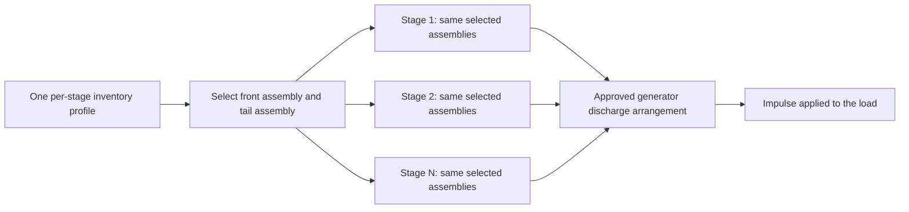
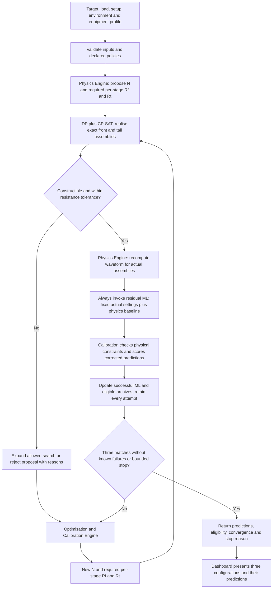
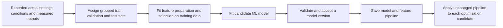
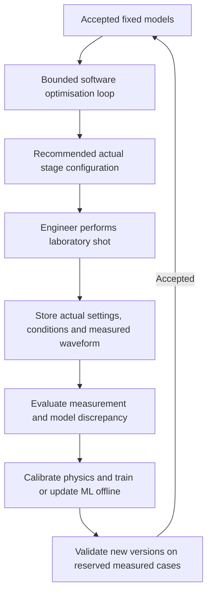
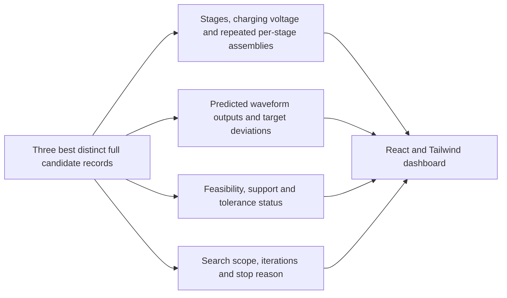
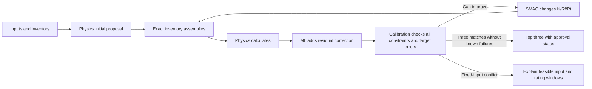

# Marx Generator Configuration Through Physics, Inventory Search, ML and Optimisation

Working architecture document | Updated 11 October 2026 | Aligned with technical specification v1.13

## 1. Purpose and agreed design

This system recommends a constructible Marx generator configuration for a specified impulse voltage test. It begins with electrical calculations, converts the required front and tail resistance into assemblies available from inventory, predicts the achievable waveform under the current conditions, and improves the configuration through a bounded feedback loop.

The intended scope includes insulators and other supported test objects, including transformers. The load is described by an appropriate electrical model using resistance, inductance, capacitance, and their connection arrangement. The initial insulator dataset is development material; it does not define the complete load scope.

The agreed design has three engines and one supporting solver:

| Component | Responsibility |
| --- | --- |
| Physics Engine | Propose an initial active stage count and required front/tail resistance per stage; predict a waveform for actual constructible settings |
| Inventory DP + CP-SAT Solver | Generate exact series–parallel assemblies with bounded DP; select compatible front/tail assemblies and enforce representable discrete constraints using OR-Tools CP-SAT |
| Residual ML Correction Engine | Hold realised settings fixed; use TabPFN v2 to estimate three corrections to physics, then add them back to obtain predicted front/peak, tail and crest |
| SMAC3 Optimisation and Calibration Engine | Own all physical-constraint verdicts after physics and ML; propose revised integer stage count and required resistances, retain three matching alternatives without known failures and manage bounded stopping |

The DP solver is a component-selection service used by the Physics Engine and the optimisation loop. It is not a fourth learning engine. A dashboard presents up to three distinct recommended configurations and the evidence supporting each.

The selected implementation uses **physics correction only**, TabPFN v2, SMAC3 and DP with OR-Tools CP-SAT. The React/Tailwind dashboard and FastAPI backend are implemented. Environmental feature collection, measured-data validation, approved physical connections and missing component ratings remain work items; accepting a frontend field does not mean the current model learned its effect.

No nearest-neighbour model, KNN-7 scheme or workbook ranking architecture is required. The workbook is the primary source of input-field definitions and supplied synthetic data; its example values are editable run inputs. The technical implementation specification supplies exact schemas, libraries and executable section deliverables. See [technical specification](Marx_Generator_Technical_Implementation_Specification.md) and [implementation status](backend_implementation_status.md).

## 2. Electrical foundations and terminology

### 2.1 What the generator does

A Marx generator stores electrical energy in stage capacitors. The capacitors are charged through charging paths, approximately in parallel in a conventional arrangement. When the switching gaps fire, charged stages are erected into a series discharge arrangement. Their voltages add to produce a high-voltage pulse.

For `N` identical active stages, each charged to `U_ch`:

```text
Ideal erected voltage = N × U_ch
Effective series generator capacitance = C_stage / N
Stored energy = N × ½ × C_stage × U_ch²
```

Here `C_stage` is the capacitance of one stage. These relations assume identical stages and the conventional series discharge arrangement. Other generator connection arrangements require their own electrical mapping.

For example, nine stages charged to 100 kV each provide an ideal erected voltage of 900 kV. The voltage actually appearing across the test object depends on the complete circuit, its load and losses.

An approximate crest estimate can use an independently justified transfer efficiency:

```text
Estimated crest ≈ efficiency × N × U_ch
```

If a detailed circuit model already represents load transfer and losses, avoid applying an efficiency factor that counts those effects again.

Here “efficiency” means voltage-transfer efficiency, approximately `V_crest / (N × U_ch)`, not the fraction of stored energy delivered to the load. Reaching the required crest and increasing this efficiency are different objectives. The main objective in this architecture remains matching the required voltage and timing within equipment limits.

### 2.2 Front resistance and tail resistance

`Rf` and `Rt` are waveform-shaping resistances in the generator circuit:

- **Front resistance, Rf:** helps control the rising edge and damping.
- **Tail resistance, Rt:** helps control the discharge and falling portion of the impulse.

They are separate from the test object's own resistance. Their effect depends on their placement and on the rest of the circuit. Altering one resistance can influence more than one output, so the optimiser must evaluate the complete waveform response.

Use explicit notation:

| Symbol | Meaning |
| --- | --- |
| `N` | Integer number of active generator stages |
| `Rf_req` | Required equivalent front resistance for one stage, proposed by physics or optimisation |
| `Rt_req` | Required equivalent tail resistance for one stage |
| `Rf_actual` | Equivalent resistance of the selected front assembly for one stage |
| `Rt_actual` | Equivalent resistance of the selected tail assembly for one stage |
| `A_f`, `A_t` | Actual wiring recipes and component usage for those assemblies |
| `U_ch` | Charging voltage per active stage |
| `R_load`, `L_load`, `C_load` | Parameters of the test-object model |
| `L_lead`, `C_stray` | Connection/setup parasitics, distinct from load parameters |

“Required” and “actual” must remain separate fields. The required value can be any positive number within the physical model. The actual value must correspond to a circuit that can be built from inventory.

### 2.3 Per-stage inventory and uniform configuration

The current project assumption is:

1. Inventory is a frontend/API input with arbitrary resistor values and catalogue sizes. The workbook example has **10 front types** and **12 tail types**; these counts are not restrictions on supplied inventory.
2. Up to four copies of each type are available in its respective catalogue in that stage.
3. Allowed assemblies may use arbitrary two-terminal series–parallel connections.
4. The selected front assembly and selected tail assembly are repeated identically across all active stages.

The workbook example represents **40 available front parts and 48 available tail parts per stage**, or 88 listed parts across both catalogues. It does not require using every available part. “Four copies of each type” also does not mean that every assembly must contain exactly four resistors.

| Catalogue | Nominal values (Ω) | Types | Copies per type per stage |
| --- | --- | --- | --- |
| Front | 10, 20, 30, 50, 75, 100, 150, 200, 300, 500 | 10 | 4 |
| Tail | 5, 10, 15, 20, 25, 30, 40, 50, 75, 100, 150, 200 | 12 | 4 |

These are the workbook's proposed catalogues, not the different resistor set printed in the PDF's equipment figure. Select a verified equipment/inventory profile before making a physical recommendation.

The system selects the configuration for one representative stage and applies it to all `N` active stages. It does not independently optimise a different resistor network for every stage.



Front and tail inventories have independent limits: **front usage ≤ 4 per front type, and tail usage ≤ 4 per tail type, per stage**. A resistance value appearing in both catalogues can therefore use up to four front parts and independently up to four tail parts. There is no combined front-plus-tail limit of four.

If stock is specified globally rather than per stage, repeated assemblies consume `N` times their per-stage component quantities. The inventory profile must state which interpretation applies.

Combining resistors in series and parallel determines `Rf_actual` and `Rt_actual`. It does not, by itself, determine `N`. The Physics Engine and optimiser select `N` subject to voltage, energy and generator limits. Generator-stage connection topology is a separate choice from resistor assembly topology. The base design uses identical stages in the approved Marx discharge arrangement.

### 2.4 Units and a general load model

Use ohms, farads, henries, volts and seconds inside the calculations. Display Ω, pF/µF, µH/H, kV and µs where convenient.

```text
1 kV = 1,000 V
1 µs = 10⁻⁶ s
1 µF = 10⁻⁶ F
1 pF = 10⁻¹² F
1 µH = 10⁻⁶ H
```

The familiar electrical relationships are:

```text
V = I × R
Q = C × V
Capacitor energy = ½ × C × V²
Capacitor current = C × dV/dt
Inductor voltage = L × dI/dt
```

`dV/dt` means the rate of change of voltage. A larger capacitance needs more current to raise its voltage at the same speed. Inductance resists rapid changes in current. Resistance dissipates energy and damps oscillations. These effects explain why different loads need different generator settings.

R, L and C values must be accompanied by a circuit arrangement. The same three values connected in series and in parallel have different responses. A supported load model may be a simple capacitive/RC model, a lumped RLC circuit or a more detailed winding network. Transformer inputs must also identify the tested terminals and other terminal connections. A simple three-value representation is used only where adequate for the required prediction.

The objective is the applied voltage at the specified test terminals. Predicting internal transformer winding stress or declaring that an object has passed a withstand test is beyond this configuration-recommendation task.

### 2.5 The three waveform outputs

For the lightning case:

```text
Target front time tf* = 1.2 µs
Target tail time tt* = 50 µs
Target crest V* = the requested test voltage
```

Lightning front time is a conventional rise parameter rather than simply the time at the crest. For a smooth full lightning impulse, the rising 30% and 90% points define the usual front and virtual origin:

```text
tf = 1.67 × (t90 − t30)
t0 = t30 − 0.5 × (t90 − t30)
tt = t50,fall − t0
```

The waveform evaluator must use the applicable test convention, especially for overshoot or ringing. A raw maximum and arbitrary threshold crossing do not establish standards compliance.

The same architecture can support switching impulses using an explicit profile. The supplied challenge describes 250/2500 µs using switching peak time. IEC 60060-1:2025 introduces a different switching front-time definition and a 170/2500 µs designation. Preserve the selected timing definition with every request and output; do not silently interchange peak time and front time. Source: [IEC edition summary](https://webstore.iec.ch/en/publication/65088).

## 3. Inputs, controls and fixed conditions

| Input group | Contents | Behaviour during one optimisation run |
| --- | --- | --- |
| Target | Impulse category, target front/peak, target tail, required crest and tolerances | Fixed |
| Load | Supported load model, R/L/C or network parameters, terminal arrangement | Fixed unless a new test scenario is explicitly started |
| Setup | Divider loading, parasitics, lead/return arrangement and other known conditions | Fixed |
| Environment | Features to be defined after extraction/assessment | Fixed for the run's declared scenario |
| Hardware | Stage ratings, maximum stages, energy limits, per-stage inventory and allowed wiring | Fixed |
| Proposed controls | `N`, `Rf_req`, `Rt_req` | May change between cycles |
| Realised controls | `N`, `Rf_actual`, `Rt_actual`, `A_f`, `A_t` | Fixed during a particular forward prediction |
| ML model and feature transformations | One accepted version of each | Fixed throughout the optimisation run |

Charging voltage must also be defined. Stage count alone cannot determine crest. The initial Physics Engine must receive or calculate `U_ch`, and the run must declare one policy:

- **Fixed-charge policy:** keep a specified charging voltage while changing `N`, `Rf_req` and `Rt_req`.
- **Recomputed-charge policy:** compute charging voltage for each proposal using a declared physics rule and verify its limits.

Under either policy, capacitor/stage voltage ratings are hard constraints. If a low predicted crest would require charging above an allowed voltage, reject that proposed charge and consider other feasible settings, including a larger active stage count. Increasing `N` is therefore an available way to address voltage feasibility, not merely a timing adjustment. Section 5.4 gives the physical reasoning and its limits.

The implemented policy is fixed charge or seed-then-fixed charge. Per-proposal charge recomputation is a future option requiring an explicit change. `U_ch` must be included in the candidate record and physics/ML context under either policy. It does not become a new independent optimiser control unless that is explicitly chosen later.

The environment is held fixed so that successive deviations refer to the same problem. A change in measured conditions starts a new scenario or requires an explicit update and reevaluation of stored candidates.

### 3.1 Complete workbook input contract

All calculator inputs remain part of the architecture. Highlighting `N`, `Rf` and `Rt` as adjustable controls does not remove the other inputs. The following are the current values in the **Hybrid Calculator** sheet; they are example settings, not universally approved ratings.

| Workbook input | Example | Meaning and use |
| --- | --- | --- |
| Maximum system voltage | 400 kV | Equipment/system voltage classification; retain as request context for selecting the applicable test profile. It is not the desired impulse crest or the generator's charging limit. |
| Impulse category | Lightning | Selects the waveform definition, timing targets and applicable tolerances. |
| Required test voltage | 1,425 kV | Target crest used by physics and the optimisation objective. |
| Test-object capacitance | 850 pF | Load model input; general loads additionally require appropriate R/L and topology information. |
| Divider capacitance | 500 pF | Measurement circuit loading in the forward model. |
| Stray capacitance | 150 pF | Setup parasitic capacitance, with a declared circuit location. |
| Stray inductance | 18.5 µH | Loop/setup inductance; does not replace a transformer's load inductance. |
| Expected efficiency | 0.82 | Initial generator voltage-transfer estimate for stage/charge sizing; retain its source and use consistently with the chosen physics fidelity. |
| Maximum stages | 15 | Editable frontend stage-count upper bound; 15 is the current example. |
| Maximum stage voltage | 200 kV | Editable frontend per-stage charging-voltage ceiling; use the supplied value for this run. |
| Stage capacitance | 3 µF | Determines effective generator capacitance, energy and the forward waveform. |
| Front and tail inventories | See Section 2.3 | Catalogue values and quantities constrain DP's physical assemblies. |

Selected practical front/tail resistances and units per stage are **results** in the calculator, not extra independent targets. In this architecture, DP produces these results, including the full wiring recipe.

The workbook supplies one expected efficiency for the generator, not separately measured efficiencies for individual stages. Define predicted generator voltage-transfer efficiency as `η = V_crest / (N × U_ch)` for equal charged series stages. Stage-voltage utilisation is `U_ch / U_stage,max`; it is a different quantity. If the project also requires a minimum efficiency or a distinct per-stage efficiency target, preserve that requirement in the input contract, define its numerator/denominator and acceptance rule, and enforce it explicitly. Do not invent per-stage efficiencies from the single workbook field or multiply stage efficiencies without a supporting circuit model. An expected estimate used to initialise physics is also distinct from a minimum efficiency constraint.

### 3.2 Three permitted document values

Only the following values from the last page of the problem statement enter the runtime:

| Parameter | Value | Use |
| --- | --- | --- |
| Maximum stored energy at rated voltage | Positive frontend input; 30 kJ fallback | Calibration enforces the resolved total limit |
| Stored energy per stage | Positive frontend input; 2.5 kJ fallback | Calibration enforces the resolved limit for each stage |
| Impulse capacitance per stage | 0.125 µF | Fallback only when frontend stage capacitance is missing; a supplied value wins |

Compute `E_stage = 0.5 × supplied_or_fallback_C_stage × U_charge²` and `E_total = N × E_stage`. Do not overwrite a supplied capacitance to make these limits pass. A 3 µF stage at 200 kV stores 60 kJ, so those frontend values fail the retained per-stage limit.

No other last-page values are imported. In particular, there is no document-based stack/crest-voltage ceiling, two-stage minimum, 545 pF basic-capacitance addition, shot-rate limit or auxiliary resistor/installation default. The workbook defines the remaining frontend inputs and example defaults, including maximum stages 15 and maximum stage voltage 200 kV. Those example numbers remain editable run inputs.

### 3.3 Resolve all frontend inputs and propagate them

All eleven fields in the workbook’s USER INPUT section (`Hybrid Calculator!B5:B15`) have API fields. Use `impulse_type` for Lightning/Switching, `equipment_inputs.N_max` for maximum stages, `equipment_inputs.U_stage_max_V` for maximum stage voltage and `equipment_inputs.C_stage_F` for stage capacitance. Other fields carry system-voltage classification, required crest, load/divider/stray capacitance, stray inductance and expected efficiency. Inventory is also a supplied input, independent of the example catalogue.

A missing stage-count or stage-voltage maximum uses the workbook example default. Missing capacitance uses 0.125 µF in the default document-fallback profile. Total generator energy uses a positive frontend input with 30000 J fallback. Stage energy uses a positive frontend input with 2500 J fallback. Require positive integer `1 ≤ N ≤ resolved.N_max`; a PDF minimum of two is not imported. Component ratings supplied with inventory, supported circuit topology, ML coverage and the previously agreed independent four-per-type/role cap remain separate project/input/model policies.

API output exposes `value_sources`, `input_sources`, resolved values and constraint outcomes. Physics uses `C_effective_load = C_object + C_divider + C_stray`, with no automatic document basic-capacitance term. Optional shot rate must be supplied explicitly for average-power/periodic-heat estimates. The optimiser varies actual `N`, required `Rf` and required `Rt` while the scenario inputs remain fixed within that run.

Pass the same complete scenario through the loop:

1. **Initial physics:** consume targets, expected efficiency where appropriate, load/setup parameters, stage capacitance and all equipment bounds to propose stage count, charge and required resistances.
2. **DP:** use the selected front/tail catalogues, quantities, permitted assembly wiring and component constraints to realise resistances.
3. **Forward physics:** recompute the numerical waveform and stored energy from actual settings and active auxiliary circuitry; do not judge physical constraints. Never set predicted crest equal to the requested crest merely to satisfy the request.
4. **ML:** predict at the same realised operating point using its validated feature contract. Expected efficiency may be supplied if appropriate, but a post-shot measured efficiency would be unavailable during prediction and must not leak into the input.
5. **Calibration and optimisation:** after physics and ML, check all physical constraints, waveform errors and any explicitly declared minimum-efficiency requirement; hold scenario inputs fixed while proposing new `N`, `Rf_req` and `Rt_req`. The optimiser cannot change equipment ratings to obtain feasibility.
6. **Dashboard/testing:** retain all inputs and constraint outcomes with each of the three retained configurations; record any explicitly supplied operating rate and setup evidence when measurements are taken; no PDF shot-rate restriction is imported.

## 4. End-to-end architecture



Every proposal, including later proposals, passes through DP and forward physics before ML evaluation. The optimiser cannot skip the inventory-realisation step, and ML must not receive unrealised required resistances as if they were actual settings.

Invalid proposals consume a declared proposal budget as well as valid ML evaluations consuming a prediction-cycle budget. A deterministic overall maximum prevents repeated invalid proposals from bypassing the stopping rule.

## 5. Physics Engine

### 5.1 Initial proposal

The Physics Engine receives the target, load, setup and verified equipment profile. It proposes:

```text
N_initial
Rf_req_initial per stage
Rt_req_initial per stage
U_ch according to the declared charging policy
```

It also returns the assumed generator topology, load model, constraint status and calculation version.

For a conventional generator and an approximate independently known efficiency, an initial stage-count estimate is:

```text
N_initial = max(N_min, ceil(V_target / (efficiency × U_stage,max)))
```

`ceil` means round upward to an integer. This is only a starting estimate. The full circuit, permissible charge, stored energy and waveform shape determine whether the proposal is feasible.

Required front and tail resistance can be estimated by inverting an appropriate circuit approximation or solving a physical inverse problem. Use equations suited to the declared load model. A capacitive-load formula must not automatically serve as a transformer/RLC-load formula.

Where an initial calculation produces total shaping resistance, convert it to per-stage required values using the approved topology. In a simple arrangement where stage resistances add, total resistance is `N × R_stage`. Do not assume this mapping for every tail-resistor placement or alternative generator connection.

### 5.2 Prediction after inventory realisation

Once DP returns actual assemblies, the Physics Engine uses:

```text
N, Rf_actual, Rt_actual, A_f, A_t, U_ch,
load model, setup and hardware profile
```

It predicts `tf_physics`, `tt_physics` and `V_physics`, and a voltage-versus-time trace if the model supports one. It computes stage and total energy and verifies the candidate's required ratings.

The predicted crest must respond to the candidate settings. Setting it equal to the requested voltage regardless of the candidate is not a valid forward model for optimisation.

There are two complementary computational methods:

- **Analytical approximations:** transparent, fast expressions for supported simple circuits, suitable for seed estimates and independent checks.
- **Numerical circuit simulation:** solve capacitor voltages and inductor currents over time for a declared generator/load network. This is the more general route for supported RLC and winding models.

The numerical method applies the electrical relations in Section 2 repeatedly over small time intervals. The same waveform evaluator extracts parameters from simulated and measured traces. Check solver convergence and known circuit cases before relying on the results.

### 5.3 Physics checks remain active in every cycle

Reject or mark unverified any proposal with an invalid stage count, charging voltage, stored energy, required component rating, generator connection or load representation. A model prediction close to the target does not override a physical constraint.

All stages share the selected per-stage assemblies. Changing `N` still changes the overall circuit: erected voltage, effective capacitance, total shaping network and load interaction must be recomputed.

### 5.4 Capacitor voltage limits and why stage count remains adjustable

**Design decision:** enforce the applicable voltage limits of each stage capacitor, and retain integer `N` as an optimisation variable within the installed generator's permitted range. This combination prevents matching the target by asking an individual stage to operate beyond its rating and allows additional active stages to contribute to the required erected voltage.

The precise physics is:

1. The charging supply and its control determine the capacitor's initial voltage `U_ch`.
2. Front/tail resistances shape the subsequent discharge. Their values affect front time, tail time, crest and voltage-transfer efficiency in a coupled, topology-dependent way.
3. Changing Rf or Rt does **not**, by itself, automatically increase the initial charging voltage. Neither resistor should be forced downward on the assumption that this always increases crest or fixes an inadequate charging condition.
4. If a control rule compensates for a low predicted crest by increasing `U_ch`, the required value may exceed the allowed capacitor/stage voltage.
5. A larger permitted stage count may supply the required total voltage with a lower charge per stage. Reevaluate the complete circuit to determine whether it actually does so while preserving the required timing.

“Capacitor voltage rating/withstand limit” is the relevant constraint. Capacitance tolerance, such as a percentage variation in µF, is a separate component property.

The distinction between selected charging voltage, series-stage multiplication and load-dependent output voltage is described in the manufacturer-authored [HAEFELY SGDA brochure, page 3](https://hvtechnologies.com/wp-content/uploads/2020/12/HVT_DS_HAEFELY_SGDA.pdf). Its values describe that product family and are not adopted as ratings for the project's equipment.

#### Approximate charging requirement

For an independently supported voltage-transfer efficiency estimate:

```text
V_target ≈ eta × N × U_ch
U_ch,required ≈ V_target / (eta × N)

Voltage-feasible condition:
    U_ch,required ≤ U_ch,allowed

Approximate stage-count lower bound:
    N ≥ ceil(V_target / (eta × U_ch,allowed))
```

`U_ch,allowed` must respect the applicable capacitor charging-voltage limit, stage rating, charging-supply operating limit and other verified operating limits. Use any required operating margin explicitly. Do not equate a stack voltage rating with the voltage permitted across one capacitor.

The estimate is a feasibility screen, not a final solution. Efficiency depends on actual assemblies, stage count, load, setup and conditions. If charge is computed from an inferred efficiency, use validated evidence and a bounded charge-selection procedure; never extrapolate an efficiency or increase charge without enforcing the limits.

#### Illustrative example

Assume a target crest of 1,425 kV, voltage-transfer efficiency 0.75, and a verified permitted charge of 200 kV per stage:

| Active stages | Approximate charge needed per stage | Voltage-limit outcome |
| --- | --- | --- |
| 9 | `1425 / (0.75 × 9) ≈ 211.11 kV` | Exceeds the assumed 200 kV limit |
| 10 | `1425 / (0.75 × 10) = 190 kV` | Within the assumed charge limit |

This illustrates why the optimiser may increase the active stage count rather than accept an excessive capacitor charge. It assumes efficiency stays at 0.75 for the comparison. The real ten-stage candidate must pass DP, forward physics, ML, energy and waveform checks; the table alone does not establish its feasibility.

#### More stages do not guarantee better transfer efficiency

For conventional identical stages in series, `C_generator = C_stage / N`. Adding stages increases ideal erected voltage at fixed charge but reduces effective generator capacitance and changes the overall shaping circuit. Load interaction and efficiency can therefore change too.

Consequently, varying `N` expands the search for a feasible target-voltage solution, but increasing it is not automatically an improvement. If a fixed `N` already admits a satisfactory configuration, a stage increase is unnecessary. If all available stage counts fail the full constraints, report that the target cannot be achieved within the tested equipment/model region rather than relax the capacitor rating.

#### Charge, energy and transient constraints

At a minimum, check charging voltage and stored energy for every realised candidate:

```text
U_ch ≤ U_ch,allowed
E_stage = ½ × C_stage × U_ch² ≤ E_stage,allowed
E_total = N × E_stage ≤ E_total,allowed
N_min ≤ N ≤ N_max, with integer N
```

The stored-energy limits can impose additional charge bounds even when the nominal voltage limit passes. Increasing `N` can increase total energy at a fixed charge, so an allowed stage voltage alone is insufficient.

Where the capacitor specification requires transient or reverse-voltage checks, simulate the voltage **across each capacitor's two terminals** over the discharge and apply the specified withstand/reversal envelope. Its absolute voltage to ground is a separate insulation constraint. Changing the shaping resistors can affect these transient stresses even when the initial charge remains fixed.

An equivalent single generator capacitor and three predicted waveform outputs do not necessarily reveal every individual stage capacitor's transient stress. Use a sufficiently detailed circuit model or a verified conservative constraint for those checks. A model that predicts only `tf`, `tt` and load crest cannot independently certify internal capacitor voltage limits.

### 5.5 Where this constraint is enforced in the loop

After DP realises the candidate, physics calculates the waveform, initial stored energy and any supported numerical stresses without judging hardware limits. ML predicts the three residual corrections for that operating point. Calibration then checks all physical constraints, including charging voltage, energy and rating evidence, and feeds violations and waveform errors back to the optimiser.

If ML predicts an inadequate crest, the optimiser may propose revised required resistances or a different `N`. It may request a different charge only through the declared charging policy. Every revised charge and stage count must pass the hard limits again. Feasibility verdicts are owned by calibration; ML supplies predicted outputs only.

The actual realised Rf/Rt values are fixed for a prediction; their effect on efficiency is a predicted response, not an independent voltage-setting mechanism.

## 6. Inventory DP Solver

### 6.1 What it solves

The solver receives required per-stage resistances and the stage inventory. It returns actual front/tail assemblies and their equivalent values:

```text
Input:  Rf_req, Rt_req, stage inventory, allowed topology, search limits
Output: Rf_actual, Rt_actual, A_f, A_t, component usage and errors
```

For positive subnetworks `a` and `b`:

```text
Series(a, b) = a + b
Parallel(a, b) = a*b/(a+b)
```

Larger assemblies are built recursively from smaller assemblies. This covers arbitrary nested two-terminal series–parallel wiring under the project assumption. Non-series–parallel bridge networks are outside this solver.

### 6.2 Count vectors and reuse of subproblems

For a catalogue with `m` types, a count vector `c = (c1, ..., cm)` records how many of each type are used. Each count is between zero and four. For the workbook example, the front solver uses `m = 10` and the tail solver uses `m = 12`; for supplied inventory, use its actual type counts and quantities. Each uses its own catalogue and stock counts.

Store the achievable equivalent resistances for each count vector, with wiring recipes. Build results in order of total parts used:

1. One part gives one inventory value.
2. Split a larger count vector into every unordered pair of nonempty smaller vectors.
3. Combine their achievable values in series and parallel.
4. Remove duplicate nominal values within the same stock-consumption state.
5. Retain enough assembly information for subsequent feasibility checks.

This is dynamic programming: each smaller subproblem is solved once and its results are reused. Inventory counts prevent the same physical stock being used twice in a larger assembly.

Use exact fractions for nominal decimal resistance values when practical. Do not rely on arbitrary floating-point rounding to decide that two results are equal.

One recipe per value and count vector is sufficient for nominal resistance matching. For topology-dependent ratings or parasitics, keep alternatives or appropriate constraint metadata. Identical nominal resistance does not establish identical pulse behaviour.

### 6.3 Search budget versus available stock

Full enumeration of the available 40 front parts or 48 tail parts is not a practical default. Even the stock-consumption vectors are numerous, before circuit arrangements and resistance values are considered:

| Search catalogue | Available parts | All quantity vectors, including empty | Nonempty vectors using at most four parts |
| --- | --- | --- | --- |
| Front: 10 types | 40 | `5^10 = 9,765,625` | 1,000 |
| Tail: 12 types | 48 | `5^12 = 244,140,625` | 1,819 |

The last column counts quantity vectors, not unique circuits or equivalent resistances.

Start with a smaller search part limit `K`. Search all permitted assemblies with at most one, two, three, four, or more parts as required, increasing the limit within an explicit computation budget.

For `K = 4`, inspect the bounded front or tail region shown above. This does not impose a permanent four-part hardware limit; it is an initial tractable search region.

At a completed exact search limit, the solver can claim the closest nominal match within that region. It must not claim the closest across the complete 40-part front or 48-part tail inventory unless that larger region is actually certified. A tolerance-based early stop returns a satisfactory match, and an approximate search must be labelled approximate.

The prior expression `sum(i! × 2^(i−1))` is not a count of unique achievable resistances. It omits subset and general grouping choices and counts many duplicate descriptions. DP avoids relying on that counting estimate.

### 6.4 Resistance tolerances and inventory allocation

For each returned assembly, calculate:

```text
front resistance error = abs(Rf_actual − Rf_req)
tail resistance error  = abs(Rt_actual − Rt_req)
```

A tolerance can be expressed in ohms or as a fraction of the required value. Declare the rule and its numeric threshold separately for front and tail. These tolerances measure whether DP adequately realises the request; they are not the waveform-compliance tolerances.

For the workbook's separate catalogues:

```text
front_count[j] ≤ 4, for each supplied front type (10 in the workbook example)
tail_count[k]  ≤ 4, for each supplied tail type (12 in the workbook example)
```

Select each assembly independently from its respective permitted catalogue, enforcing its own quantities and resistance tolerance. For example, four 30 Ω front parts and four 30 Ω tail parts in the same stage satisfy the inventory rule. The presence of the same nominal value in both catalogues does not join their stock budgets. The two resulting assemblies are then evaluated together as one complete generator candidate.

If DP cannot realise a request within tolerance, it can expand its permitted search budget or reject that proposal so the optimiser proposes a different request. It must not silently use an outside-tolerance value and describe the request as satisfied.

### 6.5 Example of a constructible front assembly

Using the proposed inventory, a per-stage required front resistance of `49.52213922066368 Ω` can be approximated by:

```text
Front branch A: 100 Ω + 30 Ω = 130 Ω
Front branch B:  50 Ω + 30 Ω =  80 Ω
Connect the two branches in parallel:

Rf_actual = 130*80/(130+80) = 1040/21 ≈ 49.523809524 Ω
```

This uses two 30 Ω parts, one 50 Ω part and one 100 Ω part, giving about 0.003373% nominal resistance error. The bounded nominal search verified that this is a closest match using at most four parts from that proposed front inventory.

Under uniform-stage configuration, every active stage receives this same front assembly. Within the front catalogue, each stage has two 30 Ω parts and three each of its 50 Ω and 100 Ω parts left. This does not consume the separate tail catalogue.

The actual front value is fed into physics and ML. The required value is retained for traceability, not substituted back into prediction.

The existing [nominal DP prototype](resistor_inventory_search.py), [proposed front inventory](resistor_inventory_front.json), [12-type tail inventory](resistor_inventory_tail.json) and [saved example](resistor_search_example.json) demonstrate the single-assembly search. That reference prototype is separate from the implemented backend DP/CP-SAT service, which checks declared stock scope and exposes exact recipe witnesses and rating verdicts. Unknown ratings remain unknown; bounded recipe coverage is not exhaustive over unlimited assemblies.

## 7. Feature preparation and Residual ML Correction Engine

### 7.1 Fixed settings in one prediction

For an evaluated candidate, the ML engine receives the realised `N`, `Rf_actual` and `Rt_actual`. It treats these as given settings and predicts the resulting waveform. It does not choose a stage count or resistor value during that prediction.

“Fixed” applies to a single evaluation. In the next cycle, the optimiser may change `N` or required resistance; DP then supplies a new realised configuration for a new ML evaluation.

The ML inputs must contain enough information to identify the electrical operating point. Alongside the realised settings, include charging voltage/policy, the declared load model and setup representation. Physics baseline outputs are included in the selected residual model. The API exposes exact assembly recipes, but the current synthetic training data does not contain wiring-level measurements, so the model cannot claim it learned differences between equal-resistance recipes.

The environmental variables will be supplied later. The model should learn how the recorded conditions and realised settings relate to measured `tf`, `tt` and `V`. It cannot learn an explicit environmental effect from a variable that was never recorded or from variation that the training data never contained.

### 7.2 Selected residual-only prediction interface

For each training record and each of the three outputs:

```text
residual label = observed output − matching physics baseline
ML(actual candidate features, physics baseline) → predicted residual
corrected prediction = physics baseline + predicted residual
```

For example, a physics crest of 1425 kV plus an ML residual of −3 kV gives a corrected crest of 1422 kV. The residual may be negative. If the requested voltage is 1425 kV, this prediction requires further calibration; do not replace it with 1425 kV to make it pass.

The implementation uses three separate pretrained TabPFN v2 regressors per category: front/peak residual in seconds, tail residual in seconds and crest residual in volts. Lightning and Switching have separate bundles. Each category uses 700 Train records and 150 Validation records; the remaining 150 Hidden Test records are retained for final evaluation. These are synthetic observations, not verified laboratory results. TabPFN uses pretrained in-context fitting, so downstream training epochs and gradient updates are not applicable. There is no defensible convergence-epoch count to infer from the 700 records.

The deployed model receives actual settings and baselines, never the observed outcomes being predicted. It remains fixed during a search run. Changing its baseline mode or feature contract requires compatible labels/artifacts; a Calculator-trained correction cannot simply be applied to an incompatible Exact simulation.

### 7.3 Feature extraction and selection

Feature extraction prepares useful inputs from recorded data. Feature selection determines which legitimate inputs improve prediction. The final environmental feature list remains open.

The workflow is:

1. Define field meanings, units, provenance and pre-shot availability.
2. Separate identifiers, realised controls, load/setup/environment features and measured outcomes.
3. Assign grouped training/validation/test partitions before fitting data-driven transformations.
4. Extract derived quantities and fit selection/preparation on training folds only.
5. Assess performance separately by impulse category, load family and operating region.
6. Save the accepted feature pipeline with the model.

The model may need a setting as an input even when that setting is fixed in an individual prediction. Variation in training data is how it learns the response when the optimiser changes the setting between evaluations.

Never use the measured outputs of the predicted shot as input features. Required resistances must not be mistaken for the actual applied settings. Avoid dropping meaningful controls simply because the initial synthetic dataset contains little variation in them.



Preparation and selection must not learn from the final test set. Source: [scikit-learn leakage guidance](https://scikit-learn.org/stable/common_pitfalls.html).

### 7.4 Use the same model throughout the loop

Keep one accepted ML model and feature pipeline fixed for a run. Each new realised candidate is evaluated by that same version under the same declared conditions. This makes changes in predicted deviation attributable to changes in the candidate rather than a moving model.

Recompute forward physics for every new realised candidate and immediately invoke residual correction after every successful forward prediction. Hardware failure does not skip diagnostic inference. Duplicate candidates in the same immutable context reuse their complete cached physics/ML evaluation. Unavailable or incompatible correction returns no corrected triplet and no physics-only calibration objective.

Return prediction-support information alongside `tf`, `tt` and `V`. A model trained only on insulator-oriented examples cannot establish transformer prediction accuracy. A proposal outside supported load, stage, resistance, voltage or environmental coverage needs explicit handling rather than an unsupported claim of realistic behaviour.

### 7.5 Train-only normalisation and feature contract

Normalisation puts different numerical units on comparable scales before the model sees them. For each selected feature and each residual target, fit a separate `StandardScaler` using that category's 700 Train rows only:

```text
standardised value z = (physical value − training mean) / training standard deviation
physical residual = predicted z × training target standard deviation + training target mean
corrected output = physics output + physical residual
```

A voltage measured in millions of volts and a front time measured in millionths of a second therefore use their own fitted scales. Validation rows, Hidden Test rows and live requests never refit the scalers. Constant training columns use the recorded selection/scale policy; unseen values are not clipped. The fitted feature/target scalers are saved with every model artifact. API traces expose their parameters and standardised inference values, while dashboard outputs remain in µs and kV.

The current feature contract contains `N`, `U_charge_V`, actual per-stage Rf/Rt, object/divider/stray capacitances, effective loop inductance, effective generator/load capacitances, effective front/tail resistances, physics front/tail/crest and expected voltage efficiency. Only features varying in that category's Train rows are selected. This is the implemented constant-feature filter, not a claim that exhaustive statistical feature selection is complete.

Environment, overshoot, exact wiring measurements and per-resistor heat are unavailable in the current training data. The model exposes `environment_effects.status=not_modelled`; supported diagnostic extrapolation is explicitly labelled and untrusted. It does not establish general transformer/RLC prediction accuracy.

SHAP explanations mask standardised inputs and explain standardised residual outputs, then convert contributions and the reference back to seconds or volts. Approximate contributions must reconcile with the returned residual under the declared additivity check. These are associations, not proof that heat or another absent feature caused a correction. Calculated resistor stress/heat evidence remains separate.

### 7.6 Understanding prediction error

Compare a prediction to the matched observation to assess accuracy; compare it to the requested target to assess waveform acceptance. A green target status does not mean an exact match to an observation. Errors may come from missing physical/environmental features, narrow training coverage, synthetic label noise, model choices and normal generalisation error. An ML correction can improve timing while worsening crest on an individual record. Normalisation helps represent numerical scales consistently, but does not remove missing information or guarantee accurate predictions.

## 8. Optimisation and Calibration Engine

### 8.1 Objective and outputs

The optimiser receives the evaluated realised configuration, ML predictions, deviations, constraints and history. It proposes:

```text
N_new
Rf_req_new per stage
Rt_req_new per stage
```

The charging policy then supplies or retains `U_ch`. The proposal goes back to the DP solver, not directly to the ML engine.

Retaining `N_new` enables the optimiser to distribute the required erected voltage across more active stages when a smaller count would require excessive charge per capacitor. It must not use reduced Rf/Rt as a substitute for checking charging voltage, and it must not assume that increasing `N` necessarily increases transfer efficiency. Evaluate the complete voltage/timing objective after inventory realisation and all hard constraints.

For lightning, minimise the absolute deviations:

```text
delta_front = abs(tf_predicted − 1.2 µs)
delta_tail  = abs(tt_predicted − 50 µs)
delta_crest = abs(V_predicted − V_required)
```

For another impulse category, use the selected profile's timing targets and definitions. Stage count must remain an integer within allowed limits; required resistances must be positive and appropriate for the equipment.

### 8.2 Combining errors and enforcing the minimum crest

Use actual ML-corrected outputs, with each deviation divided by its own allowed upper/timing deviation. Do not add raw seconds and volts.

```text
e_front = abs(tf_predicted − tf_target) / (front_tolerance × tf_target)
e_tail  = abs(tt_predicted − tt_target) / (tail_tolerance × tt_target)
e_crest = abs(V_predicted − V_required) / (crest_tolerance × V_required)
S = max(e_front, e_tail, e_crest)
if V_predicted < V_required:
    S = max(S, 1 + e_crest)
J = (w_front*e_front + w_tail*e_tail + w_crest*e_crest) / sum(weights)
```

**Crest policy `crest_no_shortfall_v1`: no predicted voltage below the requested voltage is acceptable.** The configured crest tolerance controls overshoot only. Front and tail retain their symmetric bands. With a 1425 kV target and 3% upper allowance, the accepted crest interval is **1425 to 1467.75 kV**; 1422.451 kV requires calibration even though its shortfall is less than 3%.

Compare full-precision values without rounding or an epsilon. Preserve the actual ML output and residual, including negative residuals; a negative residual is acceptable if the corrected crest still reaches the requested voltage. Any shortfall exposes `crest_below_required`, `crest_shortfall_V`, `crest_minimum_satisfied=false` and `calibration_required=true` and prevents convergence. Raising N is permitted, but every candidate still has to pass the supplied voltage ceiling, stored-energy checks and inventory realisation.

SMAC3 receives finite waveform cost `S/(1+S)` when there are no known physical failures. Known failures receive `1+p/(1+p)+0.001*S/(1+S)`, where p sums clipped normalised calibration violations; minimum-efficiency failures use their shortfall. Missing ML or unresolved/unevaluable proposals receive cost 2. Unknown evidence is preserved and still blocks verified recommendations. The diagnostic score provides feedback without waiving hardware constraints. Raw physics can be displayed and compared, but cannot replace missing correction as a calibration objective.

Within each archive, meeting the minimum crest takes priority, followed by S, J, declared secondary tie preferences and deterministic candidate identity. These comparisons order complete evaluated setups; they do not introduce a KNN ranking model.

### 8.3 The objective is evaluated after DP

The realised output is a function of the inventory mapping:

```text
Proposed N, Rf_req, Rt_req
    → DP-realised N, Rf_actual, Rt_actual and assemblies
    → physics and ML prediction
    → measured objective in predicted-output space
```

The optimiser must evaluate this complete mapping. Optimising an ideal continuous resistance while ignoring the nearest constructible assembly can produce an improvement that disappears after DP.

The mapping can be stepped or flat: several required resistance values may produce the same actual assembly. The optimisation strategy must account for that behaviour rather than assume that every small required-resistance change produces a new waveform.

### 8.4 Retain the three best distinct evaluated configurations

Keep a history entry for every proposal and three ordered archives:

- `predicted_setups`: up to three distinct realised configurations whose ML-corrected outputs **pass all three waveform thresholds**. Failed/unknown hardware and domain verdicts remain visible. These can be displayed as diagnostic waveform matches, with no claim of verified hardware eligibility.
- `recommendations`: up to three waveform matches that are also separately eligible configurations. Eligibility additionally requires hardware pass verdicts and appropriate model/laboratory evidence. The synthetic model is not laboratory validated.
- `evaluated_setups`: the best three evaluated ML predictions, including outside-threshold predictions, retained for search progress and diagnostic inspection. These do not fill the dashboard's successful top-three slots. The complete chronological history is stored separately and is not limited to three rows.

The same minimum-crest, S/J and tie ordering applies to both. Later worse candidates do not overwrite earlier better ones. These are the best evaluated configurations within the declared search scope, not a proof of the globally optimal three. Alternative setups are evaluated individually; their inventories are not consumed simultaneously. If fewer than three qualify for either archive, expose that archive's shortfall.

Deduplicate by the realised identity described in Section 9.2. Different requested resistances mapping to the same realised setup count as one configuration. Equivalent redrawings or reordered descriptions of the same assembly also count as one. Different wiring recipes with equal nominal resistance are separate alternatives only when they represent genuinely different physical assemblies; do not imply different ML-predicted behaviour unless the model represents their relevant differences.

After each eligible evaluation, insert or update its complete record, sort by the declared acceptance/objective policy and retain the best three distinct entries. Use the full history to guide subsequent proposals. All three recommendations are alternatives for the same scenario; inventory limits apply to each setup individually.

ML predictions can differ from measured results even when predicted errors are zero. Offering three evaluated setups gives the operator alternatives for subsequent verification or calibration. It does not itself quantify uncertainty or guarantee that any setup will produce the exact target. Present predicted values as predictions and keep actual measured results separately.

If fewer than three eligible distinct configurations have been found when the run stops, return the available one or two and the reason. If none are available, report the limiting constraints or unsupported coverage. Never fabricate or duplicate configurations to fill three slots.

## 9. Feedback, convergence and deterministic stopping

### 9.1 Full cycle

1. Physics proposes the initial stage count and required per-stage resistances.
2. DP constructs a feasible front/tail assembly pair within the resistance tolerances and search budget.
3. Physics recomputes the numerical waveform and stresses for the actual configuration.
4. The fixed ML model predicts `tf`, `tt` and `V` for that configuration under the declared conditions.
5. Calibration applies all physical-constraint verdicts, scores only corrected predictions and updates the successful waveform archive, the diagnostic progress archive and the separate eligible recommendation archive.
6. Evaluate stopping conditions.
7. If continuing, the optimiser proposes revised `N`, `Rf_req` and `Rt_req`.
8. Repeat from DP, including forward physics, with the new proposal.

The loop improves generator settings in software. It does not require performing a physical shot at every prediction cycle.

### 9.2 What “the result is the same” means

Use a realised-configuration identity containing:

```text
N + actual front assembly + actual tail assembly + U_ch
+ generator/load topology and fixed scenario/model versions
```

If the same realised configuration returns under the same context and deterministic predictor, reevaluating it gives the same outputs. Cache the result and treat the repetition as evidence of stagnation. Different requested values mapping to that same realised configuration do not represent an improvement.

Equal nominal Rf/Rt alone is not always identical configuration: different wiring can have different ratings or parasitics. Candidate identity should include assembly recipes where those effects are represented.

Predicted deviations may also be effectively unchanged without an identical configuration. Define numerical thresholds, rather than relying on exact floating-point equality. Track unchanged objectives as stagnation, but continue exploring to the declared count/time budgets. Repetition and stagnation do not end calibration early.

### 9.3 Stopping rules

| Rule | Condition | Reported meaning |
| --- | --- | --- |
| Three ML waveform matches | Three distinct corrected predictions meet front/tail bands and crest from the target up to its upper allowance | `ml_converged=true`; physical eligibility remains separate |
| Three eligible recommendations | Three separately eligible setups also meet the waveform acceptance rule | Verified-eligibility archive success under its recorded evidence |
| Repeated realised configuration | Return cached predictions and tell the optimiser the cost | Continue searching; this is not a stopping rule |
| Archive stagnation | Track lack of archive improvement | Continue searching; this is not a stopping rule |
| Maximum iterations | The deterministic overall proposal/cycle cap is reached | Search budget exhausted |
| DP budget exhausted | Constructibility cannot be resolved within its allowed effort | Proposal unresolved or rejected; bounded handling required |
| No feasible/supported candidate | Constraints or data coverage prevent meaningful evaluation | Explain the blocking conditions |

Finding a single predicted exact match does not trigger the three-setup success condition. Continue exploring distinct setups within the declared budgets. Deterministic maximum counts/time budgets may still end the run with fewer than three; report this explicitly. Track improvement in archive membership and quality as well as the leading objective, so the second and third recommendations can improve even when the first remains unchanged.

Store the stop reason and the limits used. A repeated candidate or negligible improvement does not establish that no better configuration exists elsewhere.

For reproducible stopping, fix maximum counts, model versions, search policies and random seeds where applicable. If an ML predictor is stochastic, use a declared reproducible inference/aggregation policy before comparing deviations.

### 9.4 Conceptual control loop

```text
context = resolve_and_freeze(request, inventory, model, crest_acceptance_policy)
seed = physics.propose_initial_configuration(context)
smac = initialise_smac(context, seed)
successful_archive = empty; progress_archive = empty; eligible_archive = empty; cache = empty

while proposal/evaluation/time budgets remain:
    proposal = smac.ask()
    actual = dp_and_cp_sat.realise(proposal, context)
    if no valid realisation:
        record reason; smac.tell(cost=2); continue within budgets
    assign_frozen_charge(actual, context)
    if actual identity is cached:
        evaluation = cached complete physics/ML evaluation
    else:
        baseline = physics.predict(actual, context)
        correction = fixed_residual_ml.correct(actual, baseline, context)
        calibration_report = calibration.assess(context, actual, baseline, correction)
        # Physical verdicts are assessed after the correction attempt.
        if correction has no valid corrected triplet:
            evaluation = unavailable_ML(objective=None, cost=2)
        else:
            objective = score_corrected_outputs_with_no_crest_shortfall(correction)
            eligibility = calibration_report.hardware_feasible and model_evidence_valid()
            evaluation = record(baseline, correction, calibration_report, objective, eligibility)
            evaluation.cost = calibration.constraint_and_waveform_cost(evaluation)
        cache[identity] = evaluation
    progress_archive.add_valid_ML(evaluation)
    if evaluation meets all waveform thresholds and evaluation.calibration.known_constraints_satisfied:
        successful_archive.add_distinct(evaluation)
        if evaluation is separately eligible:
            eligible_archive.add_distinct(evaluation)
    smac.tell(evaluation.cost)
    if three selected ML predictions meet every waveform bound and have no known physical failures:
        mark ml_converged=true
        if diagnostic purpose or three eligible matches exist:
            stop with successful-match reason
    # Fixed-input energy infeasibility, repetition and stagnation remain visible.
    # Continue optimisation; only explicit budgets/cancellation/exhaustion stop it.

return successful and eligible setups, diagnostic progress, complete attempt history,
       exact recipes, waveforms, metrics, constraints and stop reason
# Budget stopping is not a claim that a shortfall was resolved.
```

Known hardware failures retain their calibration verdicts and cannot enter either the successful or eligible archive, but they do not suppress residual evaluation after a successful forward prediction. Unsupported correction has no objective and cannot count toward ML convergence. Previously saved runs retain historical decisions; start a fresh calculation to apply a changed policy.

## 10. Walkthrough of the architecture

Consider a lightning request for 1.2/50 µs and a specified crest voltage, with one fixed load model and one fixed environmental scenario.

The Physics Engine proposes an allowed `N` and required front/tail resistances per stage. For illustration, suppose the front requirement is `49.522139 Ω`. DP selects the `49.523810 Ω` front assembly described in Section 6. It also selects a tail assembly that meets its own resistance tolerance within the independent tail catalogue limits.

The Physics Engine now evaluates the actual assemblies repeated across `N` stages, using the declared charging policy. Its waveform estimate is the baseline for that realised candidate.

The ML engine receives those same realised settings and the scenario features. Suppose its predictions have a front that is too slow, a tail that is too long and a crest that is above the requested value. These deviations describe the current candidate; the ML engine does not modify the resistors to repair them.

The optimiser proposes a revised `N` and required per-stage resistances. SMAC3 uses the recorded corrected-objective feedback to propose its next candidate. DP again maps these required values to constructible assemblies. Physics and the same ML model evaluate the new actual candidate, and the loop compares its deviations with the target.

Three outcomes are possible:

- The new actual configuration qualifies for the top three, so it enters the archive and displaces the worst retained entry if necessary.
- It performs worse than the retained top three, so the earlier three remain stored; the new evaluation remains in the history.
- The required-value change maps back to the same actual assemblies and stage count/charge, so the realised candidate is unchanged; reuse its prediction and continue searching.

If three distinct candidates reach the thresholds, return those best satisfactory configurations. If the maximum iterations or wall-time budget is reached first, return only the available successful waveform matches in the top-three slots and report the missing count. Outside-threshold predictions remain in diagnostic progress and the attempt table. Set `ml_converged=false` unless three accepted waveforms were actually obtained. The dashboard never substitutes ideal requested resistance for the selected wiring.

### 9.6 See every attempt from first to last

The dashboard's **Top three successful configurations** table appears before the wiring diagrams. It compares the three distinct waveform matches, ordered by the existing S/J objective and deterministic tie preferences. Selecting a case changes its detailed wiring and waveform panels. Finding one match is insufficient; continue until three are found or a declared stopping limit is reached.

A separate **All calibration attempts · ML predictions** table shows every optimiser proposal in chronological order. It includes requested and realised Rf/Rt, N, charge, ML front/peak time and tail time in microseconds, crest in kilovolts, each threshold verdict, prediction source, hardware verdict and rejection/support reasons. A repeated realised setup remains as a cached row rather than counting as another successful configuration. Multiple ML calls during one proposal's resistor-pair retries appear as separate rows. Attempts rejected before inference have empty ML values and an explicit reason; physics values are never substituted for absent ML predictions.

`GET /v1/runs/{id}/attempts?offset=0&limit=1000` supplies this history. The frontend retrieves all pages, displays 50 rows per page with First/Previous/Next/Last controls and includes the complete history in JSON export. Pagination changes only how many rows are visible at once, not which attempts are retained.

This walkthrough illustrates the control flow. It does not assert a measured improvement or prescribe an optimiser.

## 11. Calibration and model development

### 11.1 Optimisation cycles and calibration have different evidence

The component retains the agreed name “Optimisation and Calibration Engine”. Inside it, distinguish:

- **Configuration optimisation:** change generator settings using the fixed forward predictor to reduce deviations.
- **Model calibration:** use actual measured waveforms to update circuit parameters, learned corrections or other model quantities.

The software loop can find settings that its model predicts will work. Feeding predictions back into the same predictor does not create new evidence about the laboratory. Prediction-only cycles must not be treated as new measured training records.

### 11.2 Measured feedback

After reviewing a recommendation, the engineer performs an authorised laboratory shot. Record actual stage count, actual resistor assemblies, charging voltage, load, setup, environmental readings and the measured waveform.

Evaluate `tf`, `tt` and `V` from that trace using the selected timing convention. Compare the measurement with the stored prediction and physics baseline. Eligible measurements can support calibration and training of a new model version.



Do not change the deployed ML model midway through a candidate-comparison run. A newly accepted version starts a new run or requires reevaluation of stored candidates. If the ML model learns residuals and the physics baseline changes, regenerate residual labels against the new baseline.

### 11.3 Validation requirements

Compare physics-only and ML predictions on untouched cases. Evaluate front/peak, tail and crest separately, including load family and operating region. Evaluate whether recommended actual configurations achieve the predicted results in measurements.

Useful evidence includes absolute errors in µs/kV, tolerance-normalised errors, performance on held-out objects/configurations and the frequency of predicted acceptance followed by measured failure. Prediction uncertainty, if used, must be validated on relevant data. Three separate per-output intervals do not automatically imply a stated joint coverage for all outputs.

The training model is the selected residual TabPFN v2 bundle. Environmental feature collection, measured-data validation and calibrated uncertainty remain future work.

### 11.4 Current per-output validation metrics

The current model version is `residual-tabpfn-v2-standardised-v1`. MAE means the average absolute prediction-minus-observation error over the **150 Validation rows for each category**. It is not a tolerance band or a guaranteed error for a particular entered setup.

| Category | Front/peak MAE (µs) | Tail MAE (µs) | Crest MAE (kV) |
| --- | --- | --- | --- |
| Lightning | 0.006473218116 | 0.583334388495 | 4.472448275740 |
| Switching | 1.610415500553 | 22.426301997700 | 3.130558659210 |

Values are rounded to 12 decimal places; full SI-valued metrics and RMSE are retained in [model performance report](model_performance_report.json). The earlier “under 0.7%” figure referred to the **change in MAE after explicit normalisation**, not a combined MAE or a model accuracy score. Seconds and volts are never averaged into one physical-unit MAE. Hidden Test rows were not used to fit scalers, select features or calculate these validation scores.

Three performance views remain separate: per-setup mismatch to target and hardware constraints; per-output validation accuracy or matched-observation errors; and measured backend execution times/cache/iteration counts. Without a matched observation, exact accuracy for the entered setup is unavailable even though its exact predicted numbers and target deviations can be reported.

## 12. Records and interfaces

| Record | Required contents |
| --- | --- |
| Test request | Target profile/voltage, load and terminal model, setup, environmental scenario, hardware/inventory versions, charging policy |
| Required proposal | Integer `N`, `Rf_req`, `Rt_req`, proposal source and iteration |
| DP realisation | `Rf_actual`, `Rt_actual`, front/tail recipes, per-type usage, matching errors, part/search limits and guarantee scope |
| Actual generator candidate | Realisation plus `N`, `U_ch`, approved stage topology and repeated-stage resource interpretation |
| Physics evaluation | Predicted parameters/trace, stage/total stored energy, capacitor charging-voltage margin, represented transient/reverse stresses, feasibility checks, assumptions and physics version |
| ML evaluation | Physics baseline, actual feature values, standardised values and training-only scaler parameters, three residuals, corrected `tf/tt/V`, missing-effect/support status and fixed model/feature versions |
| Recommendation archive | Up to three distinct complete candidate records, selection order, per-candidate feasibility/support/tolerance status and any shortfall reason |
| Optimisation history | Candidate identity, target deviations, crest acceptance policy/shortfall/calibration flags, S/J/cost, rejection reasons, both archives, selection order and stop criterion |
| Measured shot | Actual applied settings/conditions, raw waveform, extracted outputs, instrument metadata and quality flags |

The optimiser uses required resistances as proposal variables. The predictor uses actual realised resistances as operating inputs. This boundary must be explicit in field names and interfaces.

Store requested and actually applied laboratory settings separately. An operator adjustment must not be recorded as if the original recommendation was used.

## 13. Dashboard output

The React/Tailwind dashboard is implemented using the supplied Claude artifact as a visual reference. Its panels communicate:

- Selected number of active stages.
- Per-stage actual front and tail resistance.
- Front/tail wiring recipes and component quantities, repeated identically across stages.
- Charging voltage and the policy used to determine it.
- Applicable capacitor/stage voltage limit and remaining charging-voltage margin.
- Target, physics estimate and ML prediction for front/peak, tail and crest.
- Absolute and normalised deviations and tolerance status.
- Hardware feasibility and model-support status.
- Iterations completed, search limits and stopping reason.
- Relevant hardware, inventory, feature, ML and physics versions.

Present the **three best distinct evaluated setups**, ordered using the declared objective and acceptance priorities. Show the listed information separately for each setup. If only one or two eligible distinct setups were found, show those and explain the shortfall; do not duplicate an entry to fill three positions. Each is an alternative complete setup for the same equipment, load and environmental scenario, rather than three setups to build simultaneously.

The dashboard plots a target curve and up to three candidate curves on a common backend time grid. The API returns `time_s`, each curve's `voltage_V` samples, corrected metrics, landmark times, fit/sampling status and curve origin. Current ML curves are **parameter reconstructions from corrected front/tail/crest**, not point-by-point ML predictions. Three summary parameters do not uniquely determine ringing, overshoot or the complete physical waveform. Reconstructed-curve RMS difference from the target is a plot comparison, not measured model accuracy. Exact resistor recipes shown in diagrams and the values used for plots must belong to the selected candidate, rather than a default or the initial mathematical proposal. A mathematically valid worksheet reference is not necessarily buildable from the submitted inventory.



The grounded Decision Summary uses backend evidence with Gemini. `GEMINI_MODEL` and `GEMINI_API_KEY` are backend environment variables; the key is never sent to the browser. Missing configuration and provider failures are reported explicitly. The computed physics, ML and SHAP explanation remains available independently of Gemini. Gemini narrates saved numerical results and does not change candidate values or authorise hardware. See the technical document for route contracts and deliverables.

## 14. Implementation sequence and checks

1. **Define equipment and scenario profiles.** Verify stage ratings, resistor stock scope, permitted assemblies, load models, waveform definitions and charging policy.
2. **Implement initial and forward physics.** Keep required per-stage resistance separate from actual settings and evaluate candidate-driven voltage/timing.
3. **Implement DP realisation.** Use bounded exact nominal search, independent front and tail stock checks, wiring reconstruction and explicit resistance tolerance outcomes.
4. **Prepare data and features.** Preserve actual settings, load/setup distinctions and measured outcomes; the environmental variables will be added after extraction/assessment.
5. **Select and validate the ML model.** Keep its interface fixed and ensure relevant settings and scenario coverage.
6. **Implement the chosen optimiser.** Consume realised-candidate predictions, propose `N/Rf_req/Rt_req`, retain the three best distinct complete results and enforce all stopping rules.
7. **Build the agreed dashboard.** Present actual assemblies and their predicted performance with clear status and provenance.
8. **Validate with measurements and calibrate.** Introduce model updates only after separate measured-data evaluation.

Checks that protect the agreed architecture:

- Arbitrary supplied inventory is accepted; four-per-type quantities are enforced independently. No requirement to use all example 40 front or 48 tail parts is introduced.
- Every active stage repeats the selected front/tail assembly pair.
- Front and tail each allow four parts per type independently; global-versus-per-stage stock is handled correctly.
- Nominal DP results cover the declared bounded series–parallel search and preserve a buildable witness.
- Outside-tolerance or unresolved DP proposals cannot bypass the loop's limits.
- Actual resistance and charging voltage drive forward predictions.
- Changing `N` triggers complete physics reevaluation.
- A target requiring excessive per-stage charging voltage is rejected at that stage count; any larger-N proposal is reevaluated rather than assumed feasible.
- Decreasing Rf/Rt is never assumed to raise initial capacitor charging voltage automatically.
- Capacitor charging limits, applicable transient/reverse-voltage limits and stage/total energy limits remain separate checks.
- Load R/L/C, generator shaping resistance and setup inductance remain distinct.
- Every successful new physics prediction receives a residual-ML attempt, even if hardware verdicts fail; missing correction cannot fall back to a physics-only objective.
- Feature and residual-target scalers fit only Train records and are frozen for validation and inference; corrections return to SI before physics addition.
- Any corrected crest below target requires calibration, including the closest representable value below target; prediction clamping and rounding-based acceptance are forbidden.
- Each candidate is evaluated using the same ML/feature versions and scenario.
- Repeated realised candidates are cached and fed back without ending the run.
- The three best distinct complete evaluated candidates survive later worse candidates; repeated proposals never occupy multiple recommendation slots.
- The maximum proposal/cycle count remains effective even when proposals fail before ML.
- Predicted outcomes never become measured training labels.
- Final output distinguishes threshold success, exhausted budget, cancellation and exhausted search space. Stagnation remains diagnostic. Shortfall plus budget stopping remains `ml_converged=false`.

## 15. Source status and decisions still required

The architecture above follows the latest project decisions and the implemented backend/dashboard. The workbook is primary for input-field definitions and synthetic data; its proposed ML architecture is not mandatory.

Local sources:

- [HV IG Problem Statement.pdf](HV%20IG%20Problem%20Statement.pdf): impulse-testing objective, inputs/outputs, variable setup parameters and equipment constraints.
- [Hybrid_Physics_ML_Impulse_Generator_Optimiser.xlsx](Hybrid_Physics_ML_Impulse_Generator_Optimiser.xlsx): proposed inventory, initial data and the numerical resistance example.

Section 3.3 defines source precedence: workbook input fields are primary, frontend values are used as supplied, and only the two stored-energy limits and capacitance fallback are taken from the document. All other input defaults come from the workbook or explicit project/model decisions. Supplied capacitance remains authoritative; energy and supplied voltage constraints can still make a run infeasible. Its synthetic records do not establish laboratory prediction accuracy or general RLC/transformer coverage, and its calculator's inductance input describes stray inductance rather than load inductance.

The broader load scope, uniform-stage/per-stage inventory assumptions and independent front/tail limits come from the assigners’ guidance and the project team’s decisions. The latest project decision requires the three best distinct setups from the evaluated optimisation history. This output requirement does not adopt the workbook’s proposed ML architecture.

Remaining decisions:

| Decision | Current status |
| --- | --- |
| Verified hardware and generator topology | To be confirmed against the intended equipment |
| Front/tail stock scope | Arbitrary supplied inventory; independent four-per-type/role caps. Workbook examples have 40 front and 48 tail parts per stage |
| Charging voltage policy | Declared per request and frozen/resolved consistently for the run; optimiser controls N/Rf/Rt |
| Capacitor/stage voltage and energy constraints | Hard constraints required; equipment-specific charging and transient/reversal limits to be verified |
| Front/tail DP tolerances and effort limits | Configurable request policies with explicit bounded search scope |
| Environmental feature set and preparation | To be provided after feature extraction/assessment |
| ML algorithm and interface | Residual-only TabPFN v2; train-only feature/target scaling; synthetic validation completed, laboratory validation pending |
| Optimisation algorithm and objective preferences | SMAC3; crest minimum then S/J and configured tie preferences; DP plus CP-SAT for realisation |
| Waveform tolerances and stopping | Front/tail symmetric; crest no shortfall plus supplied upper allowance; configured proposal/evaluation/time limits; repetition/stagnation are diagnostic only |
| Supported load models and terminal conditions | To be declared and validated |
| Dashboard layout | React/Tailwind dashboard implemented; actual candidate diagrams, metrics, reconstructed curves and grounded Gemini summary API |

The backend and dashboard are implemented and tested. This is not a claim of approved physical equipment, laboratory-validated predictions, full transformer support, exhaustive unlimited DP search or guaranteed exact matching. Detailed section deliverables and outstanding limitations are in the technical specification and implementation status.


### Default search budgets (11 October 2026)

The dashboard and API obtain default budgets from backend environment configuration. `POWERNEXT_CALIBRATION_WALL_TIME_SECONDS` has fallback **600 seconds (10 minutes)**; `POWERNEXT_CALIBRATION_MAX_ATTEMPTS` has fallback **24 total candidate attempts**, including the initial proposal. `GET /v1/dashboard/bootstrap` returns the active values under `defaults.search`; the frontend does not carry separate hardcoded numeric budget defaults. API request fields omitted by the caller use these same environment defaults. A supplied frontend/API value takes precedence; existing saved requests retain their original limits.

| Limit | Dashboard request default | API default when search fields are omitted |
| --- | --- | --- |
| Total candidate proposals | Environment max attempts (fallback 24) | Environment max attempts (fallback 24) |
| Forward-physics evaluations | Dashboard max attempts | Environment max attempts (fallback 24) |
| Residual-ML correction attempts | Dashboard max attempts | Environment max attempts (fallback 24) |
| Worker wall time | Environment wall time (fallback 600 seconds) | Environment wall time (fallback 600 seconds) |
| Consecutive cached/repeated realised candidates | 10 | 10 |
| Consecutive proposals without archive/diagnostic improvement | Dashboard max attempts | 20 unless explicitly supplied |

A proposal limit of 24 means at most **24 candidate attempts, including the initial proposal**, not 24 extra recalibrations. Successful new realisations receive physics and ML; rejected proposals and cache hits can leave fewer fresh ML calls. The dashboard's Maximum iterations input sets all three proposal/physics/ML count limits together. Increasing wall time alone does not increase those count limits.

The worker stops at the first applicable condition: three accepted ML predictions without known physical failures in diagnostic mode (or three accepted eligible recommendations for recommendation success), proposal/evaluation exhaustion, wall-time exhaustion, exhausted search space or cancellation. Constraint failures (including fixed-input energy incompatibility), repeated realised candidates and archive stagnation never cause early stopping. An ML crest below the target cannot count as a match, regardless of its percentage shortfall. Budget stopping without three matches reports `ml_converged=false`. The time check prevents starting further cycles after the worker budget is consumed; an in-flight call and final response/plot construction can finish later. The separate pre-run workbook-reference request is not part of the asynchronous worker's wall-time budget.

Actual counts are exposed as `counters.proposals`, `physics_evaluations`, `physics_predictions`, `ml_evaluations`, `ml_predictions` and `cache_hits`, together with `stop_reason` and elapsed time. These report the work that actually occurred rather than implying a fixed number of completed calibration cycles.


### Environment-controlled calibration budgets

Configure the backend in `backend/.env` (template: `backend/.env.example`):

```dotenv
POWERNEXT_CALIBRATION_WALL_TIME_SECONDS=600
POWERNEXT_CALIBRATION_MAX_ATTEMPTS=24
```

The attempt setting supplies omitted `max_proposals`, `max_forward_evaluations` and `max_ml_evaluations` fields. Wall time must be positive and finite; attempts must be an integer from 1 to 10,000. Invalid environment settings fail service configuration rather than silently disabling limits. Explicit request fields retain precedence. The request schema's numeric defaults are fallback values; runtime environment defaults are advertised by bootstrap and frozen in the persisted resolved context. A partial request receives environment defaults only for its omitted budget fields.

Restart the backend after editing `.env`, then refresh the dashboard to load the new defaults. Existing queued/running/saved contexts and resumes keep their submitted budgets. Evaluation/time budgets, cancellation, search-space exhaustion and waveform-success stopping rules still apply; the maximum attempt setting does not guarantee that all those attempts will be executed. These are search budgets, not TabPFN training epochs or model retraining counts.


### Decision summary: explain the calculation and selection

For each of the three successful waveform cases, the dashboard explains the physics baseline, the ML correction and the final predicted value, together with the target. It uses real SHAP attributions to show which **model input features** increased or decreased the correction relative to a training-background reference. The background plus all feature contributions reconstructs the saved ML correction; adding that correction to physics gives the displayed prediction. Times are shown in µs and voltage in kV. All contributions and reconstruction evidence can be expanded.

The first case is chosen by the smallest worst tolerance-normalised deviation `S`, then weighted deviation `J` for a tie. Resistor/stage preferences apply only to objective ties. The explanation compares the actual cases, reports why the search stopped, and separates waveform success from hardware eligibility. Stored-energy failures show actual energy versus the retained limits; unknown ratings remain unknown.

Gemini provides readable narration grounded in this computed evidence, including one explanation per candidate. If credentials, rate limits or response validation prevent narration, the physics, SHAP and selection explanation remains available. The provider status is shown without exposing credentials. Attributions are cached for the exact saved prediction and model, so refreshing prose need not rerun expensive SHAP computation.

SHAP explains what the fitted model learned from synthetic data; it does not prove the physical cause of reality. Environmental conditions, per-resistor heat and exact wiring effects are not learned by the current model and receive no invented attribution. Correlated input features and approximate SHAP sampling limit how uniquely an effect can be allocated. See technical Section 18.1 for independent implementation contracts, cache validity and acceptance checks.


## 16. Final responsibility: physics → ML → calibration

Physics supplies calculations; ML supplies three residual corrections; calibration owns all physical-constraint verdicts. Physics and ML do not stop numerical predictions because energy or ratings fail. Calibration checks stored energy, stage voltage/count, stock, topology evidence, capacitor transient ratings, resistor ratings and optional minimum efficiency afterward. Its results determine optimiser feedback and which setups may count toward completion. Canonical inventory recipes and valid numerical/model inputs are still required to calculate meaningful results.



At fixed capacitance and charging voltage, each stage's initial energy is `0.5*C*U²`. Adding stages does not lower it and increases total energy. Reducing stages can repair a total-energy failure when individual stages already pass. Reducing required charge by adding stages requires deliberately changing the charging input; the current optimiser varies N/Rf/Rt only.

For the case with 9 stages, 3 µF and 193.089430894 kV per stage, every stage stores 55.925 kJ and the generator stores 503.328 kJ. No N can fix that stage-energy failure at the same charge/capacitance. Calibration therefore provides these alternatives:

- Keep 9 stages and charge: use capacitance no larger than **0.134107479 µF** per stage for the retained energy limits.
- Keep 9 stages and 3 µF: charge no higher than **40.824829046 kV** per stage. This alone cannot reach the 1425 kV target.
- Deliberately retune a 15-stage scenario: the 82% expected-efficiency estimate needs **115.853658537 kV** per stage and capacitance no larger than **0.298016620 µF**. The complete waveform and ML support need reevaluation.
- Retain the original operating point on different equipment: verified energy capabilities need at least **55.925 kJ per stage** and **503.328 kJ total**. This does not override this generator's limits.

These windows only establish necessary energy/voltage conditions. They do not promise that the resistor inventory, timing or corrected voltage will meet every requirement. Other capacitances are outside the present 3 µF training data. Missing topology/rating evidence cannot be repaired by an invented range: exact resistor stress data and manufacturer ratings, a verified circuit, and capacitor internal transient/reversal evidence are needed.

Calibration does not count known-failing waveform matches toward the requested three successful setups. A proven fixed-input conflict stays visible in the constraint windows but does not terminate calibration. Search continues within the environment/request budgets whether or not energy-compatible N values exist. Unknown hardware checks remain diagnostic; verified recommendations require all checks passed. Every attempt and its prediction remain available in history. The dashboard now displays constraint windows and a separate known-constraint status. Start a new calculation to apply the revised policy; older saved runs retain their original result.

The exact API, formulas, Python stack, independent module fixtures and deliverables are specified in technical Section 19.


### 16.4 Continue constraint repair and edit the stage-energy limit

The energy-per-stage field is now your input, just like a supplied equipment capability. Enter a positive limit in kJ; the frontend sends it as `equipment_inputs.stage_energy_max_J` in J. The backend uses your value everywhere, including calibration checks, margins, performance metrics and energy windows. Missing/null API input uses the document's 2.5 kJ fallback; total energy is likewise editable via `equipment_inputs.total_energy_max_J` with a 30 kJ fallback. The optimiser does not change either limit. Changing the limit changes the input context and requires a new calculation.

A constraint failure no longer ends the run. The optimiser continues proposing N/Rf/Rt, obtains physics and ML results for each new buildable candidate, and receives penalties that improve when violations shrink. Large violations are not clipped: reducing total energy from 500 kJ to 400 kJ still helps the optimiser, even though both exceed 30 kJ. Failures and missing evidence stay visible, and failing candidates do not count toward the requested three successes. Exact repeat configurations reuse predictions and remain in the attempt table; repeats and stagnation no longer trigger early stopping.

Calibration finishes when it finds three qualifying distinct setups, reaches the configured proposal/evaluation/time budget, is cancelled or exhausts its search space. With fixed charging voltage U and stage capacitance C, per-stage energy remains `0.5·C·U²`: changing stage count or resistors cannot repair that particular failure. Decreasing N can reduce total energy. Continuing the search does not guarantee that a feasible setup exists, so report a genuine shortfall and the possible input/rating windows if the budget expires. The demonstration tab remains unrelated.


### 16.5 Edit both energy capabilities

Both energy limits are now frontend inputs: **Energy limit per stage** and **Total generator energy limit**, in kJ. The API receives `equipment_inputs.stage_energy_max_J` and `equipment_inputs.total_energy_max_J` in J. Use the document's 2.5 kJ and 30 kJ only when the respective API input is omitted/null. Your explicit values govern the calibration checks, optimisation penalties, performance utilisation and possible operating windows. The optimiser changes N/Rf/Rt within those supplied limits; it never changes the limits itself. Refresh and begin a new calculation to use changed capabilities; saved runs retain their original inputs.
