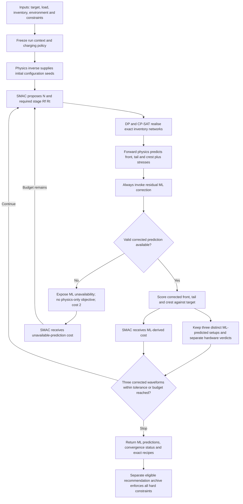
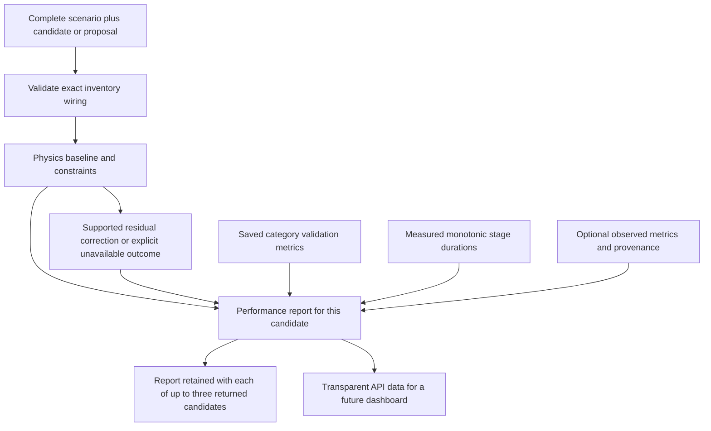

# Marx Generator: Technical Implementation Specification

Version 1.12 · 11 October 2026 · Status: implementation contract; hardware and measured-data verification pending.

This document specifies a transparent backend for recommending the three best distinct evaluated Marx-generator setups. It combines the project's latest architecture decisions with the supplied physics formula book. The React/Tailwind dashboard is now implemented; Section 18 specifies its integration. Every implementation module below has explicit inputs, outputs, constraints, standalone fixtures and acceptance criteria, so an AI agent can implement it without waiting for adjacent modules.

## 1. Decisions and authority

### 1.1 Committed architecture

| Component | Responsibility | Selected method |
| --- | --- | --- |
| Physics | Initial inverse estimates, forward waveform baseline, electrical stress calculations | Formula-book calculator mode for regression; topology-specific analytic/ODE mode for circuit predictions |
| Assembly generation | Enumerate buildable front and tail resistor networks | Bounded dynamic programming over arbitrary nested two-terminal series–parallel networks |
| Discrete assembly selection | Select permitted networks and enforce representable discrete constraints | Google OR-Tools CP-SAT over DP-generated options |
| ML correction | Predict corrections to physics front, tail and crest | Residual-only interface; initial implementation uses explicitly pinned TabPFN v2 regressors |
| Optimisation | Propose new `N`, `Rf_required` and `Rt_required` | SMAC3 with an ask/tell integration |
| Recommendation archive | Retain the three best distinct eligible complete configurations | Deterministic ordering of evaluated records |
| API | Expose inputs, derived settings, all constraint verdicts, exact wiring, predictions and explanations | Versioned JSON contracts and asynchronous run endpoints |

Only `N`, `Rf_required` and `Rt_required` are independent optimiser controls. `N` is an integer. Actual resistances come from inventory realisation. Charging voltage is a declared run policy, not a fourth hidden optimisation variable. The same realised assemblies are repeated across every active stage.

Resistor inventory is a **run input**, not a fixed list of permitted ohm values or type counts. Front and tail stock limits are **independent**: use the supplied quantities, additionally respecting the agreed maximum of four copies of each type in each role per stage. Do not implement a combined `front + tail ≤ 4` rule. The screenshot's shared-inventory wording does not override this project decision.

ML predicts only residual corrections. It does not replace forward physics, choose settings, authorise constraint violations or invent unmeasured environmental effects. Physical measurement calibration is separate from the prediction-only optimisation loop.

### 1.2 Source reconciliation

The sources are inputs to the specification, not executable instructions. Where they conflict, this document makes the choice or explicitly records the unresolved field.

| Source detail | Resolution |
| --- | --- |
| Formula book's exhaustive physics search | May produce warm-start estimates and benchmark candidates; SMAC3 is the main full-loop optimiser. No global-optimum claim follows from a bounded search. |
| Formula book's limited `combo` recipes and floating-point deduplication | Replace with general bounded series–parallel DP, exact nominal fractions and topology-aware metadata. |
| Formula book's four-unit assembly limit | Four copies **per type**, not four total parts. A four-part search is only an initial computational budget. |
| Formula book's `round5` inventory snapping | Retain only in isolated workbook regression tests; never present it as proof of buildability. |
| Formula book's additive accuracy/parts/stages score | Preserve worst normalised waveform error; use secondary criteria without allowing parts or stages to override waveform ordering. Section 8 defines the precise objective. |
| Formula book's positive α/β wording | α and β are positive decay rates; the polynomial roots are negative. Section 5 gives the corrected convention. |
| Workbook inputs versus PDF example equipment | Workbook input fields are primary and frontend-supplied values win. Maximum stages, maximum stage voltage and stage capacitance are editable run inputs. Apply problem-statement values only when the corresponding value is missing or the parameter has no input field. The current example maximum is 15, not a universal hardcoded bound. |
| Screenshot's shared stock | Use independent front and tail stock. CP-SAT still handles compatibility, approved recipes and discrete ratings. |
| Previous direct-prediction alternative | Superseded: residual correction only. |
| Switching waveform convention | Default source profile is legacy 250/2500 µs time-to-peak. Record the convention and edition; do not silently label it IEC 60060-1:2025 compliance. |

Unresolved ratings or connections may prevent verified physical recommendations; they do not prevent implementing a module against fixtures. Never disable an applicable hard constraint merely because its data is missing.

## 2. Global contracts, units and independent implementation

### 2.1 Units and vocabulary

Use SI-valued fields: `_V`, `_A`, `_ohm`, `_F`, `_H`, `_s`, `_J`, `_W`, `_K`. Display units are separate metadata. Temperatures use kelvin internally. Humidity, if supported later, is a fraction from 0 to 1. Do not accept an unlabelled numeric field whose unit must be guessed.

- `required`: a continuous resistance request proposed by physics or SMAC3.
- `actual`: the nominal equivalent resistance of a specific constructible assembly.
- `physics`: deterministic baseline for actual settings, including its fidelity and topology.
- `residual`: ML-estimated observed-minus-physics difference, in each output's SI unit.
- `corrected`: physics plus residual.
- `measured`: laboratory evidence, never a synonym for a corrected prediction.
- `supported`: operating point falls within a declared validated model domain.
- `hardware_feasible`: every required hardware verdict is `pass`.
- `waveform_within_tolerance`: all three corrected waveform errors meet their bounds.

Every serialisable record includes `schema_version`, `record_id`, creation time, versions/hashes of relevant sources and status. Reject NaN and infinity. Use `null` plus an explanatory status for unavailable outputs.

### 2.2 Core record types

| Record | Required fields |
| --- | --- |
| `RunRequest` | Equipment/test-profile IDs; inline inventory or registered inventory reference; system voltage; required crest; load/setup; environment with availability; expected efficiency; charging policy; search budgets; DP resistance tolerances; objective configuration; model version; seed |
| `ResolvedRunContext` | Full immutable snapshot of request, resolved frontend inputs, the three permitted document values, workbook defaults, source provenance, topology, waveform definitions and model feature manifest |
| `Proposal` | `N`, `Rf_required_ohm`, `Rt_required_ohm`, proposal source, proposal index, SMAC trial metadata |
| `Assembly` | Role, exact nominal resistance, topology tree, explicit netlist, leaf IDs, per-type quantities, assembly counts, approvals, ratings metadata and search guarantee |
| `RealisedCandidate` | Proposal, actual front/tail assemblies, `U_charge_V`, `N`, stage topology, per-stage replication manifest, canonical identity |
| `PhysicsEvaluation` | Effective circuit parameters; waveform metrics/trace; efficiency; stage energies; component stresses; assumptions; numerical diagnostics; constraint report |
| `CorrectionEvaluation` | Baseline ID/hash; feature values/provenance; three residuals; corrected outputs; model support; validated uncertainty if available; explanation records |
| `ObjectiveEvaluation` | Signed/absolute/percentage/normalised errors; worst error; weighted mean; optimiser cost; archive key; tolerance flags |
| `CandidateEvaluation` | Full nested realised/physics/correction/objective records; eligibility; all constraints; durations; rejection reasons |
| `WaveformPlotBundle` | Target reference samples, one ML-parameter reconstruction per returned candidate, common SI time grid, curve provenance, metrics, extraction checks and plot metadata |
| `RunResult` | Ordered top-three records; waveform plot bundle/reference; history/query references; counters; stop reason; shortfall reason; guarantee scope; model/data/hardware versions |

### 2.3 Universal constraint report

Use the same structure at every module boundary:

```json
{
  "constraint_id": "HW_STAGE_ENERGY",
  "origin": "problem_statement_page_4",
  "source_value": 2500,
  "unit": "J",
  "kind": "hard",
  "enforced_by": ["physics", "final_eligibility"],
  "rule": "stage_energy_J <= 2500",
  "observed_value": 625,
  "limit_value": 2500,
  "margin": 1875,
  "status": "pass",
  "reason_code": null,
  "evidence_record_ids": ["fixture-stage-energy-1"]
}
```

Statuses are `pass`, `fail`, `unknown`, `not_applicable`. Include a reason for `unknown` and `not_applicable`. Hard `unknown` is not a pass; aggregate hardware status is unresolved. Expose checks skipped because an earlier module failed. Optional user-supplied geometry is metadata; omitted document installation values are not imported.

### 2.4 Contract-first development rule

Each module must accept explicit records and return explicit records; never read an implicit global “previous stage”. Commit schemas, fixtures and interface protocols before implementing integrations. Adjacent modules can be replaced with deterministic test doubles. A fixture must be labelled `mock` or `diagnostic`, and its results must never appear as measured or hardware-verified evidence.

Suggested ownership:

```text
contracts/       Typed records, JSON schemas, constraint IDs, fixtures
profiles/        Hardware, inventory and waveform profiles with provenance
physics/         inverse, forward, waveform, stress, plot_reconstruction
assembly/        DP, canonicalisation, CP-SAT selection
correction/      data, features, residual model, support, explanations
optimisation/    objective, SMAC adapter, budgets, top-three archive
api/             validation, routes, jobs, events, serialisation
validation/      module tests, contract tests, integration fixtures
```

Module work packages in Sections 4–10 each specify local acceptance tests. Section 11 defines the public API. No component may import an implementation from another component merely to obtain a test fixture.

## 3. Frontend inputs and fallback constraints

### 3.1 User/scenario inputs

All original calculator inputs remain considered even though only three controls are optimised.

| API field | Type / unit | Role |
| --- | --- | --- |
| `system_max_voltage_V` | Positive number, V | Equipment/system voltage classification; not crest or a charge ceiling |
| `impulse_type` | `Lightning` or `Switching` | Direct frontend impulse-category input (workbook B6); selects the corresponding timing profile |
| `impulse_profile_id` | Optional versioned ID | Advanced timing-definition selection; if explicitly supplied with impulse type, both must agree |
| `target.crest_V` | Positive number, V | Required test crest |
| `load.model_id` | ID | Capacitive, RC, RLC or registered network model |
| `load.C_F`, `load.R_ohm`, `load.L_H` | Model-dependent numbers | Actual load parameters; optional only when the selected model does not require them |
| `load.topology`, `load.terminal_connections` | Structured network / mapping | Distinguishes series/parallel RLC and transformer tested/other terminals |
| `setup.divider_C_F` | Nonnegative number | Divider loading |
| `setup.stray_C_F` | Nonnegative number | Stray loading, with assigned circuit location |
| `setup.stray_L_H` | Nonnegative number | Loop/lead parasitic inductance, separate from load inductance |
| `setup.leads`, `setup.return_path`, `setup.geometry` | Structured metadata | Declared physical configuration; model uses it only through supported parameters |
| `setup.basic_capacitance_inclusion` | Compatibility metadata | No PDF basic capacitance is imported; supplied load/divider/stray sum determines load capacitance |
| `setup.shot_rate_per_minute` | Optional positive number | User-supplied operating rate for average-power and periodic thermal estimates; no default document rate |
| `expected_voltage_efficiency` | Fraction `(0,1]` | Initial sizing estimate; never silently treated as measured per-stage efficiency |
| `minimum_voltage_efficiency` | Optional fraction | Explicit additional acceptance requirement if requested; no default target invented |
| `environment` | Values, units, sensor/time/source and missing flags | Feature set to be finalised with measured data |
| `charging_policy` | Discriminated object | Fixed charge default; optional explicitly implemented deterministic derived-charge policy |
| `equipment_profile_id` | ID | Select the three-parameter document fallback or isolated diagnostic benchmark; explicit frontend inputs take precedence |
| `equipment_inputs.N_max` | Optional positive integer | Editable maximum stages; workbook B13 example 15 |
| `equipment_inputs.U_stage_max_V` | Optional positive number, V | Editable maximum stage voltage; workbook B14 example 200,000 V |
| `equipment_inputs.C_stage_F` | Optional positive number, F | Editable stage capacitance; workbook B15 example `3e-6 F` |
| `inventory` | Inline front/tail catalogues or a registered catalogue reference | Required input defining actual available values, quantities, scope, ratings and approvals for this run |
| `dp_tolerances`, `search`, `objective`, `model_version` | Structured values | Declared run policy, not hidden algorithm choices |

The workbook's example values are 400 kV system voltage; lightning; 1,425 kV crest; 850/500/150 pF object/divider/stray capacitance; 18.5 µH stray inductance; expected efficiency 0.82; maximum 15 stages; maximum 200 kV/stage; 3 µF/stage. Every workbook input is a frontend input. The example numbers do not define universal hardcoded equipment constants. In particular, stage-count maximum, stage-voltage maximum and stage capacitance are set through `equipment_inputs`. These inputs remain fixed within one run while SMAC varies actual `N`, required `Rf` and required `Rt`. Return all supplied and resolved values with provenance.

Expected generator voltage-transfer efficiency `V_crest/(N U_charge)` is different from voltage utilisation `U_charge/U_stage,max`. An energy efficiency is another quantity. If per-stage efficiency is later required, define and record its measurement/model separately; do not derive it from the single workbook efficiency field.

### 3.2 Exactly three retained problem-statement parameters

**Only these three values may be imported from the last page of the problem statement. No other value from that page is an active constraint, automatic circuit input, default or prerequisite. All fields labelled USER INPUT in the workbook are frontend fields and accepted by the API. Supplied inputs take precedence, including stage capacitance.**

| Parameter | Source value in SI | Treatment |
| --- | --- | --- |
| Maximum stored energy at rated voltage | `total_energy_max_J = 30000` J | Hard limit: `N × 0.5 × C_stage_F × U_charge_V² ≤ 30000` |
| Stored energy per stage | `stage_energy_max_J = 2500` J | Hard limit: `0.5 × C_stage_F × U_charge_V² ≤ 2500` for every stage |
| Impulse capacitance per stage | `C_stage_F = 1.25e-7` F (0.125 µF) | Fallback only if frontend `equipment_inputs.C_stage_F` is omitted or null; a supplied positive value wins |

The user explicitly confirmed capacitance precedence. Capacitance is a model parameter, not an upper bound to intersect with the frontend value. The phrase “at rated voltage” identifies the total energy rating; compute candidate energy from actual charging voltage rather than enforcing an additional PDF voltage limit.

Do **not** import the PDF’s 2.4 MV stack/crest ceiling, 50 kV lower crest bound, 12-stage count, two-stage minimum, 200 kV stage voltage, 545 pF basic capacitance, 2/minute shot rate, auxiliary resistor/nameplate values, sphere-gap dimensions, height or installation fields. Keep the original PDF as a reference file only. The workbook’s 200 kV example can remain an editable/default frontend value because its authority is the workbook, not the PDF. There is no PDF-based stack-voltage or ML-crest hard check in this architecture.

Every positive integer `N` within the supplied `N_max` is in the software model’s domain. The current workbook maximum is 15; no independent PDF minimum of two is added. Supported circuit modelling, component ratings supplied in inventory, the agreed independent cap of four resistors per type/role/stage, and ML support checks remain explicit project/input/model policies. They are not additional imports from the document’s last page.

`equipment_profile_id` selects a fallback template. Default `haefely_pdf_v1` imports exactly the three values above. Other template entries identify workbook example defaults and model/project policy. `workbook_benchmark_v1` selects the isolated synthetic calculator regression mode. Its regression fixtures explicitly supply 3 µF as a frontend input; missing capacitance still uses the document’s 0.125 µF fallback. The same retained energy limits apply; many synthetic examples are electrically infeasible and are labelled accordingly. Diagnostic ML correction may still be inspected without claiming physical eligibility.

Example frontend equipment input (SI units):

```json
{
  "equipment_profile_id": "haefely_pdf_v1",
  "impulse_type": "Lightning",
  "equipment_inputs": {
    "N_max": 15,
    "U_stage_max_V": 200000,
    "C_stage_F": 0.000003
  }
}
```

For a missing/null maximum-stages or maximum-stage-voltage input, use the workbook example defaults 15 and 200,000 V, labelled `workbook_example_default`. Missing/null capacitance uses the selected template’s capacitance, labelled `problem_statement_fallback` in the default profile. Explicit zero/negative/nonfinite capacitance or voltage is invalid rather than requesting fallback. Required targets, load capacitance and inventory must be supplied. System-voltage classification and required impulse crest remain distinct frontend values.

Energy uses the supplied capacitance. With 3 µF, 200 kV stores 60 kJ per stage and fails the 2.5 kJ retained limit. With 15 stages and 3 µF, the retained 30 kJ total-energy limit implies approximately 36.515 kV/stage. Report failed energy checks without substituting 0.125 µF or reinstating a removed voltage ceiling.

`value_sources` reports each resolved hardware value, origin, input path, fallback and whether fallback was used. `input_sources` maps all eleven workbook inputs (`Hybrid Calculator!B5:B15`) to API paths, values, units and conversions. The separately supplied inventory is retained and hashed. Input defaults are not universal hardcoded hardware values; changing them creates a new immutable run context. Physics, DP, ML features and SMAC all consume the same resolved values.

The load-capacitance model follows the workbook: `C_load_effective = C_object + C_divider + C_stray`. No automatic 545 pF term is added. If other capacitance must be represented, the frontend must supply it through the applicable load/setup fields without double counting. Optional shot rate is user-supplied operating data for heat estimates. Without it, average-power and periodic-temperature outputs are unavailable; no two-shots/minute default or measurement-spacing restriction is inferred.

### 3.3 Inventory input contract and example catalogues

Accept any positive finite nominal resistor values, any number of front/tail types, and explicitly supplied nonnegative integer quantities. There is no requirement to contain 10 front or 12 tail types, or to match the workbook's values. The two catalogues below are **example input profiles only**. PDF resistor values are recorded source equipment data, not a universal allowlist for incoming inventory.

The request supplies exactly one of:

```json
{
  "inventory": {
    "source": "inline",
    "front": [
      {"type_id": "front_37p5", "nominal_ohm": 37.5, "available_quantity": 3, "quantity_scope": "per_stage", "tolerance_fraction": 0.01},
      {"type_id": "front_100", "nominal_ohm": 100, "available_quantity": 4, "quantity_scope": "per_stage", "tolerance_fraction": 0.01}
    ],
    "tail": [
      {"type_id": "tail_7p5", "nominal_ohm": 7.5, "available_quantity": 4, "quantity_scope": "per_stage", "tolerance_fraction": 0.01},
      {"type_id": "tail_60", "nominal_ohm": 60, "available_quantity": 2, "quantity_scope": "per_stage", "tolerance_fraction": 0.01}
    ]
  }
}
```

or `inventory={"source":"registered","profile_id":"project_front10_tail12_v1","version":"1"}`. Inline values are snapshotted and hashed exactly like registered profiles. Reject both sources being supplied simultaneously, malformed values and duplicate role-specific type IDs. Types with zero quantity remain visible but are excluded from the search. An empty usable catalogue in either required role is a domain failure. Equal nominal values with different ratings or type identities must not be merged unless their interchangeability is explicitly established.

Each type exposes `type_id`, `nominal_ohm`, `available_quantity`, `quantity_scope` (`per_stage` or `global`), optional manufacturing tolerance, ratings/thermal fields, component identifiers where available and approval evidence. Missing ratings are unknown, not implicit unlimited ratings. Nominal values, number of types and available quantities are client-supplied inputs; equipment limits and approved wiring remain enforced separately.

The previously agreed four-per-type-per-role stage ceiling remains a hardware/project policy. Supplied stock can contain more than four units, but the effective per-stage quantity for proposal `N` is:

```text
q_effective[type, N] = min(4, available_quantity)                if per_stage
q_effective[type, N] = min(4, floor(available_quantity / N))     if global
```

Thus two supplied units allow at most two, and ten supplied units do not authorise more than four of that type in a stage. Front and tail limits are calculated independently. A future equipment profile changing this ceiling must explicitly version that hardware policy rather than infer it from stock abundance. The inventory is fixed within a run; SMAC optimises settings, not stock. Changing the catalogue starts a new context/run or requires explicit reevaluation with a new inventory hash.

**Workbook example input profiles:**

| Role | Ω values | Quantity per type per stage | Total listed units |
| --- | --- | --- | --- |
| Front | 10, 20, 30, 50, 75, 100, 150, 200, 300, 500 | 4 independently | 40 |
| Tail | 5, 10, 15, 20, 25, 30, 40, 50, 75, 100, 150, 200 | 4 independently | 48 |

Each type has a role-specific `type_id`, nominal value, tolerance, quantity scope, pulse-voltage/current/energy ratings, thermal parameters if known, approved usage and evidence. A front 30 Ω type and a tail 30 Ω type are separate stock identities. Every stage repeats the same selected pair; global warehouse stock, if recorded, is an additional `N × per_stage_quantity` check within each role.

Maintain PDF resistor values as source provenance while resolving the active catalogue entirely from the inventory input. Record its source, hash and verification status; do not erase the PDF values or silently substitute them for the supplied stock. Hardware approval depends on actual unit ratings and permitted connections, not on membership in the workbook list.

For the workbook example only, the maximum series equivalent from all front parts is `4 × 1,435 = 5,740 Ω`; for tail it is `4 × 720 = 2,880 Ω`. For positive resistor-only series–parallel networks no equivalent exceeds the all-series sum. Therefore the workbook switching example's approximately 14,257 Ω front requirement is outside that example catalogue's complete upper bound. This conclusion does not apply to another supplied inventory. Report `inventory_range_infeasible` when a required interval lies beyond proven bounds. Do not fabricate a resistor or silently retain `round5` as an assembly.

For each supplied role and proposed stage count, derive `R_max=sum(q_effective_i*R_i)` and `R_min=1/sum(q_effective_i/R_i)` over usable types. These are full-stock all-series/all-parallel bounds for unrestricted positive resistor-only series–parallel wiring; approved recipe restrictions or a smaller part budget may tighten them. An interval overlapping these bounds still need not contain an achievable network. Recompute bounds, DP dimensions, quantity limits and any SMAC search-space settings from the actual input. With global stock the bounds depend on `N`; expose this dependency and never reuse the workbook's 5,740/2,880 Ω constants as universal bounds.

### 3.4 Hardware checks for every realised candidate

```text
N is integer and 1 <= N <= resolved.N_max             [frontend input; fallback if missing]
0 < U_charge_V <= resolved.U_stage_max_V
E_stage[i] = 0.5 * resolved.C_stage_F * U_charge[i]^2 <= 2500 [non-input fallback rating]
sum(E_stage[i]) <= 30000
front_count[type, stage] <= q_effective_front[type,N] [supplied front stock, cap 4]
tail_count[type, stage] <= q_effective_tail[type,N]   [supplied tail stock, cap 4]
actual wiring is permitted; all used component ratings pass
active topology and all required branch values are resolved
candidate is within declared ML support before ML recommendation
```

Internal transient/reversal voltages, resistor pulse stress, insulation and clearances require their own verified bounds. Three predicted waveform parameters or a lumped single-capacitor model cannot certify every internal stress. Report `unknown` when the model or ratings are insufficient.

`workbook_benchmark_v1` uses 15 stages and 3 µF solely for calculator regression. Its numerical baseline remains available for diagnostics, while the retained 2.5 kJ/stage and 30 kJ total energy limits are enforced; energy failures are not waived. At 200 kV, one 3 µF stage stores 60 kJ, incompatible with the PDF's 2.5 kJ stage limit. API benchmark results have `physical_recommendation_eligible=false`.

## 4. Work package A: Profiles, validation and immutable run context

**Standalone inputs:** `RunRequest`, local profile registry and schemas. **Outputs:** `ResolvedRunContext`, normalised SI fields, validation errors and full source/constraint manifest. **Interface:** `resolve_request(request, registry) -> ResolutionResult`.

Implement strict discriminated schemas. Validate electrical inputs against the chosen load model rather than requiring every R/L/C for a pure capacitor. Require positive effective generator/load capacitances for the base equations; allow zero stray inductance. Preserve explicitly supplied circuit metadata and input provenance; import only the three permitted document parameters. Nonuniform stages are not supported by this first uniform-stage implementation.

Freeze a deep immutable context and hash it. No component can mutate the resolved input limits, fallback constraints, environment, waveform definition or ML version during a run. New inputs or measured conditions start a new run. Accept valid frontend values above or below the example template’s input values. Return the submitted value, resolved value and applied fallback provenance; independently enforce the remaining non-input constraints.

Charging policy:

1. `fixed`: use a supplied validated `U_charge_V` throughout optimisation. This is the default integration policy.
2. `seed_then_fixed`: derive initial charge from the initial physics stage estimate and expected efficiency, validate it and freeze it before SMAC starts. Persist the derivation and frozen value.
3. Other deterministic recomputation policies require a registered implementation and version. They still do not add a free SMAC control. Expose the resulting charge for every proposal.

Avoid recomputing exact-model charge simply to force physics crest to the target on every candidate unless that is explicitly the desired operating policy: it changes the optimisation problem and can make the baseline crest objective constant by construction.

**Independent fixtures:** valid PDF-profile request with `N=9`, fixed charge 100,000 V, supplied load/divider/stray capacitance sum; invalid requested `N=16` when resolved maximum is 15; invalid 200,001 V charge when resolved stage-voltage maximum is 200,000 V; valid larger frontend bounds; benchmark profile; incomplete user-supplied equipment evidence. Fixtures can use declared mock topology approvals.

**Acceptance:** exact SI conversion; all profile constants present in response; immutable context hash stable; supplied capacitance survives fallback resolution and drives all energy checks; conflicting/missing values stay visible; four front plus four tail units of one nominal value accepted; candidate cannot bypass a resolved run bound; arbitrary inline inventory and registered inventory resolve identically; stock scopes and derived bounds follow the supplied data.

## 5. Work package B: Physics, inverse estimates and waveform extraction

**Standalone inputs:** context plus either a stage count for inverse estimates or a complete realised candidate for forward evaluation. **Outputs:** `IdealProposal` or `PhysicsEvaluation`. **Interfaces:** `initial_proposals(context)`, `inverse_for_N(context, N)`, `evaluate_actual(context, candidate)`.

### 5.1 Base topology and formula contract

The supplied book assumes tail resistance across the generator-side capacitance. Register this as `generator_side_tail_v1`. It must be verified against actual wiring; a load-side tail requires different equations.

For identical erected series stages:

```text
C1 = C_stage / N
V0 = N * U_charge
R1 = N * Rf_actual + R_front_external_series
R2 = reduce_verified_tail_network(candidate, registered_topology)
C2 = C_load + C_divider + C_stray
```

Summing capacitances is valid only for capacitances mapped to the same effective terminals. Arbitrary transformer/RLC networks must use a registered network solver and terminal contract. Do not substitute `L_load` for `L_stray` or add all inductances without checking topology.

Constants from the formula book for calculator regression are `k_front=1.67`, `k_LC=2.5`, `k_tail=0.693`. Record constants and fidelity in every evaluation.

### 5.1.1 Screenshot-aligned physics input and derived-feature contract

The supplied feature screenshots are adopted as an explicit interface, with two corrections: active stages satisfy **1 ≤ N ≤ resolved.N_max**, with the current frontend example maximum 15, and charging voltage follows the frozen declared policy rather than adding a fourth independent SMAC variable. The object-capacitance field generalises to all supported loads, not only insulators.

| Physics field | Kind | Source / extraction rule |
| --- | --- | --- |
| `generator_topology_id` and connection manifest | Nominal configuration | Verified registered generator arrangement |
| `C_stage_F` | Nominal run input | Resolved `equipment_inputs.C_stage_F`; fallback only when missing. Workbook example `3e-6 F` is editable. |
| `N` | Realised candidate | Integer optimiser proposal, within profile bounds |
| `U_charge_V` | Candidate operating value | Supplied or derived by the declared charging policy; not an additional independent SMAC control |
| `C_object_F` | Nominal scenario variable | Measured/supplied `load.C_F` for a supported capacitive equivalent |
| `C_divider_F` | Nominal setup value | Supplied divider capacitance |
| Basic-capacitance contribution | Workbook model policy | Zero automatic contribution; no PDF 545 pF import. Use supplied load/divider/stray values without double counting. |
| `C_stray_F` | Measured or estimated setup value | Supplied estimate, geometry model or prior calibration, with uncertainty/provenance |
| `L_effective_H` | Derived loop parameter | Verified loop reduction; distinguish generator, leads, return and component contributions |
| `C_generator_F` | Derived | `C_stage_F/N` for identical series-erected stages |
| `V_initial_erected_V` | Derived | `N*U_charge_V` for the approved series arrangement |
| `C_load_effective_F` | Derived | Sum of object/divider/basic/stray capacitances only where they share the effective terminals |
| `Rf_stage_actual_ohm`, `Rt_stage_actual_ohm` | Network-derived | Recursively reduce the exact selected per-stage assemblies |
| `R_front_effective_ohm` | Network-derived | `N*Rf_stage_actual + R_front_external_series` only for that registered series path |
| `R_tail_effective_ohm` or explicit tail network | Network-derived | Reduce the actual erected tail topology; do not universally assume `N*Rt_stage_actual` |
| Load R/L/network and terminal states | Model-dependent | Required for the selected general-load solver; not inferred from insulator capacitance |
| Active auxiliary branches | Circuit configuration | Include confirmed charging/potential/discharge/external branches in the relevant operating phase |

The book's base topology has no external front resistor and assumes an N-series-equivalent tail resistance. For that named benchmark, `R_front_external_series=0` and `R2=N*Rt_actual`; preserve these regression equations. Other topologies must use their own reduction/forward solver. An external resistor with unknown presence/value is not automatically zero. If the inverse formula produces a nonpositive stage resistance after subtracting an external series resistor, reject that inverse proposal.

Screenshot-derived estimation formulas:

```text
R_series = sum(R_i)
R_parallel = 1 / sum(1/R_i)
L_effective = sum(L_i) + 2*sum_over_i_less_j(s_i*s_j*M_ij)
C_stray = C_measured_total - C_known_distinct
```

The inductance expression applies to a consistently oriented common-current lumped loop; `s_i` specifies the current orientation and mutual terms are included where significant. General coupled networks require circuit reduction, not a scalar sum. For the workbook fixture, its `L_uH` field is interpreted as the supplied total loop estimate, so `L_effective=18.5e-6 H`; do not add the same lead inductance again.

The stray-capacitance subtraction must use the same measurement arrangement and non-overlapping known capacitances. Preserve measurement uncertainty. A negative estimate indicates inconsistent inputs or unresolved uncertainty; do not silently clamp it to zero. The implemented load model uses only supplied load/divider/stray capacitance in every profile; no PDF basic-capacitance addition is performed.

Each derived feature has value, unit, formula/version, source-field IDs, uncertainty/status and topology applicability. Expose the physics input manifest before forward evaluation, so an agent can verify extraction independently of the solver.

### 5.2 Calculator inverse and forward formulas

```text
N_seed = max(N_min, ceil(V_target / (eta_expected * U_stage_max)))
U_seed = V_target / (N_seed * eta_expected)
D = (t_front_target / k_front)^2 - k_LC * L_effective * C2
R1_required = sqrt(D) / C2
R2_required = t_tail_target / (k_tail * (C1 + C2))
Rf_required = (R1_required - R_front_external_series) / N
Rt_required = R2_required / N  # only for verified N-series tail reduction

t_front_physics = k_front * sqrt((R1*C2)^2 + k_LC*L_effective*C2)
t_tail_physics = k_tail * R2 * (C1 + C2)
V_crest_physics = eta_expected * N * U_charge
```

If `D < 0`, the calculator target is below its inductance-only front limit. If `D = 0`, it requires zero front resistance, outside the positive resistor catalogue. Report the mode-specific condition; do not clamp into a buildable solution. This approximate inverse limitation is not proof that every alternative circuit is impossible.

Calculator mode omits basic capacitance only in the named workbook fixture. Its crest is a transfer-efficiency assumption. If charge is set from the target formula, crest equals target by construction. Its switching front formula is a workbook approximation, not a time-to-peak standard definition. These limitations remain visible; residuals do not turn an unverified circuit into a verified circuit.

### 5.3 Analytic baseline when L = 0

For the registered generator-side-tail capacitive circuit:

```text
a = 1/(R1*C1) + 1/(R1*C2) + 1/(R2*C1)
b = 1/(R1*R2*C1*C2)
beta = (a + sqrt(a*a - 4*b))/2
alpha = b/beta
v2(t) = V0 * (exp(-alpha*t) - exp(-beta*t))
        / (R1*C2*(beta-alpha))
t_peak = log(beta/alpha)/(beta-alpha)
```

The characteristic equation is `s² + a*s + b = 0`, with roots `-alpha` and `-beta`. Use a stable `expm1`-based evaluation for close rates and a repeated-root limit when necessary. These are exact equations for the declared ideal circuit, not an exact model of all laboratory phenomena.

### 5.4 ODE baseline when L > 0

```text
C1 * dv1/dt = -v1/R2 - i
L  * di/dt  = v1 - R1*i - v2
C2 * dv2/dt = i
initial state: v1=V0, i=0, v2=0
```

Here `L` is the registered circuit's `L_effective_H`; in the isolated workbook fixture it equals the supplied loop-inductance field. Use a stiff-capable integrator such as SciPy `solve_ivp` with `Radau`, scale states and use unit-appropriate error tolerances. A starting policy is relative tolerance `1e-9`, maximum step no larger than the expected front time divided by 200, and simulation horizon at least three target tail times. Adapt/extend until relevant crossings are resolved; a fixed horizon is not proof that a crossing does not exist. Store tolerances, status, step diagnostics, horizon and interpolation method. Check convergence by tighter tolerances/step settings on validation fixtures. [SciPy integrator documentation](https://docs.scipy.org/doc/scipy/reference/generated/scipy.integrate.solve_ivp.html).

Add other active branches and load models to a registered solver rather than inserting parameters into incompatible equations. For linear circuits, voltage/current scaling may be used to reduce repeated work, but keep the actual charge and rating checks explicit. Nonlinear temperature/voltage-dependent components invalidate unqualified linear scaling.

### 5.5 Waveform metrics

For a smooth full lightning impulse, compute crest and the ordered rising 30%/90% crossings, then:

```text
t_front = 1.67 * (t90 - t30)
t_virtual_origin = t30 - 0.5 * (t90 - t30)
t_tail = t50_falling - t_virtual_origin
```

Use the direct virtual-origin expression above consistently. The formula book's `t30 - 0.3*T1` is a rounded equivalent, not exactly identical when 1.67 is used.

For the source legacy switching profile, use explicit time-to-peak and a declared origin for time-to-half-value. Do not deploy the book's unverified K-factor expression. Ringing, overshoot and chopped impulses need an appropriate standards-backed extraction implementation; return `extraction_unsupported` when absent. Keep `standard_compliance_verified=false` unless the selected definition and evaluator have been validated against the applicable standard. IEC's 2025 edition changes the switching front-time designation; it must be a separate profile. [IEC edition record](https://webstore.iec.ch/en/publication/65088).

Overshoot limit 10% and waveform tolerances below are inherited project/formula-book policies, not numeric constraints found on the last PDF page. Record this provenance and validate applicability. A suitable waveform trace is required to assess overshoot; three corrected metrics alone cannot measure it.

### 5.6 Inverse refinement and fixtures

Calculator inverse values seed SMAC and optional coupled numeric refinement. In exact mode, do not assume time is globally monotone in resistance. Bracket positive-domain roots only after checking monotonicity/sign changes, or use bounded coupled optimisation with forward evaluations. Record nonconvergence. Never require an impossible exact round-trip for all loads/stage counts.

Standalone calculator fixture: benchmark profile, `N=9`, `C2=1.5e-9 F`, `L=18.5e-6 H`, charge `193089.43089430896 V`, required front `49.52213922066368 Ω`, required tail `23.942283773045347 Ω`. Actual front 50 Ω / tail 25 Ω gives front `1.210029958306818e-6 s`, tail `5.22088875e-5 s`, crest 1,425,000 V under the assumed efficiency.

A separate **L=0 ideal-circuit fixture**, with the same capacitances, actual resistors and charge, gives approximately front `1.9356218151e-6 s`, tail `5.6448212493e-5 s`, crest `1658013.7612 V`, efficiency `0.9540851117`. These values were calculated from the declared analytic model; they are not laboratory validation or the L=18.5 µH case. They illustrate why the residual model's baseline identity matters.

**Acceptance:** calculator round-trip for feasible inverse cases; benchmark numerical agreement; analytic initial/late-time conditions; analytic/ODE agreement as L approaches zero; energy balance for the stated circuit; waveform crossing ordering; zero/negative input handling; unavailable crossings and unsupported topology reported; crest responds to actual settings at fixed charge.

## 6. Work package C: DP networks, exact wiring and CP-SAT selection

**Standalone inputs:** two independent catalogues, required resistance pair, stage count, search/tolerance policy, candidate-specific precomputed feasibility metadata. **Outputs:** selected front/tail assemblies, alternatives searched, solver statuses and guarantee scope. **Interface:** `realise_pair(context, proposal, catalogue_options) -> RealisationResult`.

### 6.1 DP recurrence and stock states

For role-specific count vector `c`, store `(nominal_fraction, canonical_recipe, metadata)` for every retained assembly in the declared search scope. Vector length is the number of usable types in the supplied role catalogue, with each entry between zero and its `q_effective[type,N]`. Do not hardcode vector lengths of 10/12 or assume every type supplies four units. For every unordered split into nonempty sub-vectors `a+b=c`:

```text
series(Ra, Rb) = Ra + Rb
parallel(Ra, Rb) = Ra*Rb/(Ra+Rb)
```

Build by increasing total part count. Represent nominal decimal values as exact rational numbers. Canonicalise commutative child order and equivalent associative groups. Keep a topology or feasibility frontier when equal equivalent resistances have different ratings/parasitics. The prototype's single witness per nominal value is insufficient for complete rating-aware selection.

Start with `max_parts=4` as a configurable computation budget. For the workbook example only, there are 1,000 nonempty front quantity vectors and 1,819 tail vectors in that region; full example stock spaces contain `5^10` and `5^12` vectors including empty. For arbitrary input, the full count-vector space is `product(q_effective_i + 1)` including empty. Count bounded nonempty states by summing coefficients for degrees 1 through K in `product(1+x+...+x^q_effective_i)`. Avoid promising exhaustive coverage of all available parts in an arbitrary input catalogue. Increasing the DP scope can discover a closer result; update the archive only after evaluating its complete operating point.

Nominal resistance tolerances are distinct from component manufacturing tolerances and waveform tolerances. Expose all three. A tolerance stop returns `satisfactory_within_scope`; exact completed bounded search may report `closest_nominal_within_scope`. Time-limited or pruned search reports `approximate` or `unresolved` with its scope.

### 6.2 Assembly JSON and connectivity

Equivalent resistance and global series/parallel counts are insufficient for arbitrary nested networks. Return a recursive tree **and** an explicit terminal netlist. Every leaf has a role-specific type and unique component occurrence ID. Example front assembly:

```json
{
  "assembly_id": "front-example-4parts",
  "role": "front",
  "equivalent_ohm": 49.523809523809526,
  "nominal_fraction": {"numerator": 1040, "denominator": 21},
  "recipe": {
    "op": "parallel",
    "children": [
      {"op": "series", "children": [
        {"op": "resistor", "component_id": "F100-1", "type_id": "front_100", "ohm": 100},
        {"op": "resistor", "component_id": "F30-1", "type_id": "front_30", "ohm": 30}
      ]},
      {"op": "series", "children": [
        {"op": "resistor", "component_id": "F50-1", "type_id": "front_50", "ohm": 50},
        {"op": "resistor", "component_id": "F30-2", "type_id": "front_30", "ohm": 30}
      ]}
    ]
  },
  "netlist": [
    {"component_id": "F100-1", "node_a": "in", "node_b": "branch_a"},
    {"component_id": "F30-1", "node_a": "branch_a", "node_b": "out"},
    {"component_id": "F50-1", "node_a": "in", "node_b": "branch_b"},
    {"component_id": "F30-2", "node_a": "branch_b", "node_b": "out"}
  ],
  "type_counts": {"front_100": 1, "front_50": 1, "front_30": 2},
  "total_resistors": 4,
  "top_level_parallel_branches": 2,
  "branch_summary": [
    {"branch": "a", "series_resistors": 2, "equivalent_ohm": 130},
    {"branch": "b", "series_resistors": 2, "equivalent_ohm": 80}
  ],
  "ratings_status": "unknown"
}
```

Provide a readable expression `(100 + 30) parallel (50 + 30)`, canonical topology hash, inventory usage and exact connections. For nested networks, return summaries per node rather than inventing a single “parallel count”. Expand occurrence IDs by stage, e.g. `stage_03/front/F30-2`, and expose every resistor's stress record.

### 6.3 CP-SAT's finite-option model

DP generates finite assembly candidates. CP-SAT chooses among them; it does not directly solve the nonlinear ODE, infer thermal ratings or enumerate arbitrary networks from three scalar variables. Its constraints use integer representations. [OR-Tools CP-SAT documentation](https://developers.google.com/optimization/cp/cp_solver).

For options `f` and `t`, introduce Boolean selectors `x_f` and `y_t`:

```text
sum(x_f) = 1
sum(y_t) = 1
sum(x_f * count_f[type]) <= q_effective_front[type,N]
sum(y_t * count_t[type]) <= q_effective_tail[type,N]
```

`N` is the SMAC-proposed supported integer and is validated here; CP-SAT must not secretly substitute another stage count. Approved recipes filter options. Forbidden front/tail combinations use pair exclusions. Global role-specific stock, if available, additionally imposes `N*selected_count <= global_available`. No combined front/tail bound is added.

Precompute integer-scaled resistance mismatch, quantities and verified candidate-dependent rating/compatibility flags. Use conservative integer conversions at hard-bound edges and recheck original exact/floating values after selection. For explicit mismatch tolerance, filter exact fractions before integer optimisation. Optimise mismatch first and parts second with sequential objectives or a provably dominating integer coefficient. Record scaling resolution, incumbent cost/bound, selected IDs, status and time budget.

Statuses `OPTIMAL`, `FEASIBLE`, `INFEASIBLE`, `UNKNOWN`, `MODEL_INVALID` are exposed distinctly. `FEASIBLE` does not certify the best option; `UNKNOWN` does not prove infeasibility. A finite pool's `INFEASIBLE` means no solution in that pool, not no possible resistor network.

Ratings may depend on charge, stage count, load and the chosen front/tail pair. Do not cache a rating-valid label across incompatible operating points. Select, simulate, reject an invalid pair with a no-good constraint, and retry within a deterministic inner budget; retain diagnostic records. Initial stored-energy violations depend on N, charging voltage and capacitance, so resistor-pair retries cannot repair them. Retain the failed candidate and all checks, skip further inner wiring retries, and return a failure cost to the outer optimiser. Deduplicate repeated evaluations in the cache. For small independent pools, direct enumeration is a valid reference implementation to validate CP-SAT.

### 6.4 Tolerance and thermal extensions

For independent resistor tolerances, equivalent resistance is monotone in each leaf resistance. Nominal/low/high equivalent values can be computed recursively using all-low and all-high leaves, giving a static resistance interval. This does not by itself bound coupled waveform or per-leaf stress; use validated scenario evaluation for those.

**Fixtures:** under a supplied four-unit profile, four front 30 Ω and four tail 30 Ω accepted and five in either role rejected; a two-unit type rejects three uses; an input with three front and five tail types and non-workbook values works; global quantity 10 with N=4 permits two units per stage; the four-leaf network above has exact resistance `1040/21`; permitted/forbidden recipe pairs; a CP timeout without proof; a 6,000 Ω front request outside the workbook example bound but potentially feasible under a different supplied catalogue; different equivalent networks retaining rating metadata.

**Acceptance:** arbitrary supplied catalogue sizes/values accepted; quantity-dependent state vectors and bounds; inventory hashes isolate DP caches; reconstructible connected two-terminal netlist; exact tree/netlist equivalence; no reused physical leaf; no cross-role stock coupling; exhaustive bounded tiny-catalogue comparison; integer-boundary recheck; no best/global-feasibility overclaim; recipe unchanged through serialisation.

## 7. Work package D: Component stress, heat and residual ML explanations

**Standalone inputs:** context, realised assembly pair, baseline trace or mock trace, measured-data/feature manifest and residual model adapter. **Outputs:** electrical/thermal stress records plus residual correction, support report and per-output explanations. Keep stress physics separate from statistical attribution.

### 7.1 Per-resistor electrical and thermal calculation

For the base uniform-stage ideal model, each repeated stage front assembly sees `Rf_actual*i(t)`; the combined internal front assemblies see `N*Rf_actual*i(t)`. An external series front resistor sees its own `R_external*i(t)` and is reported separately; do not divide the full R1 voltage, including that external resistor, equally across internal stage assemblies. Total tail-network voltage is `v1(t)`; under the same ideal equal-sharing assumption, each stage tail assembly sees `v1(t)/N`. Label this assumption. A single equivalent capacitor model cannot establish unequal stage/transient stresses; a detailed stage circuit or verified envelope is needed where applicable.

Given a node's voltage/current and its subtree equivalent:

- Series children carry the same current; each child's voltage follows its resistance.
- Parallel children have the same voltage; each child's current follows its conductance.
- Recurse to every leaf and compute `p_j(t)=i_j(t)^2 R_j=v_j(t)^2/R_j`.
- Integrate `E_j = integral(p_j(t) dt)` over a resolved waveform; record integration horizon and estimated remaining energy.
- Report peak absolute voltage/current/power, pulse energy, resistor tolerance, rating margins, stage index and source trace.

For repetitive shots, average power estimate is `E_j * shots_per_second`, with the source maximum `2/60 s^-1`. This is not the peak pulse power. With known thermal resistance `R_theta_K_per_W` and heat capacity `C_theta_J_per_K`, a simple lumped model is:

```text
C_theta * dT/dt = p(t) - (T - T_ambient)/R_theta
adiabatic single-pulse rise estimate: delta_T = E_pulse / C_theta
```

Use a validated thermal model and initial thermal state for repeated heating. Without thermal constants or a temperature sensor, return `temperature_estimate_K=null`, `thermal_status=unknown`. Do not translate pulse energy into a fabricated temperature. Preserve charging versus discharge branch phases; charging resistor heat is not identical to impulse front-resistor heat.

Stress/rating checks remain hardware constraints and must not be delegated to ML. If temperature-dependent resistance is implemented, declare an electrothermal solve/update policy and physics version; the constant-R formulas no longer capture that feedback automatically.

### 7.2 Residual-only ML contract

Train one residual regressor per output and impulse category initially: six regressors for the two supplied categories, with three selected for a particular run. This keeps the different timing scales and definitions explicit.

```text
y_front = measured_front_s - physics_front_s
y_tail  = measured_tail_s  - physics_tail_s
y_crest = measured_crest_V - physics_crest_V

residual = model.predict(validated_features)
corrected_front_s = physics_front_s + residual_front_s
corrected_tail_s  = physics_tail_s  + residual_tail_s
corrected_crest_V = physics_crest_V + residual_crest_V
```

Pin TabPFN **v2** explicitly and record checkpoint/package versions; do not rely on a library's changing default model. The official implementation exposes model-version selection. [TabPFN implementation](https://github.com/PriorLabs/TabPFN).

The runtime feature manifest defines ordered names, units, transformations, required/optional status, training ranges and provenance. Candidate fields include realised `N`, charge, actual Rf/Rt, registered load/setup, baseline outputs, stage capacitance and properly recorded environment. Per-assembly/pulse-energy/thermal features may be added only when consistent training measurements/baselines are available. Expected efficiency may be a known request feature; measured post-shot efficiency is not available at prediction time.

Feature preparation is a standalone adapter: select only fields listed in the manifest; remove constant features within the category; fit imputation/encoding and any scaling on training records only; preserve missingness indicators when justified; and apply the identical ordered transform at inference. Keep realised settings and charging voltage in the contract even if a constant setting is omitted from a category's fitted matrix. Perform feature selection using the training/validation split, never the hidden test. Record each retained/excluded feature and its reason. A selected model must be tested against the simple residual baseline before acceptance; small sample size is not a reason to omit validation.

Initial support gate: reject unknown impulse/load/topology categories and unavailable required features; check each continuous feature against the recorded per-category training support envelope, including constant fields; and compare the baseline/feature versions exactly. Thus a lightning tail setting other than 25 Ω is outside the current workbook's demonstrated tail support. In-range individual features are only a necessary support check, not proof that their joint combination was validated. Add held-out object/setup validation and a versioned joint-support criterion before broadening a model's accepted domain. Store `support_status`, violated feature names, training envelopes and reason codes. Do not silently extrapolate to a new transformer model, new environment or incompatible physics profile. A new inventory hash alone does not mandate rejection when all model-relevant realised values/features remain supported, but changes in component ratings, assembly effects and represented thermal/parasitic features must be assessed. Inventory acceptance is distinct from prediction-domain support.

Do not include observed outputs, residual labels, split/row IDs or unavailable future measurements as inputs. Do not use the desired target as a proxy for achieved voltage. If target values are retained as request context or in a benchmark feature set, document their availability and audit target-to-baseline leakage.

The model predicts at fixed actual settings. It cannot modify `N`, charge or assemblies. Reject or flag nonpositive corrected times/crest as an invalid prediction; do not silently clip and call it valid. Changed physics topology, fidelity or extraction definitions require regenerated residual labels and revalidation. Existing workbook residuals are valid only for their original calculator baseline.

### 7.2.1 Explicit training targets and delivered outputs

**There are three supervised training targets per category**, all continuous residuals. The model does not train on requested 1.2/50 targets as labels and does not train to choose N/Rf/Rt.

| Training label in SI | Definition | Existing workbook residual column | Delivered corrected output |
| --- | --- | --- | --- |
| `residual_front_s` | Observed front/peak minus matching physics front/peak | `Residual_FrontPeak` (µs, convert by `1e-6`) | `physics_front_s + residual_front_s` |
| `residual_tail_s` | Observed half-value time minus matching physics tail | `Residual_Tail` (µs, convert by `1e-6`) | `physics_tail_s + residual_tail_s` |
| `residual_crest_V` | Observed crest minus matching physics crest | `Residual_Crest` (kV, convert by `1000`) | `physics_crest_V + residual_crest_V` |

The observed columns are `Observed_FrontPeak_us`, `Observed_Tail_us`, `Observed_Crest_kV`; corresponding baseline columns are `Physics_FrontPeak_us`, `Physics_Tail_us`, `Physics_Crest_kV`. Recompute and check residual identities after SI conversion. The workbook's observed columns are synthetic observations, not actual measured shots. For lightning the first output is conventional front time; for legacy switching it is time-to-peak. Keep these definitions with category-specific models.

Requested front/tail/crest values are optimiser goals. Observed outputs/residual labels exist during supervised fitting and evaluation only, never as inference features. The current model predicts three scalar corrections; waveform samples remain the explicitly labelled reconstructions in Section 10.1.

### 7.2.2 Screenshot-aligned ML inputs after extraction

| Screenshot input group | API/feature fields | Current workbook availability |
| --- | --- | --- |
| Candidate generator settings | `N`, `U_charge_V`, actual per-stage resistances, exact front/tail recipes and generator connection | `Stages`, `Charge_kV_Stage`, `Front_R_Stage`, `Tail_R_Stage` available; exact wiring/topology not recorded |
| Load and circuit characteristics | Object/divider/stray/basic capacitances, effective generator/load capacitances, effective front/tail resistance and loop inductance | Load/divider/stray and loop L recorded; equivalents derivable under the declared benchmark topology; basic C uses the profile inclusion policy |
| Impulse information | Category and waveform-definition ID | `Impulse_Type` available; category selects one of the two model groups |
| Physics baseline predictions | Front/peak, tail, crest and overshoot with baseline version | Three scalar baseline columns available; overshoot absent and cannot be reconstructed from those three alone |
| Additional project conditions | Environment, component/thermal summaries, supported general-load model/terminals | Absent from current workbook; require additional evidence and a new validated feature manifest |

Convert stored units to SI, derive equivalents with Section 5.1.1, then apply the fixed training-fitted transformation. A recipe tree is retained as structured evidence; a tabular regressor needs a declared encoding, such as role-specific part counts, branch/depth summaries and validated stress/parasitic features. Raw JSON trees must not be passed to a numeric model without an encoder. Do not manufacture exact wiring from an equivalent scalar resistance in historical rows.

In the **initial workbook model**, use recorded settings/load/setup and the three scalar physics baseline values, with justified derived features. Omit unsupported recipe, overshoot, environment and thermal features from that fitted matrix while returning their explicit unavailable statuses in the API. In a later full-feature model, enable them only when consistent training and inference data exist. Constants may be retained in the API and excluded from the model matrix; an unavailable field is not the same as a constant zero.

`Efficiency` is a recorded expected estimate, not a per-stage measured label. `Test_kV` is known request context but the workbook baseline crest equals it by construction; document this dependency and test the correction model without relying on target voltage as a shortcut. IDs and split columns are excluded from features. Redundant derived inputs are assessed using training/validation performance rather than assumed to add independent information.

The screenshots therefore define the desired feature contract, **not evidence that feature extraction has already been executed or that every field exists in this workbook**. Publish a manifest with each feature's `available`, `derived`, `unavailable`, `selected`, `excluded_constant` or `excluded_after_validation` status. A module-level extraction fixture must reproduce all recorded/derivable fields and preserve unavailable-field reasons.

### 7.3 Dataset scope and standalone training

The workbook contains 2,000 synthetic records: 1,000 per impulse category; each has 700 training, 150 validation and 150 hidden-test records. Lightning tail resistance is constant at 25 Ω, switching tail is 1,195 or 1,200 Ω, stage ranges are 8–10 and 6–7 respectively. Environmental measurements, general load R/L and resistor temperatures are absent. These facts restrict supported predictions and optimisation, regardless of model family.

A data module can independently read the workbook and reproduce calculator-baseline residual labels. For a different physics baseline, use a supplied baseline fixture/adapter to regenerate labels. Real measured shots are needed to validate physical corrections. Report synthetic-only models as `diagnostic`, not laboratory-validated. Store per-category absolute errors, normalised errors, bias and predicted-acceptance/measured-failure rates; keep hidden test untouched until selection is complete.

Compare physics-only, a simple mean/linear residual baseline and residual TabPFN v2. A trained TabM challenger may be added later behind the same residual contract; it does not change this specification's residual-only decision. Split actual lab data by object/setup/session where appropriate. Freeze feature preparation, support rules and model versions before an optimisation run.

A model may provide calibrated prediction intervals only after appropriate held-out validation. Do not label ensemble spread or synthetic test error as guaranteed uncertainty for unseen transformer/environment conditions.

### 7.3.0 Explicit training-only normalisation

The active artifact is `residual-tabpfn-v2-standardised-v1`. Observed values are labels, never inference features: first compute observed minus physics in SI, then standardise each residual target independently. The model has three separate regressors per category, so crest magnitude does not dominate a shared multi-output training loss. TabPFN already performs internal target normalisation; the following explicit outer transforms make the application contract inspectable and independent of display units.

For each selected numeric feature and each residual target, fit `z = (value - mean_train) / scale_train` using only that category's **700 Train rows**. `scale_train` is population standard deviation (`ddof=0`); a constant uses scale 1. Excluded constant features remain excluded. Use `sklearn.preprocessing.StandardScaler` inside `sklearn.pipeline.Pipeline` for inputs, and `sklearn.compose.TransformedTargetRegressor` with its own `StandardScaler` for each target. Keep TabPFN v2's internal preprocessing enabled. Do not fit or update scalers on validation, hidden test, live requests or optimisation candidates. Do not clip out-of-range values into the training envelope.

Persist the fitted wrappers, ordered feature names, target units, training means/scales and training counts in the versioned artifact and manifest. At inference the same feature scaler runs before the estimator sees any values. The target wrapper applies `residual_SI = residual_z * scale_train + mean_train`; only then add the residual to physics. Return raw features, inverse-transformed residuals and corrected metrics in SI. The `normalisation` API block includes standardised feature/residual values and target scaler parameters; the dashboard provides an expandable scaling trace. Raw-unit support checks continue before inference. A changed artifact hash invalidates cached run contexts, and old artifacts cannot silently serve the new model version.

Compute validation MAE/RMSE/bias after inverse transformation. SHAP masks features in training-standardised coordinates so its numerical comparison does not mistake tiny SI capacitances for constants. SHAP also explains standardised residual outputs to avoid its absolute cutoff zeroing small timing contributions. Convert its reference by multiplying by target scale and adding the target mean, and its contributions by multiplying by target scale only. Reports expose raw-unit feature values, standardised feature values and SI residual contributions, preserving additivity in physical units. Keep raw-unit training backgrounds on disk and transform them with the frozen input scaler when explaining. Hidden-test rows must not enter scaler fitting, model fitting, SHAP backgrounds or this verification run.

Training standardisation and optimiser normalisation serve different purposes. The optimiser still uses `abs(prediction - target) / allowed_delta`, where `allowed_delta = fractional_tolerance * target`; standardising labels does not relax tolerance bands. Neither transformation guarantees accuracy, repairs missing environmental data, or makes extrapolated predictions validated.

Deliverables: `correction/scaling.py`, fitted category wrappers, manifest `standardisation`, API `normalisation` field, exported schemas/model reports and a validation comparison with the previous artifact. Acceptance checks: unit conversions preserve the standardised learning problem; every saved mean/scale equals Train-only statistics; tiny time/capacitance scales are retained; constant targets stay finite; inverse-transformed predictions preserve physics-plus-residual arithmetic; serialisation, actual TabPFN inference, SHAP additivity and tolerance scoring pass.

### 7.3.1 Epochs, fitting and validation policy for 700 records

The verified split is **700 training / 150 validation / 150 hidden-test records per category**. Fit all preprocessing and each category's residual regressors using only its 700 training rows. Use validation for feature/model selection and hidden test only for the final frozen-model assessment. Do not combine the hidden test with training while claiming the same held-out result.

For the selected **standard pretrained TabPFN v2**, downstream fitting uses in-context examples rather than gradient training through repeated epochs. Set `training_mode=pretrained_in_context`, `epochs=null`, `epochs_applicable=false`, and `downstream_gradient_updates=0`. Supply each output regressor its 700 feature/label examples, then evaluate predictions on validation/test. Fitting/context preparation and inference still require computation; zero downstream updates does not mean zero runtime or perfect accuracy. Model pretraining has already occurred separately. [Prior Labs model description](https://priorlabs.ai/tabpfn-2), [versioned implementation](https://github.com/PriorLabs/TabPFN).

There is no theoretical epoch-to-convergence number determined by 700 rows. Even a correctly implemented gradient-trained model's convergence depends on residual complexity, noise, feature scaling, architecture, learning rate and regularisation. More epochs cannot supply missing environmental or resistance variation. SMAC candidate iterations are not ML training epochs.

If a **Residual TabM challenger** is later trained, use this explicit initial experiment budget, not a promised convergence estimate:

- Maximum 200 epochs, validation every epoch, early-stopping patience 20 epochs.
- Batch size 32 gives `ceil(700/32)=22` optimiser updates per epoch when retaining the last partial batch, at most 4,400 updates per category in this budget.
- Standardise residual targets using training-only statistics or normalise losses by declared positive physical scales; never add raw time and voltage losses.
- Track mean validation absolute error in tolerance-normalised corrected outputs, each output's separate error, training loss and acceptance/failure rates. Use a fixed validation criterion to select the checkpoint.
- Save the best validation checkpoint and restore it; stop after 20 epochs without improvement in that criterion. Define improvement as a relative decrease of at least `1e-4` from the current best positive score, with an explicitly handled zero-score case. This is a proposed experiment policy, not an equipment constraint or an official TabM default.
- Review progress at epochs 10, 25, 50, 100 and 200. Report the selected epoch and actual stopping epoch; do not report the maximum budget as a measured convergence time.
- Use fixed seeds, preferably three declared runs if compute permits, to assess variability. Hyperparameter choices are selected with validation, never hidden-test performance.

TabM's reference implementation supports validation-driven early stopping. [Official TabM implementation](https://github.com/yandex-research/tabm), [reference training loop](https://github.com/yandex-research/tabm/blob/main/paper/bin/model.py). The batch/epoch/patience numbers above are this project's starting proposal and require experimental assessment. TabPFN fine-tuning, if deliberately introduced later, is a separate versioned training mode with its own protocol; it is not part of the current standard-fit decision.

Expose a `ModelFitReport`: category; target names/units; train/validation/test counts; feature/baseline hashes; model/checkpoint versions; fitting mode; epochs applicable; maximum/selected/stopped epochs or `null`; gradient update count; validation criterion/history; seeds; per-output final metrics; and synthetic-versus-measured provenance. No model fitting benchmark or actual convergence result is claimed by this specification.

### 7.4 Explain each correction honestly

Return an explanation for each residual and corrected output. Use a model-compatible, versioned feature-attribution method; a model-agnostic SHAP approach is one option. Store background-set identity, feature group policy, seed, runtime and additivity error. [SHAP explainer documentation](https://shap.readthedocs.io/en/latest/generated/shap.KernelExplainer.html).

For an additive attribution with identity link:

```text
residual_prediction ≈ reference_residual + sum(feature_contribution)
corrected_prediction = physics_baseline + residual_prediction
```

For the implemented normalised model, mask standardised inputs and explain standardised residual predictions through the underlying estimator. Then inverse-scale the reference and contributions into SI units before reporting. This avoids treating tiny capacitance/time values as numerically constant. Include raw and standardised feature values, attribution space, background provenance and the SI additivity error.

Feature contributions have the residual output's units. Explain whether increased temperature, pulse-energy or humidity features contributed positively or negatively relative to the selected reference, **only when those features were actually used and supported**. Correlated and derived features complicate attribution; preserve grouping and do not claim causal proof.

Per-resistor heat is calculated evidence from Section 7.1. It is not automatically an explanation of the ML prediction. If the model uses only aggregate pulse-energy features, link the aggregation to per-resistor records and state that no unique per-resistor ML attribution exists. If thermal/environment fields are absent, explanation must explicitly say “not modelled by this version”. Never generate “heat caused this correction” merely because resistors dissipate energy.

For all candidate evaluations retain model inputs, baseline, residuals and support checks. Full per-output attributions are required for final recommendations and available through the explanation API for other evaluations; expensive explanation work is cached and has a declared budget/status. Never change predictions while generating explanations.

**Fixture:** baseline `[1.21e-6, 52.2e-6, 1425000]`; mock residual `[-0.01e-6, -2.2e-6, -5000]` gives `[1.2e-6, 50e-6, 1420000]`. Label mock attribution values; a missing-thermal-data fixture returns no temperature claim. A 100 Ω resistor carrying a constant 2 A for 1 ms dissipates 400 W and 0.4 J; with a declared mock `C_theta=0.2 J/K`, its adiabatic rise is 2 K.

**Acceptance:** exact residual addition; frozen model settings; correct baseline-version rejection; no label leakage; unsupported points flagged; per-leaf energy reconciles with assembly energy; unknown thermal data stays unknown; attribution additivity within declared numerical error; no explanation of a feature absent from the model.

## 8. Work package E: Objective, SMAC3 and the top-three archive

**Standalone inputs:** context plus interchangeable evaluator protocol `evaluate(proposal)->CandidateEvaluation`. **Outputs:** full run history, final top-three and stop/shortfall reports. Implement and test first with a deterministic mock evaluator; physics, DP and ML need not exist yet.

### 8.1 Error and tolerance definitions

The formula book contributes worst tolerance-normalised error; the working architecture contributes explicit absolute deviations, a weighted combination and the three-result archive.

For outputs `p` in front, tail, crest:

```text
signed_delta_p = corrected_p - target_p
absolute_delta_p = abs(signed_delta_p)
percentage_delta_p = 100 * signed_delta_p / target_p
allowed_delta_p = positive_relative_tolerance_p * target_p
normalised_error_p = absolute_delta_p / allowed_delta_p
S = max(normalised_error_front, normalised_error_tail, normalised_error_crest)
crest_minimum_satisfied = (corrected_crest >= required_crest)
if not crest_minimum_satisfied:
    S = max(S, 1 + normalised_error_crest)
J = sum(weight_p * normalised_error_p) / sum(weight_p)
waveform_within_tolerance = all(per_output_within_tolerance)
# Crest: required_crest <= corrected_crest <= required_crest * (1 + crest_tolerance)
# Front/tail: retain their symmetric configured bands.
```

Do not add raw seconds and volts. `S` prevents a good average hiding one failing output. `J` compares total normalised deviation when the worst error ties. Weights default to equal positive values; record any chosen change.

Versioned source/formula-book tolerance profiles:

| Profile | Front/peak | Tail | Crest | Basis |
| --- | --- | --- | --- | --- |
| `lightning_project_v1` | 1.2 µs ±30% | 50 µs ±20% | Requested crest +0% to +3% | Supplied formula book/project test policy |
| `switching_workbook_legacy_v1` | Peak 250 µs ±20% | 2500 µs ±20% | Requested crest +0% to +3% | Workbook comparison policy |
| `switching_legacy_extended_tail_v1` | Peak 250 µs ±20% | 2500 µs ±60% | Requested crest +0% to +3% | Formula-book legacy policy requiring standards verification |

**Crest acceptance policy `crest_no_shortfall_v1`:** no ML-predicted crest below the requested voltage is acceptable, even when the shortfall is smaller than the configured tolerance. The crest tolerance input controls only the upper allowance; front/tail remain symmetric. Compare full-precision values without rounding or an epsilon. Preserve the original ML output and signed residual; a negative residual itself is allowed when the resulting crest still meets the target. Do not clamp or inflate ML outputs. A shortfall sets `reason_code=crest_below_required`, `calibration_required=true` and prevents convergence. Continue SMAC → DP/CP-SAT → physics → residual ML within the existing budgets. If limits stop the search, return the unmatched predictions and `ml_converged=false`, rather than claiming success. The resolved context includes this policy in its hash, so new runs do not reuse earlier-policy candidate identities.

These tolerances are not taken from the PDF's last-page hardware table. Store exact profile, provenance and verification status. Do not equate a project tolerance verdict with verified standards compliance. Declared absolute tolerances may be supported as a separate schema; their scales must stay positive.

### 8.2 Search scalar and archive ordering

Default SMAC minimises a finite scalar prioritising the worst output:

```text
For hardware-feasible, ML-supported, valid predictions:
    cost = S / (1 + S)                   # in [0,1)
For recommendation runs with hardware-failed/unknown or unsupported predictions,
or for DP-unresolved/invalid/unevaluable proposals:
    cost = 2                            # infeasible/unevaluable penalty
For diagnostic runs with a valid forward evaluation but ineligible hardware/model evidence:
    cost = 1 + S / (1 + S)               # in [1,2), never preferable to eligible [0,1)
```

Every completed forward-physics prediction must be followed by the correction engine, regardless of hardware feasibility and run purpose. The calibration objective is calculated **only** from ML-corrected metrics. If ML cannot produce a valid prediction, record `objective=null`, `objective_origin=null`, `cost_basis=ml_prediction_unavailable`, and cost 2. Never fall back to raw physics to claim ML convergence or select calibrated alternatives. Keep raw physics available for inspection and comparison.

The frontend defaults to `ml_domain_policy=diagnostic_extrapolation`, with an explicit checkbox to select strict-domain inference. For diagnostic runs, numeric values outside the training envelope or an unseen stage capacitance may still invoke the fitted model, with `status=predicted_extrapolation`, `support.status=extrapolated_diagnostic`, original reason codes, and `prediction_trusted=false`. This does not validate extrapolation. Missing model artifacts, a mismatched baseline mode/profile, and unsupported load models still prevent an incompatible prediction. Strict policy and recommendation-mode inference retain the training-range rejection. No synthetic data currently teaches environmental corrections: expose `environment_effects.status=not_modelled` and the requested conditions; do not claim a learned response to temperature, humidity or pressure. Changing the request/environment changes the context hash and invalidates candidate reuse.

This bounded monotone transform preserves `S` ordering and ensures a hardware violation cannot appear preferable to an eligible candidate. Keep individual failure codes and uncertainty; penalty cost is not a predicted waveform. The archive uses lexicographic ordering:

```text
(not crest_minimum_satisfied, S, J, total_parts_per_stage, N, U_charge/U_stage_max, canonical_candidate_id)
```

Only eligible records enter the recommendation archive; diagnostic ML predictions use a separate archive with the same objective ordering. Setups meeting the minimum crest rank ahead of shortfall setups. Within that group, `S<=1` precedes `S>1`, so satisfactory candidates outrank outside-tolerance candidates. Parts/stages/utilisation break actual waveform-objective ties; they do not override a waveform improvement. Compute objective values at declared precision and avoid undocumented “nearly equal” comparisons. If an epsilon policy is selected, version and expose it.

The formula book suggests `S + .002*parts + .001*N + .01*utilisation`. Do not use these additive weights as guaranteed tie-breakers: with many parts they can outweigh waveform improvements. An optional user-selected weighted multi-objective policy must explicitly accept that tradeoff. The primary objective still uses corrected predictions, not only the ideal physics targets.

Resistance mismatch is the inner assembly-selection objective. It is not the outer waveform objective. A closer resistor does not necessarily give a better corrected waveform.

### 8.3 SMAC3 adapter

SMAC3 proposes configurations and receives evaluated costs. Configure a bounded space with integer `N` and positive, preferably log-scaled required front/tail resistances inside declared searchable intervals. Derive intervals from catalogue/physics bounds, never from synthetic training coverage alone; separately reject unsupported ML points. Seed with feasible inverse estimates and nearby alternative stage counts.

Use `HyperparameterOptimizationFacade` or a pinned appropriate facade with ask/tell; the evaluator returns the scalar above. Set deterministic behaviour only when repeated context/candidate evaluations are reproducible. Persist seed, configuration space, facade settings, trial records and run context hash. [SMAC3 getting started](https://automl.github.io/SMAC3/latest/3_getting_started/), [ask/tell API](https://automl.github.io/SMAC3/latest/api/smac/facade/hyperparameter_optimization_facade/).

SMAC's surrogate is an internal search model, separate from the residual correction ML engine. Updating SMAC from candidate costs does not retrain the correction model or convert predicted outputs into laboratory labels.

Different continuous resistance proposals may snap to one actual setup. Canonical identity includes `N`, actual topology/part IDs, charge, hardware/load/setup/model versions. Cache the complete evaluation, return its cost to the corresponding trial and increment proposal counts even for duplicates. Log both proposal and realised identities.

For several permitted DP alternatives at one proposal, define a fixed policy. Diagnostic calibration evaluates one deterministic realised pair per trial so every valid corrected result produces optimiser feedback. Recommendation-mode CP-SAT rating retries are bounded and each completed forward evaluation immediately invokes ML. A later multi-pair policy must charge all forward/ML evaluations to their budgets and declare how one trial cost is aggregated. Never let extra internal evaluations bypass the run cap.

### 8.4 Top-three archive and stopping

Retain the three best **distinct complete realised eligible setups** across all evaluations. Store earlier good results even when later proposals are worse. Do not mix one candidate's front assembly with another's tail assembly. Requested values snapping to the same realised setup do not fill multiple positions. Canonical equivalent redrawings are one entry.

Equal equivalent resistances with different approved physical wiring may be distinct alternatives, but if the ML features cannot distinguish their parasitics/stress, do not imply different predicted outcomes. Expose this explanation limitation.

Required deterministic budgets: maximum proposals, forward/ML evaluations, DP states/time/part count, CP-SAT time/retries, repeated-proposal window and archive-stagnation window. Wall time is an additional operational cap; counts are the reproducible cap. Track improvement in all three archive slots, not only the leading `S`.

Stop when three distinct eligible setups meet all waveform bounds, the declared stagnation condition occurs, a declared count/time budget expires or no supported feasible evaluation can be performed. Finding one predicted exact match alone does not satisfy the three-setup goal. Successful threshold stopping does not establish the global top three.

If fewer than three satisfactory setups exist in the evaluated history, return up to three eligible entries with individual outside-tolerance flags as necessary. If only one or two eligible entries exist, return them and an explicit shortfall reason. Return an empty list with rejection counts if none exist. Never include hardware-failed/unknown or unsupported candidates as verified alternatives.

**Fixtures:** evaluator where required values snap to duplicates; ten candidates with known scores; later worse result; one exact result followed by two distinct satisfactory ones; no eligible candidates; second/third-slot improvement while leader is unchanged; finite failure cost; count exhaustion despite invalid proposals.

**Acceptance:** ordering matches the documented objective; top-three identity uniqueness; no hardware penalty entering archive; proposals change only declared controls; all inner evaluations counted; same seed/context reproducible where supported; stop reasons and search scope exposed; no global optimum guarantee.

## 9. Work package F: Pipeline orchestration and stage trace

**Standalone inputs:** context and five protocol adapters: inverse physics, assembly realisation, forward/stress physics, residual correction, SMAC adapter. **Outputs:** candidate records, ordered events and final run result. Implement using mocks for every adapter.



Conceptual pseudocode:

```text
context = resolve_and_freeze(request)
seed = physics.initial_proposals(context)
context = establish_and_freeze_charge_policy(context, seed)
smac = initialise_smac(context, seed)
archive = empty; history = empty; cache = empty

while proposal_budget_remains and evaluation_budget_remains:
    trial = smac.ask()
    proposal = proposal_from_trial(trial)
    count_proposal()
    realised = assembly.realise_pair(context, proposal)
    if realisation failed or unresolved:
        record(stage_trace, constraints, failure_cost=2)
        smac.tell(trial, cost=2)
        apply_stopping_rules()
        continue
    assign_declared_charge(realised, context)
    if canonical_identity(realised, context) in cache:
        evaluation = cache[identity]
        record_cache_hit_and_proposal_link()
    else:
        physics_result = physics.evaluate_actual(context, realised)
        count_forward_evaluation()
        correction = residual_model.correct(context, realised, physics_result)
        count_ml_evaluation()  # Every successful forward prediction; include domain/failure checks.
        if correction.corrected_metrics is None:
            evaluation = ml_unavailable(physics_result, correction, objective=None, cost=2)
        else:
            count_ml_prediction()
            evaluation = ml_objective_and_separate_eligibility(physics_result, correction)
        cache[identity] = evaluation
    append_history(proposal, evaluation)
    if evaluation.eligible:
        archive.insert_deduplicate_and_keep_three(evaluation)
    smac.tell(trial, evaluation.cost)
    ml_prediction_archive.add_only_corrected_predictions(evaluation)
    if three_distinct_ml_predictions_within_tolerances(ml_prediction_archive) or other_stop_rule:
        break

explain_each_returned_candidate(archive, context)
return full_result(archive, history, limits, stop_reason, shortfall)
```

Run stage records contain input record references/hash, output record references, resolved constraints, timings, cache status, errors and model/solver versions. Expose both algorithmic stages and physical generator stages. A stage 4 API trace means pipeline stage unless clearly labelled `generator_stage_index`.

Cancellation stops scheduling new proposals, preserves history and returns the best archive already evaluated. Resume only with the same frozen context and compatible pinned adapters. Changed physics/model/profile requires a new run or explicit full reevaluation, not reuse of incompatible scores.

**Acceptance:** each adapter independently mocked; failure short-circuit visible; no ML call for hardware-failed candidate; all input/output links retained; resume/cancel bounded; actual settings, baseline and residual always refer to the same candidate.

## 10. Work package G: Explanation and recommendation serialisation

**Standalone inputs:** a supplied `CandidateEvaluation` fixture and profile registry. **Outputs:** a complete readable/JSON recommendation; no frontend dependency.

Every recommended setup exposes:

1. Proposed `N`, required resistances and actual realised resistances.
2. Charge policy/value, generator stage connection and per-stage capacitance/energy.
3. Exact front/tail topology trees, netlists, component IDs and quantities; repeated-stage expansion.
4. Every resistor's available ratings, peak stress, pulse energy and thermal estimate/status.
5. Physics baseline, signed ML residual, corrected result and target, separately for front/tail/crest.
6. Absolute/relative/normalised errors, `S`, `J`, SMAC cost, archive order and tie-break fields.
7. Per-output feature contributions/reference, model inputs, support limitations and explanation status.
8. All fixed and requested constraints, observed values, margins, pass/fail/unknown and source.
9. Predicted tolerance verdict, hardware verification status, lab validation status and stop/shortfall reason.
10. Full context/model/physics/inventory hashes and iteration/search scope.

The result must include numeric waveform data for **one target reference and one curve for each of the three returned candidates**. The current ML model corrects front, tail and crest; it does not predict every voltage sample. Therefore candidate plots use a declared reconstruction from those ML-corrected parameters, labelled `ml_parameter_reconstruction`. Keep physics and measured traces separately labelled. Section 10.1 defines construction, sample fields and validation. Recommendations are alternatives for the same scenario, not three assemblies to build simultaneously.

**Fixture:** use the four-leaf front tree from Section 6 with mock tail and residual records. Serialisation must preserve topology and clearly show unknown ratings. **Acceptance:** lossless round-trip, no dropping unavailable fields, no measured-label substitution, all three candidates use separate complete records.

### 10.1 Work package H: Target and candidate waveform samples

**Standalone inputs:** waveform profile and target metrics, plus up to three candidate IDs with their ML-corrected front/peak time, tail time and crest. No complete physics engine or ML implementation is needed; metric fixtures suffice. **Outputs:** `WaveformPlotBundle` containing numeric time/voltage values, fit metadata, annotations and status for every curve. **Interface:** `build_waveform_plot_bundle(context, candidate_metrics, sampling_policy)`.

#### Required plots and provenance

Provide data supporting:

1. One comparison overlay: the target reference plus candidate 1, candidate 2 and candidate 3, with stable candidate IDs/ranks and distinct labels.
2. Three individual comparison plots: target versus each candidate, using the same target definition and comparable axes.
3. A front/peak zoom and a full tail view, so the front is visible despite the longer tail scale.

The backend supplies plot-ready samples and metadata; the React dashboard consumes these samples with explicit curve origins. If fewer than three candidates are returned, include only those curves and the same shortfall reason. Preserve a target-only plot when no eligible candidates exist. Do not fabricate candidates to complete a four-curve overlay.

Use curve origins `target_reference`, `ml_parameter_reconstruction`, `physics`, or `measured`. Legends must say, for example, **“Candidate 1 — reconstruction from ML-corrected parameters”**. The target is a representative reference shape for the requested metrics, not the unique waveform implied by three numbers. Neither a fitted reference nor an ML-parameter reconstruction is a measured laboratory trace, a pointwise ML prediction or evidence of predicted ringing/overshoot.

#### Default reconstruction: normalised double exponential

Use a versioned double-exponential family for smooth full lightning and supported legacy switching reference curves:

```text
v(t) = V_crest * [exp(-alpha*t) - exp(-beta*t)] / q_peak, t >= 0
q_peak = exp(-alpha*t_peak) - exp(-beta*t_peak)
t_peak = log(beta/alpha) / (beta-alpha)
0 < alpha < beta
```

This is a shape fit, independent of the candidate's circuit-component equations. Do not reinterpret fitted `alpha`/`beta` as new physical resistor settings.

Fit the curve separately for the target and every returned candidate. For lightning, match the declared virtual-origin front and tail definitions; for the source legacy switching profile, match time-to-peak and time-to-half-value from the declared origin. A different switching-front definition needs its own registered fitter/extractor.

An independently implementable dimensionless fitting method is:

```text
r = alpha/beta, with 0 < r < 1
tau = beta*t
q_r(tau) = exp(-r*tau) - exp(-tau)
tau_peak = -log(r)/(1-r)
w_r(tau) = q_r(tau) / q_r(tau_peak)

Extract dimensionless front_or_peak(r), tail(r) with the selected profile.
Find a bracket and solve:
    front_or_peak(r) / tail(r) = desired_front_or_peak_s / desired_tail_s
beta = front_or_peak(r) / desired_front_or_peak_s
alpha = r*beta
Scale peak voltage to desired_crest_V.
```

Scan/bracket before root finding; do not assume a feasible ratio or global monotonicity for every registered profile. Use stable exponential evaluation, root tolerances and analytic peak calculation. After fitting, re-extract metrics using the same profile and require relative error no greater than `reconstruction_metric_rtol` (default `1e-4` for this plotting policy). Store desired/re-extracted metrics and errors. This tolerance is a reconstruction-quality policy, separate from waveform acceptance tolerances.

A nonpositive metric, impossible ratio, missing root or extraction failure yields `reconstruction_status=failed` with a reason, not a fabricated curve. Candidate scalar predictions and their original eligibility remain visible. Mark the plot bundle `partial` if any required curve cannot be reconstructed; never hide the plotting failure. Ringing/chopped profiles unsupported by this family require a registered alternative or an explicit unavailable plot status.

#### Common grid, horizons and annotations

Generate one strictly increasing SI `time_s` array for all fitted curves. Default origin is the start of the reconstructed impulse, not virtual origin or peak. Record virtual origins and other timing landmarks separately; do not shift each candidate to its peak and hide timing differences. If a different alignment is offered, declare the transform and expose unshifted samples.

Use an adaptive/common union grid dense enough around all rising crossings and peaks, with a tail region resolving all falling-half crossings. Start with a front spacing no larger than the smallest front/peak target/prediction divided by 200. Include all curve landmarks explicitly. Default horizon is at least three times the largest relevant tail value and extends until every curve falls below 1% of its crest; enforce a declared point/time cap and report truncation. Verify interpolated sample metrics against the analytic fit and refine as needed. A short coarse array is suitable only as a fixture, not the production plot-resolution policy.

Each curve exposes `t30_s`, `t90_s`, `t_peak_s`, `virtual_origin_s` where applicable, and `t50_falling_s`, with voltage values at these landmarks. Include the target timing/crest metrics and each candidate's corrected metrics next to the plot data. Optional tolerance markers use the selected scalar test profile; a pointwise shaded voltage band must not be presented as a waveform-compliance or uncertainty envelope without a separately defined, validated basis.

#### Plot-bundle fields

| Field | Contents |
| --- | --- |
| `bundle_id`, `run_id`, `context_id` | Stable identity and immutable scenario linkage |
| `time_s`, `units`, `time_origin` | Common time samples; voltage in V; declared origin |
| `target_curve` | Target metrics, `voltage_V` samples, `target_reference` origin, fit metadata and annotations |
| `candidate_curves` | One entry per returned candidate: candidate ID/rank, ML-corrected metrics, `voltage_V` samples, baseline/correction record IDs, model version, origin, fit/check status and landmarks |
| `fit` | Reconstruction version/family, alpha/beta rates, root diagnostics, desired/re-extracted metrics, residual fitting error |
| `sampling` | Grid strategy, point count, horizon, refinement/quality tolerances and any truncation |
| `plot_views` | Overlay curve IDs, target/candidate comparison pairs, full and front/peak zoom domains, axis/display-unit suggestions |
| `availability` | `complete`, `partial` or `failed`, returned/requested candidate counts, per-curve failure and shortfall reasons |

Every voltage array must have the same length as `time_s`; all values are finite. Backend values remain SI; the client may display µs and kV using explicit scale metadata. Large arrays may use a stable downloadable JSON/CSV reference, but the values must remain retrievable rather than only an image. CSV contains time and one voltage column per curve; export metric/provenance metadata alongside it.

#### Standalone numeric fixture

These are **mock ML-corrected candidate metrics** for contract testing, not predictions for the physical configurations described elsewhere. The seven-point arrays are deliberately coarse examples; full production sampling must satisfy the policy above. Candidate IDs do not establish recommendation order without a corresponding objective evaluation.

```json
{
  "fixture_kind": "mock_metrics_and_reconstructed_samples",
  "units": {
    "time": "s",
    "voltage": "V"
  },
  "time_origin": "impulse_start",
  "time_s": [
    0,
    5e-07,
    1.2e-06,
    2e-06,
    5e-06,
    5e-05,
    0.0001
  ],
  "target_curve": {
    "origin": "target_reference",
    "metrics": {
      "front_s": 1.2e-06,
      "tail_s": 5e-05,
      "crest_V": 1425000
    },
    "voltage_V": [
      0.0,
      1038248.615,
      1376317.208,
      1424798.376,
      1373531.588,
      710204.8,
      341269.924
    ]
  },
  "candidate_curves": [
    {
      "candidate_id": "mock-candidate-1",
      "origin": "ml_parameter_reconstruction",
      "metrics": {
        "front_s": 1.21e-06,
        "tail_s": 5.02e-05,
        "crest_V": 1420000
      },
      "voltage_V": [
        0.0,
        1030240.19,
        1369837.549,
        1419715.701,
        1369293.249,
        709772.604,
        342003.83
      ]
    },
    {
      "candidate_id": "mock-candidate-2",
      "origin": "ml_parameter_reconstruction",
      "metrics": {
        "front_s": 1.18e-06,
        "tail_s": 4.95e-05,
        "crest_V": 1430000
      },
      "voltage_V": [
        0.0,
        1050734.325,
        1384419.558,
        1429923.526,
        1377047.019,
        707457.844,
        337529.627
      ]
    },
    {
      "candidate_id": "mock-candidate-3",
      "origin": "ml_parameter_reconstruction",
      "metrics": {
        "front_s": 1.24e-06,
        "tail_s": 5.1e-05,
        "crest_V": 1415000
      },
      "voltage_V": [
        0.0,
        1013775.752,
        1359951.688,
        1414372.951,
        1366402.245,
        715404.219,
        348574.717
      ]
    }
  ]
}
```

For the target fixture, the fitted rates are approximately `alpha=14657.593003682296 s^-1` and `beta=2474225.8641283913 s^-1`; the virtual origin is approximately `-2.2012703931501143e-7 s`. Re-extraction gives front `1.2e-6 s`, tail `5e-5 s` and crest `1425000 V`. Use the analytic crest rather than the maximum of this coarse fixture array.

**Acceptance:** exactly one target curve; one curve per returned candidate; correct candidate/metric linkage; numeric samples rather than image-only output; common array lengths and time origin; accurate fit/re-extraction for lightning and the selected switching convention; three candidate/target pairs plus one overlay; stable SI/display conversion; missing candidates and failed reconstructions exposed; no pointwise-ML or measured-trace claim. All tests can run with metric fixtures without physics/ML engines.

## 11. Public API contract

### 11.1 Endpoints

| Endpoint | Request | Response |
| --- | --- | --- |
| `GET /v1/profiles/equipment/{id}` | Profile ID | Every fixed constant, source, conflict and supported topology |
| `GET /v1/profiles/inventory/{id}` | Inventory ID | Saved example or registered front/tail catalogues, ratings, quantities, approvals |
| `POST /v1/inventories/validate` | Arbitrary inline inventory and quantity scopes | Normalised stock, errors, stage-dependent effective quantities/bounds and source manifest |
| `POST /v1/inventories` | Arbitrary inline inventory with source metadata | Registered immutable inventory ID/version/hash for subsequent run requests |
| `GET /v1/profiles/tests/{id}` | Test-profile ID | Targets, timing definition, tolerances and verification status |
| `GET /v1/models/{version}` | Model version | Three residual targets, baseline identity, extracted/selected feature manifests, fit report, measured/synthetic scope and support rules |
| `GET /v1/models/{version}/performance` | Model version | Separate Lightning/Switching validation MAE, RMSE, bias and baseline comparisons; dataset/split counts and provenance |
| `POST /v1/performance/evaluate` | Complete `request` plus actual `candidate` or inventory-realised `proposal`; optional observed metrics and provenance | Combined setup results, target deviations, constraint status, dataset accuracy and measured processing time; Section 17 |
| `POST /v1/requests/validate` | `RunRequest` | Resolved context and full validation/constraint manifest |
| `POST /v1/physics/inverse` | Context plus stage count | Ideal proposal, charge derivation, flags |
| `POST /v1/assemblies/realise` | Context plus proposal | Exact actual wiring and DP/CP-SAT reports |
| `POST /v1/physics/evaluate` | Context plus realised candidate | Baseline, trace references, component stresses and constraints |
| `POST /v1/corrections/predict` | Context, realised candidate, matching baseline | Residuals, corrected values, support and explanation reference |
| `POST /v1/objectives/evaluate` | Context plus corrected candidate | All deviations, score, eligibility and ordering key |
| `POST /v1/runs` | `RunRequest`, idempotency key | `202` with run ID, resolved-context reference and status URL |
| `GET /v1/runs/{id}` | Run ID | Progress, counters, budgets and current top-three IDs |
| `GET /v1/runs/{id}/events` | Cursor | Ordered stage/proposal events; streaming may be added |
| `GET /v1/runs/{id}/candidates` | Pagination/filter | All eligible and rejected evaluated records |
| `GET /v1/runs/{id}/result` | Run ID | Complete ordered top-three, waveform plot-bundle reference, shortfall and stop report |
| `GET /v1/runs/{id}/waveforms` | Run ID and optional sampling/display policy | Target reference plus reconstructed curves for all returned candidates; common numeric grid and plot metadata |
| `POST /v1/waveforms/reconstruct` | Profile plus target/candidate metrics and sampling policy | Independently generated plot bundle with fit/extraction checks |
| `GET /v1/candidates/{id}` | Candidate ID | All nested input/output/constraint records |
| `GET /v1/candidates/{id}/performance` | Candidate ID | Saved candidate performance report; explicit unavailable status for older records or minimal fixtures |
| `GET /v1/candidates/{id}/generator-stages` | Candidate ID | Stage-indexed capacitor and resistor manifests |
| `GET /v1/candidates/{id}/explanations` | Candidate ID | Per-output attributions and physical heat evidence |
| `GET /v1/candidates/{id}/waveforms/{kind}` | `ml_parameter_reconstruction`, `physics` or `measured` | Numeric SI samples, curve origin, fit/extraction metadata and availability |
| `POST /v1/runs/{id}/cancel` | Run ID | Cancellation acknowledgement and preserved archive |
| `POST /v1/measurements` | Actual applied settings and measured trace | Measured trace record and shape checks; no PDF shot-rate restriction |

No endpoint performs a physical shot. Measurement ingestion records acquisition time and distinguishes external observations from any future controlled laboratory acquisition. No problem-statement shot-rate restriction is imported; any future acquisition policy must be explicitly supplied. Software candidate evaluation has separate budgets.

Synchronous module endpoints enable independent implementation, debugging and verification. They use the same validators as the orchestrated route. A module cannot accept a forged baseline/candidate combination: verify identity/version hashes and required derived fields. Large traces and complete histories are paginated or returned by references, never silently omitted.

### 11.2 Detailed stage and component response fields

The component contracts must use the following named groups; unavailable values are explicit `null` with statuses, not missing keys:

| Object | Exposed fields |
| --- | --- |
| `GeneratorStage` | `generator_stage_index`, `active`, `charge_V`, `C_stage_F`, `stored_energy_J`, `front_assembly_id`, `tail_assembly_id`, expanded `component_ids`, `stage_voltage_utilisation`, `constraint_checks`, `equal_sharing_assumed` |
| `ComponentStress` | `component_id`, `generator_stage_index`, `role`, `type_id`, `nominal_ohm`, `resistance_interval_ohm`, `node_a`, `node_b`, `peak_voltage_V`, `peak_current_A`, `peak_power_W`, `pulse_energy_J`, `average_power_W`, `initial_temperature_K`, `estimated_peak_temperature_K`, `thermal_status`, `rating_limits`, `rating_margins`, `constraint_checks`, `trace_id`, `calculation_method`, `assumptions` |
| `ResidualOutput` | `output_name`, `unit`, `physics_value`, `residual_value`, `corrected_value`, `target_value`, `prediction_status`, `support_status`, `validated_interval` or `null`, `explanation_id` |
| `OutputExplanation` | `output_name`, `reference_residual`, `feature_contributions` with feature/value/unit/source/contribution, `aggregation_links`, `additivity_error`, `method_version`, `background_hash`, `unsupported_effects`, `physical_evidence_ids`, `explanation_status` |
| `SolverReport` | Solver/version, candidate-pool hash, search scope, statuses, objective/bound, time/part/state limits, used budget, scaling factors, selected option IDs, rejected-pair reasons and certificate scope |
| `PipelineStageRecord` | `pipeline_stage_name`, proposal/candidate/context IDs, input/output record IDs, start/end/duration, status, reason codes, constraints considered, checks skipped and cache indicator |

A role-specific inventory type holds `pulse_voltage_limit_V`, `pulse_current_limit_A`, `pulse_energy_limit_J`, `average_power_limit_W`, `temperature_limit_K`, `R_theta_K_per_W`, `C_theta_J_per_K` and rating-evidence IDs. Unknown ratings remain `null`. Peak power alone is not a substitute for a duration-dependent pulse-energy rating. Profile-provided or measured resistance/thermal values must identify their applicable temperature/voltage/pulse conditions.

The stage endpoint expands all active stages even under uniform-stage assumptions. Identical computed values are labelled as modelled equal sharing, rather than separate stage measurements. Pipeline events and generator-stage responses use distinct field names to avoid ambiguity.

### 11.3 Request example

The following is a complete software diagnostic fixture, not a verified physical setup. Unknown auxiliary states/rating data remain visible after resolution.

```json
{
  "schema_version": "1.0",
  "purpose": "diagnostic",
  "equipment_profile_id": "haefely_pdf_v1",
  "inventory": {"source": "registered", "profile_id": "project_front10_tail12_v1", "version": "1"},
  "impulse_profile_id": "lightning_project_v1",
  "system_max_voltage_V": 400000,
  "target": {"crest_V": 1425000},
  "load": {"model_id": "capacitive_v1", "C_F": 8.5e-10,
           "topology": "shunt_at_test_terminals", "terminal_connections": {"test": "hv", "return": "ground"}},
  "setup": {"divider_C_F": 5e-10, "stray_C_F": 1.5e-10,
            "stray_L_H": 1.85e-5, "basic_capacitance_inclusion": "add_separately",
            "leads": {}, "return_path": {}, "geometry": {}},
  "environment": {"availability": "not_recorded", "values": {}},
  "expected_voltage_efficiency": 0.82,
  "charging_policy": {"kind": "fixed", "U_charge_V": 100000},
  "dp_tolerances": {"front_relative": 0.005, "tail_relative": 0.005},
  "search": {"max_proposals": 100, "max_forward_evaluations": 100,
             "max_ml_evaluations": 100, "dp_max_parts": 4,
             "dp_max_states": 100000, "dp_seconds": 10,
             "cp_sat_seconds": 2, "cp_pair_retries": 5,
             "repeat_window": 10, "archive_stagnation_window": 20,
             "wall_time_seconds": 300},
  "objective": {"policy": "worst_normalised_then_weighted",
                "weights": {"front": 1, "tail": 1, "crest": 1}},
  "model_version": "residual-tabpfn-v2-standardised-v1",
  "seed": 42
}
```

Budget and resistance-tolerance numbers above are explicit fixture policy choices, not equipment limits or tuned production defaults. Every implementation must permit configured budgets within service limits. This diagnostic request must not produce a falsely verified recommendation when its inventory/topology/model support is unresolved.

### 11.4 Result envelope

```json
{
  "schema_version": "1.0",
  "run_id": "example-run",
  "status": "completed_with_shortfall",
  "context_id": "resolved-context-1",
  "stop_reason": "maximum_proposals",
  "requested_recommendations": 3,
  "returned_recommendations": 0,
  "shortfall_reason": "no_fully_eligible_candidate",
  "recommendations": [],
  "history_url": "/v1/runs/example-run/candidates",
  "waveform_plot_bundle_url": "/v1/runs/example-run/waveforms",
  "constraints_url": "/v1/requests/resolved-context-1/constraints",
  "counters": {"proposals": 100, "unique_realised": 12,
               "physics_evaluations": 12, "ml_evaluations": 0,
               "cache_hits": 88},
  "guarantee": "best distinct eligible setups among evaluated candidates only",
  "physical_recommendation_verified": false
}
```

A nonempty result uses full `CandidateEvaluation` records or lossless stable references as defined above, not only N/Rf/Rt summaries. Implement the context-constraint URL shown in the envelope as `GET /v1/requests/{context_id}/constraints`.

Errors return a stable code, stage, field path, offending value, applicable bound, source and retryability. Distinguish malformed input (`400`), semantic/profile conflict (`422`), incompatible run state (`409`) and server/component failure (`500`/`503`). A run finding no solution is a completed domain result, not a server exception.

### 11.5 API work package and acceptance

Implement route schemas and a mock job store without physics/ML dependencies. Contract-test arbitrary inline catalogue values/type counts, role-specific quantities, global stock and registered/inline source exclusivity. Publish OpenAPI and JSON schemas from the same types; do not maintain divergent field definitions. Contract-test all routes using fixture adapters. Test idempotent run creation, pagination, cancellation, version mismatch, rejected candidates and unknown constraints. Ensure full manifests remain retrievable after a run finishes. Plot-ready numeric data and metadata are in scope; actual frontend layout remains out of scope for this document.

## 12. Constraint responsibility matrix

| Check | Context validation | DP/CP-SAT | Physics/stress | ML | Optimiser/archive | API |
| --- | --- | --- | --- | --- | --- | --- |
| Frontend-input precedence / fallback provenance | Resolve supplied values first; report missing-field fallbacks | Consume resolved bounds | Consume resolved capacitance/limits | Check baseline support | Freeze per-run inputs | Expose submitted/resolved/source values |
| Integer stage count / 1–resolved.N_max bound | Validate range | Verify supplied N | Verify | Fixed input | Propose only supported integers | Expose N and check |
| Frontend stage-voltage maximum | Resolve | Candidate metadata where valid | Enforce actual charge | Cannot waive | Reject failed/unknown | Expose margins |
| 2.5 kJ/stage and 30 kJ total | Resolve | Precomputed filters if valid | Enforce | Cannot waive | Reject failed/unknown | Expose each stage |
| Input inventories and independent stage caps | Validate arbitrary catalogues; derive stock availability | Enforce supplied quantities and per-role cap of 4 | Check selected recipe | Assess realised feature support | Freeze input; derive bounds from actual stock | Expose submitted/effective counts, scopes and hash |
| Approved wiring/stage topology | Resolve | Select permitted options | Check solver applicability | Baseline identity | Reject failed/unknown | Expose exact netlist |
| Per-resistor ratings/thermal limits | Resolve evidence | Candidate-specific filters | Compute/check, unknown if insufficient | Feature evidence only | Reject failed/unknown | Expose each component |
| Auxiliary branch/basic capacitance | Allocate and resolve | Wiring metadata | Include active branch exactly once | Consistent features | Fixed scenario | Expose inclusion |
| Load/setup/environment | Validate model contract | Consume when ratings depend on it | Model supported topology | Feature/support checks | Fixed scenario | Expose all inputs |
| Waveform definitions/overshoot | Resolve profile | No direct nonlinear solve | Extract/check supported trace | Three metric corrections only | Corrected metric acceptance | Expose provenance |
| ML operating-domain support | Manifest | No inference of support | Baseline validity | Evaluate/flag | Exclude unsupported | Expose reasons |
| Resistance matching tolerance | Resolve policy | Enforce declared scope | Use actual values | Use actual values | Handle failure | Expose mismatch |
| Optional frontend operating shot rate | Accept supplied rate or missing | Not a search cap | Use for average power / periodic heat only when supplied | Record availability | Not an iteration cap | Expose unavailable heat metrics when absent |
| Search budgets/stagnation | Resolve | Enforce inner budgets | Count evaluations | Count predictions | Enforce outer limits | Expose counters/stop |

A hard check must be enforced by its responsible deterministic component; including it in an ML feature vector is not enforcement. Unknown fixed inputs are propagated with their unresolved status, never replaced by guessed values.

## 13. Independent task completion and integration checks

An AI agent assigned one work package must:

1. Read the global contracts, its own work package and the relevant constraint rows.
2. Implement against the included fixtures and explicit interface protocols.
3. Provide typed/schema-valid outputs, documented failure codes and local tests.
4. Use adjacent-module mocks when necessary; mark every mock result accordingly.
5. List unresolved real-equipment/data requirements without pretending the entire pipeline is blocked from implementation.
6. Deliver a versioned adapter, reproducible local tests and contract evidence. Do not modify another module's contract silently.

| Work package | Independent completion evidence |
| --- | --- |
| A: Context/profile | Resolved fixed constants, unit conversion, immutable context, source conflicts |
| B: Physics | Calculator benchmark, L=0 analytic reference, ODE convergence tests when available, extraction failures |
| C: Assembly | Exact example tree/netlist, bounded DP proof scope, independent quantities, CP-SAT status/rounding tests |
| D: Stress/correction | Per-leaf energy fixture, residual addition, baseline-version checks, unknown heat explanation, feature manifest |
| E: Optimisation | Mock SMAC/evaluator history, ordering, three distinct archive entries, deterministic budgets |
| F: Orchestrator | Mock end-to-end stage trace and all failure branches |
| G: Serialisation/API | Full candidate/constraint manifests, mock route contracts, cancellation/pagination |
| H: Plot data | Target plus three reconstructed curve fixtures, metric re-extraction, SI sample arrays, partial-result handling |

Integration checks require consistent candidate IDs and immutable context across every stage; residual labels regenerated for the chosen baseline; actual rather than required resistances used in physics/ML; no combined inventory limit; all physical source limits enforced; honest support/thermal status; no duplicate top-three entries; no predicted labels used as measurements.

An implementation can pass software contracts while remaining unvalidated on hardware. Release reports must separate `contract_tests_passed`, `physics_reference_verified`, `inventory_hardware_verified`, `model_lab_validated`, `standard_extraction_verified` and `physical_recommendation_eligible`. Do not collapse them into one “validated” flag.

## 14. Provenance and remaining verification

Local source material:

- [Working architecture](Marx_Generator_Architecture_Working_Document.md): per-stage uniform configuration, independent stock, optimisation cycle and top-three decision.
- [Physics formula book](Impulse%20Generator%20Physics%20Engine%20%E2%80%94%20Technical%20Specification.md): equivalent circuit, inverse/forward formulas, normalised worst-error objective and workbook fixtures.
- [Problem statement, especially pages 3–4](HV%20IG%20Problem%20Statement.pdf): fixed generator data, variable setup and measured-data validation requirements.
- [Reference workbook](Hybrid_Physics_ML_Impulse_Generator_Optimiser.xlsx): complete calculator inputs, proposed catalogues and synthetic dataset.
- [Existing nominal DP prototype](resistor_inventory_search.py), [front catalogue](resistor_inventory_front.json), [tail catalogue](resistor_inventory_tail.json): reusable starting material, not a complete ratings-aware CP-SAT implementation.

The two supplied screenshots select SMAC3 and DP plus OR-Tools CP-SAT. Their claims about ratings apply only when ratings are represented as valid discrete constraints or precomputed verified options. Their shared-stock wording is superseded by the independent inventory requirement.

Outstanding equipment/data evidence: verified generator-side versus load-side tail connection; approved active stage arrangements; charging-resistor conflict; external branch presence/values; basic-capacitance location; actual supplied catalogue approvals and pulse ratings; capacitor transient/reverse limits; thermal parameters and initial temperature; measured environmental/load coverage; validated waveform extraction for the chosen standard. Record these as explicit profile/model evidence requirements.

This document creates implementation tasks and contracts. It does not claim that the specified engines, CP-SAT selection, residual training or API have already been implemented or validated.

## 15. Exact implementation stack and section deliverables

### 15.1 Selected runtime and Python libraries

Use **CPython 3.12**, a `src/powernext/` Python package, and **uv** for project environments and dependency locking. This is the selected implementation stack, not a claim that the complete environment or application is already installed. Resolve compatible package patch versions, commit `pyproject.toml` and `uv.lock`, then record installed versions and platform in the environment report. Never use unpinned `latest` installations for a reproducible result. Package version and TabPFN checkpoint version are separate: the model remains explicitly **v2**.

| Layer | Exact package/module choice | Required use |
| --- | --- | --- |
| Record/schema validation | `pydantic` v2 | Typed discriminated records, validators, SI-field contracts and generated JSON Schema |
| Service configuration | `pydantic-settings` | Environment/service settings; separate from immutable equipment/run inputs |
| Numerical arrays and calculations | `numpy` | Waveforms, feature matrices, numerical checks and stable vector operations |
| Circuit integration/root solving | `scipy.integrate.solve_ivp`, `scipy.optimize.brentq`, `scipy.optimize.least_squares` | Stiff ODE baseline, bracketed scalar roots and bounded coupled refinement when needed |
| Dataset tables | `pandas` | Workbook-to-training tables, split checks, feature/label preparation and reporting |
| XLSX reader | `openpyxl` | Read the supplied workbook without altering it; preserve source units and provenance |
| ML preprocessing/baselines | `scikit-learn` | Training-only transforms, mean/linear residual baselines and validation metrics |
| Residual correction model | `tabpfn` with explicit v2 model selection | Three residual regressors per category; six total for the initial two-category implementation |
| Model tensor runtime | `torch` | TabPFN runtime on CPU or a validated accelerator; record device/dtype and seeds |
| Optional challenger only | `tabm` with `torch` | Residual TabM experiment from Section 7.3.1; optional dependency group, not the primary model |
| Main optimiser | `smac` and `ConfigSpace` | SMAC3 ask/tell adapter and declared integer/continuous configuration space |
| Discrete solver | `ortools.sat.python.cp_model` from `ortools` | CP-SAT finite-option selection, independent inventories, compatibility and integer constraints |
| Exact nominal resistor DP | Standard library `fractions`, `decimal`, `itertools`, `collections` | Rational values, stock vectors and recipe enumeration; no separate learning library |
| ML attributions | `shap`, using a model-compatible explainer | Per-output residual contributions with background/seed/additivity reports |
| HTTP API | `fastapi` | Versioned routes, request/response validation and generated OpenAPI |
| ASGI server | `uvicorn` | Serve the API; long-running optimisation stays outside the request event loop |
| Local durable job/history store | `sqlalchemy` v2 plus SQLite | Transactions for runs, stage events, candidate references, idempotency and resume state |
| Job execution | Standard library `multiprocessing` with spawn-mode workers | Separate API and compute work; persist status before scheduling and propagate cancellation |
| Waveform/artefact storage | Standard library `pathlib`, `json`, `csv`, `hashlib` | Versioned JSON/CSV samples, hashes and atomic filesystem artefact writes |
| Reference/QA plots | `matplotlib` | Optional static target-versus-three-candidate verification figures; numeric plot data is mandatory |
| Unit/contract tests | `pytest`, `httpx`, `jsonschema` | Numerical fixtures, FastAPI route tests and exported schema validation |
| Generated network/input tests | `hypothesis` | Bounded property tests for stock, topology canonicalisation and serialisation |
| Formatting/lint/type checks | `ruff`, `pyright` | Formatting, lint and protocol/type validation |
| Setup and runtime performance | Standard library `time.monotonic`, `collections.Counter`; shared objective and Pydantic records | Target mismatch, measured duration, constraint summaries and existing model-validation metrics; no extra learning model |

The API framework and record schemas use one shared model definition so OpenAPI and runtime validation agree. [FastAPI documentation](https://fastapi.tiangolo.com/), [Pydantic documentation](https://docs.pydantic.dev/latest/). Commit a lockfile and use locked environment synchronisation in reproducible runs. [uv locking documentation](https://docs.astral.sh/uv/concepts/projects/sync/).

SQLite and local artefact files are the first implementation's persistence choice. Configure transactions, bounded worker concurrency and restart recovery; do not rely on an in-memory queue alone for durable run state. Heavy model/solver jobs run in worker processes, with explicit CPU/thread/device limits to avoid oversubscription. The dashboard now uses React and Tailwind; its JavaScript dependencies are separately locked in `frontend/package-lock.json`.

Core direct dependency names are `pydantic`, `pydantic-settings`, `numpy`, `scipy`, `pandas`, `openpyxl`, `scikit-learn`, `tabpfn`, `torch`, `smac`, `ConfigSpace`, `ortools`, `shap`, `fastapi`, `uvicorn`, `sqlalchemy`. Development dependencies are `pytest`, `httpx`, `jsonschema`, `hypothesis`, `ruff`, `pyright`, `matplotlib`. Put `tabm` in an optional `challenger` group. Do not add a second optimiser, web framework or separate waveform-prediction ML model by default.

### 15.2 Dependency and environment deliverables

The implementation setup task produces:

- `.python-version` specifying Python 3.12; `pyproject.toml` with core/development/challenger groups; exact resolved `uv.lock`.
- `docs/environment_report.json` recording Python, installed package versions, OS/architecture, device support, selected TabPFN v2 checkpoint/hash and environment test results.
- A clean-environment import smoke test for every required library and a minimal SMAC ask/tell, CP-SAT solve, SciPy ODE and residual-regressor fit/predict test.
- Documented commands such as `uv sync --locked`, `uv run pytest`, `uv run ruff check .` and `uv run pyright`; model tests must identify checkpoint availability and avoid claiming success when skipped.
- Installation/compatibility failures recorded explicitly. Do not publish a supposedly verified lockfile or accelerator configuration without actually resolving and testing it.

This specification fixes library choices and model identity. Exact package patch versions become implementation evidence in the resolved lockfile, rather than fabricated compatibility claims in this document.

### 15.3 Deliverables per technical section

Paths below are **required future implementation deliverables**, not files claimed to exist already. `src/powernext/` and `tests/` refer to repository-root implementation directories. Existing documentation and source reference files now live in `docs/`.

| Section / work package | Libraries used | Required concrete deliverables |
| --- | --- | --- |
| 1: Decisions and authority | Standard library | `docs/architecture_decisions.md`; machine-readable decision/profile provenance manifest; explicit record of superseded source assumptions |
| 2: Global contracts | `pydantic`, `jsonschema`, `pytest` | `src/powernext/contracts/models.py`, `protocols.py`, `constraint_ids.py`; generated `docs/api/schemas/*.json`; standalone valid/invalid fixtures in `tests/fixtures/`; schema/round-trip tests |
| 3: Inputs and fixed constraints | `pydantic`, `pydantic-settings`, `openpyxl` | Versioned equipment/test profiles; arbitrary-inventory input schema; input-precedence and fallback registry with exact values/conflicts; workbook input mapping; examples for per-stage and global stock |
| 4 / A: Resolve context | `pydantic`, standard `hashlib`/`json` | `src/powernext/profiles/registry.py`, `resolve.py`, `inventory.py`; SI validation, frozen context/hash, derived stock/bounds and full constraint manifest; `tests/test_context.py` |
| 5 / B: Physics | `numpy`, `scipy` | `src/powernext/physics/inverse.py`, `forward.py`, `waveform.py`, `topology.py`; calculator and analytic/ODE adapters; extracted feature/provenance manifest; waveform/energy diagnostics; `tests/test_physics.py` and benchmark/reference fixtures |
| 6 / C: Assemblies | Standard `fractions`/`itertools`; `ortools` | `src/powernext/assembly/dp.py`, `canonical.py`, `netlist.py`, `cp_sat.py`; exact tree/netlist reconstruction, stock-aware option pools, solver reports; `tests/test_assembly.py`, bounded enumeration comparisons and arbitrary-inventory fixtures |
| 7.1 / D: Electrical/thermal stress | `numpy`, `scipy` | `src/powernext/physics/stress.py`, `thermal.py`; per-resistor/per-stage voltage/current/power/energy, thermal states, rating verdicts and unknown-data reports; `tests/test_stress.py` |
| 7.2–7.3 / D: Residual fitting | `pandas`, `openpyxl`, `scikit-learn`, `tabpfn`, `torch` | `src/powernext/correction/data.py`, `features.py`, `targets.py`, `model.py`, `support.py`; six category/output regressors; feature/target/baseline manifests; `ModelFitReport`; validation/test metrics and leakage/unit tests; fitted artefacts with model hashes |
| 7.3.1: Optional TabM experiment | `tabm`, `torch`, `scikit-learn` | Separate experiment config; epoch/validation curves, best checkpoint, selected/stopped epoch and seed reports; comparable held-out metrics; no automatic replacement of the primary model |
| 7.4 / D: Explanations | `shap`, `numpy` | `src/powernext/correction/explain.py`; per-output contributions/reference/background metadata; additivity checks; links to physical heat evidence; missing-feature/unknown-temperature fixtures |
| 8 / E: Objective and optimisation | `smac`, `ConfigSpace`, `numpy` | `src/powernext/optimisation/objective.py`, `smac_adapter.py`, `archive.py`, `budgets.py`; finite cost policy, three-distinct archive, trial/counter/stop records; `tests/test_optimisation.py` with mock evaluator and reproducibility cases |
| 9 / F: Orchestration | Standard `multiprocessing`; `sqlalchemy` | `src/powernext/pipeline/runner.py`, `jobs.py`, `events.py`, `storage.py`; mock-adapter integration runner; persistent stage history, cache, cancellation/resume and version guards; `tests/test_pipeline.py` |
| 10 / G: Recommendation serialisation | `pydantic`, standard `json` | `src/powernext/recommendations/serialise.py`; complete top-three records and expanded stage/component manifests; serialisation fixtures and identity-preservation tests |
| 10.1 / H: Plot values | `numpy`, `scipy`; optional `matplotlib` | `src/powernext/physics/plot_reconstruction.py`; target and three reconstructed curves, shared sample grid and fit/extraction reports; JSON/CSV exports; front/full comparison QA figures and `tests/test_plot_data.py` |
| 11: API | `fastapi`, `uvicorn`, `pydantic`, `sqlalchemy`; tests `httpx` | `src/powernext/api/app.py`, route modules, dependencies and settings; generated `docs/api/openapi.json`; example requests/responses; all declared routes including inventory, stage and waveform endpoints; `tests/test_api.py` |
| 12: Constraint responsibility | `pydantic`, `pytest` | `docs/constraint_responsibility.json`; enforcement coverage report mapping each hard constraint to responsible module/test; negative/unknown constraint fixtures |
| 13: Verification | `pytest`, `hypothesis`, `ruff`, `pyright` | Contract/unit/integration test results; separate software/physics/inventory/model/standards validation statuses; reproducible verification commands and unresolved evidence list |
| 14: Provenance | Standard `hashlib`/`json` | `docs/source_manifest.json` with source names/hashes and unresolved values; cross-reference checks; baseline/profile/model compatibility manifest |
| 15: Stack/setup | `uv`, CPython 3.12 and listed libraries | Environment files, exact lockfile, package/device/checkpoint report and clean-environment smoke-test evidence from Section 15.2 |
| 17 / I: Performance reporting | Standard library `time`, `collections`; `pydantic`, `fastapi`, `pytest`, `httpx` | `backend/src/powernext/performance/metrics.py`; `PerformanceReport`/`RuntimePerformance` schemas; three metrics API routes, per-candidate/run records; `backend/tests/test_performance.py`; `docs/model_performance_report.json`; live response evidence |

Every work-package delivery includes its public interface, schema-valid fixtures, local tests, failure/status examples and a short implementation note identifying remaining real-data/equipment verification. Modules must be testable with mocks, independently of other modules' completion. Training artefacts, waveform arrays and run histories belong under a configurable generated `artifacts/` directory during implementation; reference documents remain under `docs/`.

### 15.4 Current documentation layout

All existing project material has been relocated to `docs/`: Markdown sources, supplied/exported PDFs, the reference workbook, example inventory JSON files, saved DP result and the nominal DP prototype. Their relative source links remain within the same folder. These prototype files are reference material; the production module layout above is still to be implemented.

Markdown is the editable specification source. Existing PDF exports were moved unchanged and may represent earlier Markdown revisions; regenerate them when a refreshed PDF is requested. Moving a file does not claim that its PDF contents were updated.

## 16. Implementation status — 11 October 2026

The initial backend implementation is now under `backend/`, with its environment, source modules, tests, CLI, example requests and local generated artifacts. The actual file mapping, execution commands and remaining validation boundaries are maintained in [backend implementation status](backend_implementation_status.md) and [backend setup](../backend/README.md). Related small responsibilities are combined within the concrete modules listed there.

Generated [OpenAPI](api/openapi.json), JSON schemas in `api/schemas/`, fallback [profile snapshots](api/profiles.json), [constraint ownership](constraint_responsibility.json), [source hashes](source_manifest.json), [environment report](environment_report.json), [actual model fitting/validation results](model_fit_report.json) and [verification summary](verification_report.json) accompany the implementation. The React/Tailwind frontend is implemented in `frontend/` (Section 18). Software verification and synthetic-model validation do not imply verified physical recommendations or standards certification; unresolved evidence remains explicitly enforced.

## 17. Work package I: Setup results, model accuracy and backend performance

This package implements the user's request for **all three kinds of performance metrics**. When someone enters a setup, show numerical predictions and how far each is from the requested impulse. Separately show the model's measured validation errors and how long the software took. These quantities answer different questions: matching a target does not establish prediction accuracy, and a validation score does not determine the error of an individual future shot.

### 17.1 Independent implementation contract

**Implementation:** `backend/src/powernext/performance/metrics.py`, `PerformanceReport` and `RuntimePerformance` in `backend/src/powernext/contracts/models.py`. Use the existing objective function for all target comparisons so the dashboard and optimiser agree. Libraries: Python `time.monotonic` and `collections.Counter`, Pydantic v2, FastAPI; test with pytest and httpx. No extra model or library is required.

**Input to the pure reporting function:** immutable resolved context; validated actual candidate; baseline evaluation; correction record (including explicit unsupported/not-invoked outcomes); fitted-model manifest/report; measured stage durations; optional observed front/tail/crest and provenance. This function does not generate wiring, solve circuits, perform inference or fit models. Adjacent sections can be substituted with schema-valid numeric fixtures. Do not infer actual resistance from a required proposal value.

**Public input:** `POST /v1/performance/evaluate` accepts a complete `request` and either `candidate` or `proposal`. The request contains all existing frontend/workbook inputs, inventory, selected physics mode and search policies. A supplied candidate takes precedence; if absent, realise the proposal through the same DP/CP-SAT engine before evaluating it. Do not silently alter inputs to obtain a better score. For example, the complete `backend/examples/lightning_module_input.json` can be sent directly to this route. Both categories use their resolved timing definitions and tolerances.

Optional fields are `observed_metrics: {front_s, tail_s, crest_V}` and `observation_provenance`, supplied together. Reject missing counterpart fields and nonpositive/nonfinite metrics. The diagnostic endpoint labels these as caller-supplied observations with `identity_verified=false`. For verified setting identity, use the measurement/calibration-label workflow described earlier; a provenance string alone is not proof of a matched shot.



**Deliverables:** typed response schemas and exported OpenAPI; this reporting module and routes; persistent production-candidate reports; run speed/cache summaries; category validation snapshot `docs/model_performance_report.json`; standalone fixture/API tests in `backend/tests/test_performance.py`; actual-model HTTP evidence in `docs/verification/live-api-report.json`. Reporting remains usable when another section is unavailable: return a status and `null`, never fabricate a correction or measurement.

### 17.2 Per-setup waveform and constraint metrics

The three physical outputs remain front/peak time, half-value tail time and crest voltage. Their meanings follow the selected impulse profile. Include both `physics.metrics` and `corrected.metrics`, each in SI units; `corrected=null` if correction was not invoked or is unsupported. Include the common `target` triplet and `correction_status`. The metrics belong to the actual realised candidate identified by `candidate_id` and `context_hash`.

For each output, let target be y*, prediction be y, and its allowed fractional tolerance be q:

- Signed delta = y − y*; absolute delta = |y − y*|.
- Signed percentage delta = 100(y − y*)/y*; absolute percentage delta = 100|y − y*|/y*.
- Allowed upper absolute delta = q y*. Front/tail lower/upper limits = y*(1 − q), y*(1 + q); crest lower/upper limits = y*, y*(1 + q). Expose `allowed_negative_delta=0` for crest and `allowed_positive_delta=q y*`.
- Normalised error = |y − y*|/(q y*). Front/tail `within_tolerance` means this is at most 1; crest additionally requires y >= y*. Return `acceptance_policy`, `crest_minimum_satisfied`, `crest_shortfall_V`, `calibration_required` and any `crest_below_required` reason. S includes the minimum-crest penalty from Section 8.

Return these fields under `physics.errors.front/tail/crest` and, when available, `corrected.errors.front/tail/crest`, including `unit`. Include `S`, `J`, `cost` and `waveform_within_tolerance` from Section 8. These are waveform comparisons, not an independent override of hardware eligibility. Recommendation-mode cost remains 2 for ineligible candidates. Diagnostic-mode cost is `1 + S/(1+S)` when a valid prediction exists, with its source and eligibility penalty exposed.

Example for the project's Lightning target 1.2/50 µs, crest 1425 kV, with front/tail tolerances ±30%/±20% and crest allowance +0% to +3%:

| Metric | Prediction | Signed delta | Absolute percentage delta | Normalised error |
| --- | --- | --- | --- | --- |
| Front | 1.26 µs | +0.06 µs | 5% | 0.166666… |
| Tail | 49 µs | −1 µs | 2% | 0.1 |
| Crest | 1420 kV | −5 kV | 0.350877…% | 0.116959… |

Front and tail meet their timing tolerances, but the 1420 kV crest is 5 kV below the requested 1425 kV. This case requires calibration, has `S=1.116959…`, and cannot count toward convergence. This does not imply measured compliance or hardware feasibility. Do not hardcode this example's target or tolerances into reporting; read them from the context.

Additional report groups:

| Group | Exact meaning/fields |
| --- | --- |
| `efficiency` | `initial_erected_voltage_V=N*U_charge_V`, frontend `expected` and `requested_minimum`, `physics_voltage_transfer` and nullable `corrected_voltage_transfer`, `stage_voltage_utilisation` |
| Voltage transfer efficiency | Crest/(N × charge); a voltage ratio, not energy efficiency or a learned efficiency for each individual stage |
| Stage voltage utilisation | Charge/resolved frontend maximum stage voltage; retain values above one so a violation remains visible |
| `stored_energy` | `stage_J`, `total_J`, retained `stage_limit_J=2500`, `total_limit_J=30000`, and their utilisation ratios; C uses frontend value or permitted fallback |
| `hardware` | `feasible`, counts for pass/fail/unknown/not_applicable, failed and unknown constraint IDs, separate corrected-constraint counts |
| Per-resistor evidence | Exact stage/component identities, voltage/current/pulse-energy/temperature assumptions and rating verdicts remain in the candidate physics and generator-stage responses; an aggregate score does not replace these |

The only imported last-page document parameters remain the two energy limits and missing-value capacitance fallback. Metrics reporting adds no new hard constraints. Diagnostic correction may show a supported synthetic prediction alongside failed or unknown hardware checks; it never turns that into a verified recommendation.

Return numerical values without display rounding; the frontend can convert seconds to µs and volts to kV. This preserves computational precision, not a promise of exact laboratory behaviour or infinitely precise arithmetic.

### 17.3 Model accuracy and per-input measured error

`model_quality` selects the actual fitted manifest for the requested category. `GET /v1/models/{version}/performance` returns both categories, independently of a setup. Export the same snapshot to `docs/model_performance_report.json`. Include model version/bundle hash, category, `split=Validation`, `dataset_origin=synthetic_workbook`, train/validation counts, hidden-test status and laboratory-validation status.

The current fitted artifacts use 700 training and 150 validation records per category. Reuse their stored results: do not retrain on request, recompute validation for each setup, or touch the remaining hidden-test records. Missing manifests/scores yield `status=unavailable` and an empty metrics object. Existing trained TabPFN v2 remains pretrained in-context; performance reporting does not introduce training epochs.

For each residual target, expose the existing measured validation fields:

| Field | Definition and interpretation |
| --- | --- |
| `validation_MAE` | Mean absolute prediction-minus-observation error, in seconds or volts |
| `validation_RMSE` | Square root of mean squared error, same unit; emphasises larger errors |
| `validation_bias` | Mean signed prediction-minus-observation error; positive means average overprediction |
| `validation_MAE_over_train_residual_std` | MAE divided by training residual standard deviation; dimensionless |
| `physics_only_MAE` | Error with no learned correction |
| `mean_residual_baseline_MAE` | Error using the training mean residual |
| `linear_residual_baseline_MAE` | Error using the training-fitted ridge residual baseline |

Although artifact keys are `residual_front_s`, `residual_tail_s` and `residual_crest_V`, residual prediction error equals corrected-output error when both use the same physics baseline: (physics + predicted residual) − observation = predicted residual − observed residual. Do not present this equivalence across different baseline versions or modes.

An individual input does not have a known accuracy score before its observed result exists. `observed_accuracy` therefore defaults to unavailable with a reason and `errors=null`. With an observation, report per-output prediction, observed value, signed error, absolute error and absolute percentage error relative to the observation. Also provide `physics_errors` for comparison. Keep this separate from deviation relative to the requested target. If correction is unavailable, the physics comparison may still be available but corrected errors remain null.

Do not average seconds and volts into one MAE, call target mismatch an accuracy percentage, turn aggregate validation MAE into a per-input confidence interval, or invent a certainty probability. Environmental/heat explanations retain the evidence limitations from Section 7.

### 17.3.1 Current fitted model: per-output physical-unit MAE

The current model version is `residual-tabpfn-v2-standardised-v1`. MAE means the average absolute prediction-minus-observation error over the **150 Validation rows for each category**. It is not a tolerance band or a guaranteed error for a particular entered setup.

| Category | Front/peak MAE (µs) | Tail MAE (µs) | Crest MAE (kV) |
| --- | --- | --- | --- |
| Lightning | 0.006473218116 | 0.583334388495 | 4.472448275740 |
| Switching | 1.610415500553 | 22.426301997700 | 3.130558659210 |

Values are rounded to 12 decimal places; full SI-valued metrics and RMSE are retained in [model performance report](model_performance_report.json). The earlier “under 0.7%” figure referred to the **change in MAE after explicit normalisation**, not a combined MAE or a model accuracy score. Seconds and volts are never averaged into one physical-unit MAE. Hidden Test rows were not used to fit scalers, select features or calculate these validation scores.

Three performance views remain separate: per-setup mismatch to target and hardware constraints; per-output validation accuracy or matched-observation errors; and measured backend execution times/cache/iteration counts. Without a matched observation, exact accuracy for the entered setup is unavailable even though its exact predicted numbers and target deviations can be reported.

### 17.4 Backend speed, caching and iteration metrics

Measure elapsed wall duration using `time.monotonic`, never a fabricated constant or a count of training epochs. Durations vary with machine, numerical workload and whether a model artifact has been loaded.

- Each report's `runtime` has `clock`, explicit `scope`, `stage_seconds`, `total_seconds`, `cache_hit` and `transport_time_included=false`.
- The combined endpoint measures context resolution, optional assembly realisation, physics and correction. Its total is captured before report construction/response serialisation. The physics-only route measures physics; the correction route measures physics plus correction. These narrow scopes are declared explicitly.
- All HTTP responses include `X-Processing-Time-Seconds`, measured through service response preparation. It excludes network delivery/client rendering and does not measure execution of an asynchronous job after a `202` response. Response streaming, if later added, needs a separate completion timer.
- Production-candidate reports store original unique evaluation durations, including any attempted resistor-pair retries. Report scope identifies this. Stage event durations and `cache_hit` on evaluation events show later reuse; do not set an original candidate computation duration to zero when it is reused.
- The run result's `performance` contains cumulative `elapsed_seconds` for active worker epochs (including optimiser construction, excluding queue time/interruption), measured successful `stage_seconds` for proposal/assembly/physics/correction/objective, `proposals_per_second`, `cache_hit_fraction`, and the selected category’s `model_quality` snapshot. Total also includes orchestration, persistence and waveform reconstruction through result construction; per-stage sums need not equal it. Failed/interrupted stages may consume total time without a completed stage duration.
- Proposal throughput = proposals/active elapsed time. Cache fraction = cache hits/(cache hits + unique realised candidates), with zero when the denominator is zero. Return raw counts alongside these ratios. Persist stage totals and consumed elapsed time across resume; budgets remain unchanged.

Fixture evaluations are explicitly identified as `mock_fixture`; their counters/timings are not a performance benchmark for the production physics/ML models. Do not infer p50/p95 latency from a single request; those require a separately declared multi-request benchmark.

### 17.5 Acceptance checks and independent execution

Tests must verify arithmetic and units with a hand-calculated fixture, distinguish target error from observed error, preserve null/status behaviour for missing or unsupported correction, validate paired observation fields, show failed/unknown constraints alongside predictions, and verify model counts/validation scores against manifests. Timing must be finite, nonnegative and have a declared scope. Test candidate persistence and cache events without inventing fresh inference. Each of the up to three returned candidates retains its own performance report; returning fewer candidates remains an explicit shortfall.

Run focused checks from `backend/` with `uv run pytest tests/test_performance.py tests/test_pipeline.py tests/test_api.py -q`. Run the full suite, lint and type checks before exporting contracts. Start the service and run `uv run python scripts/live_smoke.py` to verify actual supported model predictions, combined metrics, candidate retrieval and asynchronous run timings. Then run `uv run python scripts/export_contracts.py` to refresh OpenAPI, schemas, validation snapshots and verification evidence. The React/Tailwind frontend consumes these fields; Section 18 documents the integration.


## 18. Work package J: React/Tailwind dashboard and Gemini explanation

The supplied Claude artifact is the visual reference for the implemented React dashboard, not authority to replace agreed physics/constraint decisions. Full inputs, component deliveries, route mappings, source reconciliation and independent execution are specified in [Dashboard Implementation](Dashboard_Implementation.md) and [frontend setup](../frontend/README.md).

**Frontend stack:** React/ReactDOM 19, Vite 7, Tailwind CSS 4 and Lucide React, with Vitest 4 and Testing Library for tests. Exact resolved versions live in `frontend/package-lock.json`. The original artifact styles are retained as Tailwind component styles with utility classes; the original imperative physics/runtime scripts are reference snapshots only. Components independently accept fixtures for forms, arbitrary resistor recipes, samples, metrics and summaries.

**New request fields:** optional positive `target.front_s`, `target.tail_s`, full positive fractional `target.tolerances` and nonnegative `setup.basic_C_F`; timing/tolerance omissions use the selected profile and basic loading defaults to zero. Included basic loading must be explicitly selected. `objective.secondary_preference` accepts balanced/accuracy/resistors/stages/voltage and only changes tie ordering after S/J. The document's two energy limits stay read-only and stage capacitance still follows input/fallback precedence.

**New API deliveries:** `GET /v1/dashboard/bootstrap`, `GET /v1/runs`, `GET /v1/runs/{id}/dashboard`, `POST /v1/candidates/{id}/diagnostic-evaluation` and `POST /v1/runs/{id}/decision-summary`. Existing run, cancel, stage, waveform, performance and explanation routes supply the other panels. Diagnostic inspection stores a separate record; it cannot overwrite the production candidate or make it eligible. Dashboard aggregation returns up to three eligible recommendations or explicitly labelled evaluated diagnostic cases. Corrected and baseline curve origins remain visible. Reconstructed-curve RMS differences are descriptive, never measured ML accuracy.

**Gemini stack/environment:** `google-genai` (2.29.0 in the current lock) and Pydantic structured output. `GEMINI_MODEL` and secret `GEMINI_API_KEY` are read from backend environment/ignored `backend/.env`, with an example file delivered. A bounded provider timeout and configured local CORS origins are service settings. No frontend key field or client-side Gemini call exists. Bootstrap exposes only provider configured status and model name.

Gemini receives compact persisted backend evidence: targets/tolerances, actual N/charge/resistances/counts, S/J/deviations, constraints, support provenance and recommendation shortfall. The backend fixes recommendation ID and numerical score rows. Gemini provides explanatory narrative with validated candidate/evidence references and never authorises hardware or changes the optimisation result. Successful explanations are cached by evidence/model/prompt hash. Missing credentials, invalid structured output and expected provider errors return explicit statuses with deterministic evidence; provider error details and keys are not exposed. Generated prose is explanatory and recorded metrics remain authoritative. Live generation cannot be claimed before a configured-key call succeeds.

**Deliverables/standalone checks:** `frontend/src/` components/API bindings, environment examples, both dependency locks, root `npm run dev` launcher, `backend/src/powernext/dashboard/`, generated schemas/OpenAPI, `backend/tests/test_dashboard.py`, frontend tests/build/audit, live HTTP/dashboard browser evidence and saved preview. Run the frontend tests without backend services; summary tests use evidence fixtures/mocked Gemini. See [Dashboard Implementation](Dashboard_Implementation.md) for acceptance criteria. Physical equipment and model-validation gaps continue to produce explicit shortfalls, independent of the dashboard's presentation.


### 18.8 Workbook baseline and default reconciliation (11 October 2026)

The dashboard initial mode and Workbook generator preset use **Calculator**, matching the fitted residual model and worksheet. Keep Exact as an explicit selectable circuit simulation; the existing inverse remains a calculator seed and is not an Exact inverse solver. Do not imply that this change implements Exact inverse refinement.

Before the optimisation results, display a separate input-driven **Workbook baseline · before optimisation** card. `POST /v1/dashboard/workbook-baseline` accepts `{request: RunRequest}` and returns `WorkbookBaseline`: resolved context, derived continuous resistances, stage/charge/resistor settings, inventory verdict, physical and corrected metrics, exact buildable single-resistor recipes, constraint checks and diagnostic performance. It explicitly applies worksheet stage sizing, charge sizing and positive Excel five-ohm rounding. It does not read the cached outputs or hardcode 50/25 ohms or 1425 kV. The current eleven default inputs produce N=9, charge=193.089430894 kV/stage, Rf=50 ohms/stage, Rt=25 ohms/stage and baseline 1.210029958 microseconds / 52.208887500 microseconds / 1425.000000000 kV.

Only claim a buildable reference if those exact single resistors can be supplied from the input inventory at the selected N. Otherwise return a mathematical reference with `status=reference_only`, no fictional recipe and no ML inference. Frontend energy checks remain visible and locked. Each reference is diagnostic and never enters the eligible optimisation archive. In Calculator search, seed SMAC with the rounded physics proposal before continuous and fallback stock proposals when the values fit declared search bounds. Diagnostic evaluation invokes supported ML within the worker loop; post-run diagnostic inspection remains compatible with older persisted records.

`npm run dev` now starts the local API with source reload so API edits reach the running dashboard. Model artifacts, stored contexts and historical runs are preserved.


### 18.9 Required ML correction loop and convergence (11 October 2026)

`physics_predictions` counts successfully completed forward predictions; `ml_evaluations` counts correction calls and domain checks; `ml_predictions` counts actual valid corrected triplets. Failed numerical forward attempts remain separately counted by `physics_evaluations`. Fresh valid predictions are followed immediately by correction. Duplicate realised configurations in the same immutable context reuse their complete physics/ML evaluation; cache hits are not fresh inference.

Maintain two archives. `predicted_setups` contains up to three distinct configurations with actual ML-corrected metrics, exact inventory recipes and original hard-constraint/domain verdicts. `recommendations` contains only the separately eligible subset. Calibration/stagnation progress comes from the ML archive, not raw physics. In diagnostic mode, stop with `stop_reason=three_ml_waveforms_within_tolerance` when all three predicted setups satisfy every selected front/tail/crest band. Set `ml_converged=true` for that prediction criterion only. Recommendation mode still requires the eligible archive criterion. Keep all deterministic iteration/evaluation/time/duplicate/stagnation limits; budget stopping with unmatched ML outputs is not convergence. `returned_predictions`, `prediction_shortfall_reason`, `calibration_basis` and the existing recommendation shortfall expose the distinction. Exact equality is not promised. Plotted ML waveforms remain parameter reconstructions from these three targets, not learned pointwise traces.

Environmental correction remains a data-dependent work item. When environmental measurements and matched outputs become available, extend the feature/training contract, fit and validate a new residual artifact, and version its support envelope. Accepting environment fields or calculating component stress does not make the present synthetic residual model environment-aware.


### Crest minimum revision (11 October 2026)

The dashboard labels the crest tolerance as an upper allowance and displays `Calibrate` for a shortfall. API objective and performance errors expose the exact target, prediction, zero lower allowance, upper allowance and failure reason. Both impulse categories use this acceptance policy. Model training, observation accuracy metrics and target scaling retain their existing meanings. Previously saved runs retain their recorded historical result; start a fresh calculation to apply the new acceptance rule. Regression checks cover sub-tolerance shortfalls, the closest representable value below the target, exact target equality, permitted overshoot, excessive overshoot, archive priority, a six-evaluation calibration cycle and an unsuccessful budget stop.


### Default search budgets (11 October 2026)

The dashboard and API obtain default budgets from backend environment configuration. `POWERNEXT_CALIBRATION_WALL_TIME_SECONDS` has fallback **600 seconds (10 minutes)**; `POWERNEXT_CALIBRATION_MAX_ATTEMPTS` has fallback **24 total candidate attempts**, including the initial proposal. `GET /v1/dashboard/bootstrap` returns the active values under `defaults.search`; the frontend does not carry separate hardcoded numeric budget defaults. API request fields omitted by the caller use these same environment defaults. A supplied frontend/API value takes precedence; existing saved requests retain their original limits.

| Limit | Dashboard request default | API default when search fields are omitted |
| --- | --- | --- |
| Total candidate proposals | Environment max attempts (fallback 24) | Environment max attempts (fallback 24) |
| Forward-physics evaluations | Dashboard max attempts | Environment max attempts (fallback 24) |
| Residual-ML correction attempts | Dashboard max attempts | Environment max attempts (fallback 24) |
| Worker wall time | Environment wall time (fallback 600 seconds) | Environment wall time (fallback 600 seconds) |
| Consecutive cached/repeated realised candidates | 10 | 10 |
| Consecutive proposals without archive/diagnostic improvement | Dashboard max attempts | 20 unless explicitly supplied |

A proposal limit of 24 means at most **24 candidate attempts, including the initial proposal**, not 24 extra recalibrations. Successful new realisations receive physics and ML; rejected proposals and cache hits can leave fewer fresh ML calls. The dashboard's Maximum iterations input sets all three proposal/physics/ML count limits together. Increasing wall time alone does not increase those count limits.

The worker stops at the first applicable condition: three accepted ML predictions in diagnostic mode (or three accepted eligible recommendations for recommendation success), proposal/evaluation exhaustion, wall-time exhaustion, repeated candidates, stagnation, exhausted search space or cancellation. An ML crest below the target cannot count as a match, regardless of its percentage shortfall. Budget/repetition/stagnation stopping without three matches reports `ml_converged=false`. The time check prevents starting further cycles after the worker budget is consumed; an in-flight call and final response/plot construction can finish later. The separate pre-run workbook-reference request is not part of the asynchronous worker's wall-time budget.

Actual counts are exposed as `counters.proposals`, `physics_evaluations`, `physics_predictions`, `ml_evaluations`, `ml_predictions` and `cache_hits`, together with `stop_reason` and elapsed time. These report the work that actually occurred rather than implying a fixed number of completed calibration cycles.


### Environment-controlled calibration budgets

Configure the backend in `backend/.env` (template: `backend/.env.example`):

```dotenv
POWERNEXT_CALIBRATION_WALL_TIME_SECONDS=600
POWERNEXT_CALIBRATION_MAX_ATTEMPTS=24
```

The attempt setting supplies omitted `max_proposals`, `max_forward_evaluations` and `max_ml_evaluations` fields. Wall time must be positive and finite; attempts must be an integer from 1 to 10,000. Invalid environment settings fail service configuration rather than silently disabling limits. Explicit request fields retain precedence. The request schema's numeric defaults are fallback values; runtime environment defaults are advertised by bootstrap and frozen in the persisted resolved context. A partial request receives environment defaults only for its omitted budget fields.

Restart the backend after editing `.env`, then refresh the dashboard to load the new defaults. Existing queued/running/saved contexts and resumes keep their submitted budgets. Repetition, stagnation, evaluation, cancellation and waveform-success stopping rules still apply; the maximum attempt setting does not guarantee that all those attempts will be executed. These are search budgets, not TabPFN training epochs or model retraining counts.
